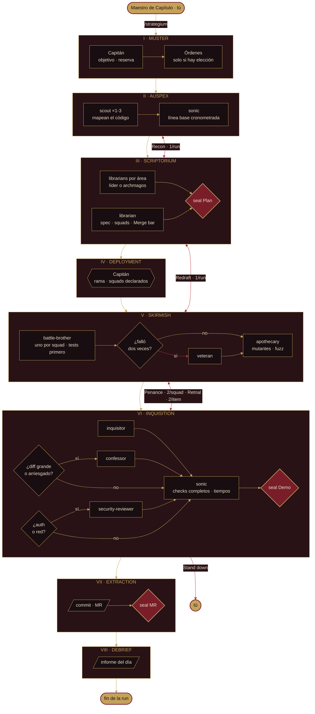

<h1 align="center">
  <picture>
    <source media="(prefers-color-scheme: dark)" srcset="docs/banner-dark.svg">
    
  </picture>
</h1>

<p align="center">
  <a href="https://github.com/frandev94/strategium/releases"></a>
  <a href="https://omp.sh/"></a>
  <a href="LICENSE"></a>
</p>

<p align="center"><em>«Un sello concedido es un sello que se defiende.»</em><br><sub>— pensamiento del día</sub></p>

<p align="center">English: <a href="README.md">README.md</a></p>

**Strategium** es un workflow orquestador para omp. La sesión principal planifica y delega, los agentes especializados construyen y revisan, y tú conservas los sellos. Trabaja cualquier objetivo: texto libre, un fichero de spec o de plan, o un ticket. **El ticketing es opcional**, y con él viene un temporizador de reserva.

Este es un plugin de **omp**: se instala, se actualiza y se ejecuta con omp, y no apunta a ningún otro agente de programación.

El plugin trae tres cosas:

| Parte | Qué es |
|---|---|
| **Extensión** | el tool `strategium` y el comando `/strategium`: reserva de la run por sesión, bloqueo de edición, temporizador de reserva opcional |
| **Agentes** | `battle-brother`, `veteran`, `librarian`, `apothecary`, `inquisitor`, `confessor`, `archmagos`, más los incluidos `scout` y `sonic` |
| **Skills** | `strategium`, `strategium-alarm`, `strategium-github`, `strategium-release`, `strategium-setup`, `strategium-study`, `strategium-ui` |

## Cómo funciona una run

La sesión principal es el **Capitán**: nunca edita código de producto. Planifica, delega y custodia los sellos. Tú eres el **Maestro de Capítulo**: solo tú concedes un sello (Plan, Demo, MR, Commit, Review & merge).

```
Muster → Auspex → Scriptorium → Deployment → Skirmish → Inquisition → Extraction
```

1. **Muster** — el objetivo y las órdenes: Plan por defecto, Demo y MR cuando aplican (Demo cuando el objetivo tiene algo que ver funcionando: una pantalla, una API HTTP, una DLL cargada por un host) y, con ticketing, la reserva. Solo se te pregunta cuando hay elección (una reserva, activar o no Demo o MR, `Review & merge`, un campo del teatro o la casilla del Archmagos); si no, la run toma los valores por defecto y pasa directa a Auspex.
2. **Auspex** — los scouts mapean el código que toca el objetivo y los tiers de checks del repo (fast, squad, full); un `sonic` cronometra los checks completos sobre `main` como línea base y marca como flaky un fallo que pasa al repetirlo una vez.
3. **Scriptorium** — un librarian escribe una especificación, de 1 a 5 squads y una Merge bar; cuando el objetivo se divide en áreas, un librarian por área y después un líder une las partes (con el Archmagos Dominus marcado en Muster, un `archmagos` integra las partes en lugar del líder).
4. **Deployment** — una rama para la run, los squads declarados con sus ficheros; cada agente aislado trabaja en su propio checkout de omp.
5. **Skirmish** — un `battle-brother` implementa cada squad con los tests primero, con los tiers de checks fast y squad (los checks completos quedan para `sonic`); un `apothecary` intenta romper los tests nuevos, solo en squads con lógica nueva y dentro de un presupuesto fijo.
6. **Inquisition** — un `inquisitor` revisa el diff contra la Merge bar y comprueba que cada test borrado o debilitado sigue cubierto por otro, y se une un `confessor` de otra familia de modelos (si está disponible) cuando el plan marca el diff como grande o arriesgado, o en el bucle Review & merge; un `sonic` ejecuta las comprobaciones completas del repo y da sus tiempos junto a los de la línea base.
7. **Extraction** — el commit y la merge request, después de tu sello. Con el sello opcional `Review & merge`, un inquisitor y un confessor nuevos revisan la PR cuando el CI está en verde, como máximo 2 rondas, y una revisión limpia termina en el merge.



Los nombres de estación, los nombres de agente y las alertas tienen su propia voz; el `archmagos` la usa solo en el chat y el todo, nunca en el fichero del plan. Los tickets, los mensajes de commit y las merge requests se quedan planos y profesionales.

### Volver atrás

Una run vuelve atrás en vez de avanzar, y cada vuelta tiene un detonante, un destino y un presupuesto. Cuando el presupuesto se agota, la run se para y te enseña lo que queda abierto. Las flechas rojas del diagrama de arriba muestran las vueltas; la tabla da el detalle.

| Vuelta | Detonante | Destino | Presupuesto |
|---|---|---|---|
| **Recon** | el mapa del código está equivocado | un `scout` más con ese hueco concreto | 1 por run |
| **Redraft** | el plan está equivocado, o el check de un squad no se puede cumplir tal cual está escrito, o rechazas el plan en el sello Plan | primero vuelta a Auspex: uno o dos scouts refrescan el mapa con lo que cambió (una sección `## Redraft`, nunca un barrido completo). Luego el mismo `librarian` reescribe el trabajo restante (con áreas, solo el área afectada, y el líder vuelve a unir; en una run marcada para el Archmagos Dominus, un `archmagos` nuevo vuelve a integrar solo esa área), y el sello Plan se pide otra vez | 1 por run |
| **Penance** | el código está equivocado: check rojo, supervivientes o crashes del fuzz del apothecary, hallazgos BLOCKING | un `battle-brother` de reparación con todos los IDs de hallazgos abiertos en un solo brief, nunca el informe anterior; primero reproduce cada hallazgo, y el que no puede reproducir vuelve como NOT REPRODUCED | 2 rondas por squad, luego un `veteran` |
| **Retrial** | el código reparado necesita otra mirada | el `inquisitor` otra vez (el `confessor` revisa sus propios IDs), solo sobre los IDs de hallazgos abiertos y el rango del arreglo, y luego `sonic` para los checks completos | 2 rondas por item del Merge bar |
| **Stand down** | se agotó el presupuesto, o el fallo no está en el código | tú, con los puntos abiertos | — |

Si el código puede cumplir el check del squad tal como está escrito, es un penance; si no puede, el squad se cortó mal y es un redraft. Una vuelta que pasa por delante de un sello ya concedido rompe el sello (salvo el bucle Review & merge) y hay que pedirlo otra vez. Lo que ya pasó, sigue pasado.

### Los agentes

El Capitán planifica y delega; cada uno de los demás papeles es un agente que él lanza. Cada uno tiene un único trabajo y un límite estricto.

| Agente | Estación | Qué hace | Nunca | Modelo / esfuerzo |
|---|---|---|---|---|
|  **Capitán** (sesión principal) | todas | planifica, delega, guarda los sellos, hace los commits | edita código del producto | el modelo de tu sesión |
|  `scout` | Auspex | mapea el código que toca el objetivo; de 1 a 3 a la vez, cada uno con su foco | escribe ficheros o ejecuta bash | `@smol` / medium |
|  `librarian` | Scriptorium | escribe la spec, los squads y el Merge bar; uno por área cuando el objetivo se divide, y luego un líder une las partes | edita ficheros del repositorio | `@plan` / high |
|  `archmagos` | Scriptorium | integra los planes de cada área en uno, comprobando cada supuesto contra el código; solo si se marcó en Muster | edita, escribe o lanza agentes | `@plan` / xhigh |
|  `battle-brother` | Skirmish | construye un squad con los tests primero, con los tiers de checks fast y squad, y reporta la evidencia rojo/verde | hace commits, toca ficheros fuera de su squad o ejecuta los checks completos | el [tier](#tiers) de su squad |
|  `veteran` | Skirmish | rehace un squad que falló dos veces, después de averiguar por qué | hace commits o ejecuta los checks completos | tier heavy (`@slow:high`); solo para escalar |
|  `apothecary` | Skirmish | muta las líneas cambiadas del squad y hace fuzzing de la entrada no fiable, para enseñar dónde los tests no protegen el código | edita los tests que audita, o deja el árbol cambiado | `@task` / medium |
|  `inquisitor` | Inquisition | revisa el diff contra el Merge bar y cada test borrado o debilitado; un PASS necesita evidencia con fichero:línea o un comando | edita, hace commits o push | `@slow` / high |
|  `confessor` | Inquisition | una segunda revisión, independiente y de otra familia de modelos, cuando el plan marca el diff como grande o arriesgado, o en el bucle Review & merge | lee el informe del inquisitor | gpt-6-astra (si no, `@task`) / high |
|  `security-reviewer` | Inquisition | entra cuando el diff toca auth, entrada externa, secretos o la red | edita | incluido en omp, el modelo de tu sesión |
|  `sonic` | Auspex, Inquisition | ejecuta los checks completos del repo: primero la línea base cronometrada (un fallo que pasa al repetirlo una vez es flaky), al final los checks completos con sus tiempos junto a los de la línea base | arregla lo que falla | `@smol` / medium |

#### Modelos

Los agentes eligen modelo con los alias de rol de omp: eliges los modelos una vez en `~/.omp/agent/config.yml` y Strategium los sigue. Configura los tres roles que usa, sin sufijo `:nivel` (un sufijo pisa el effort de todos los agentes de ese rol). Un rol sin configurar cae en lo que trae omp: `plan` y `task` en el modelo de tu sesión, `slow` en tu `default` (si tampoco está, en la lista de omp, que puede acabar en el modelo más caro que conoce):

```yaml
modelRoles:
  plan: anthropic/claude-opus-5-5   # librarian, archmagos
  slow: anthropic/claude-opus-5-5   # inquisitor
  task: anthropic/claude-sonnet-5-5 # apothecary, confessor sin Codex; nivel standard
```

El effort que pide cada agente está en la tabla de arriba. Para llevar un solo agente a otro modelo, usa `task.agentModelOverrides`, p. ej. `inquisitor: anthropic/claude-sonnet-5-5`. Durante una run, `battle-brother` y `veteran` siguen `STRATEGIUM_TIERS`: el modelo del hook sustituye ese override. La config recomendada completa y sus motivos: [docs/models.md](docs/models.md) (en inglés); `/skill:strategium-setup` compara tus roles con ella.

#### Tiers

El plan da a cada squad un tier de coste con un motivo de una línea, y el plugin lanza cada `battle-brother` con el tier de su squad, así que un mismo lote en paralelo puede mezclar tiers. Un tier es un selector de modelo de omp; su sufijo `:nivel` fija el effort y gana al `thinkingLevel` del propio agente.

| Tier | Selector por defecto | Para |
|---|---|---|
| `light` | `@smol:medium` | docs, prompts, renombrados, fixtures, ediciones mecánicas con un check claro |
| `standard` | `@task:medium` | código normal con tests (el valor por defecto de un squad sin tier) |
| `heavy` | `@slow:high` | concurrencia, seguridad, parsers, workflows de CI con tokens de escritura, código sin tests, todo lo irreversible |

El sello Plan muestra el tier de cada squad y una estimación aproximada (coste relativo 1 / 3 / 10, unos 5 / 10 / 20 minutos por squad, de la tabla de la skill), y puedes cambiar un tier ahí (`S2 heavy`) sin redraft. Un squad cuyo builder falló recibe su penance un tier más arriba (heavy sigue en heavy, y después el `veteran`); los revisores conservan sus propios tiers. Con `STRATEGIUM_TIERS` cambias los selectores, y hay que configurar el rol `smol`, que `light` necesita: mira [docs/models.md](docs/models.md) (en inglés).

## Instalación

Strategium funciona dentro de [omp](https://omp.sh/), nuestro agente de código: instala omp primero.

**Que lo haga un agente:** pega este prompt en cualquier agente de código con acceso a la shell. Instala omp si falta y después el plugin.

```text
Set up omp (https://omp.sh/) with the Strategium plugin on this machine.

1. Run `omp --version`. If omp is not found, install it:
   - macOS / Linux: curl -fsSL https://omp.sh/install | sh
   - Windows (PowerShell): irm https://omp.sh/install.ps1 | iex
   If `omp` is still not on PATH, open a new shell and try again. Stop and report if it still fails.
2. Run `git --version` and `bun --version`. If one is missing, tell me with its official install command; do not install it without asking.
3. Install the plugins (if one is already there, keep it and move on):
   omp plugin marketplace add addyosmani/agent-skills
   omp plugin install agent-skills@addy-agent-skills
   omp plugin marketplace add frandev94/strategium
   omp plugin install strategium@strategium
4. Verify with `omp plugin list` and `omp plugin doctor`.
5. Report a table: step, result, and the error output of any failure. Then tell me to open a fresh omp session and run /skill:strategium-setup.

Change no other omp settings, and do not remove or upgrade anything already installed.
```

**Como plugin de marketplace:**

```
/marketplace add frandev94/strategium
/marketplace install strategium@strategium
```

Desde la shell: `omp plugin marketplace add frandev94/strategium` y `omp plugin install strategium@strategium`.

**Enlazado desde una copia local:**

```
omp plugin link /ruta/al/strategium
```

Luego, en una sesión nueva, ejecuta `/skill:strategium-setup`. Comprueba el plugin, sus dependencias, las herramientas y la configuración, y devuelve una tabla de lo que hizo. omp 19 no carga las `rules/` de un plugin enlazado en las sesiones, así que la skill las lee ella misma desde `rules/`.

> [!IMPORTANT]
> Reinicia omp después: recargar un plugin dentro de una sesión ya en marcha no monta el tool `strategium`.

### Requisitos

| Necesita | Para qué |
|---|---|
| `bun` | ejecutar el script de la alarma, las alarmas del temporizador y la suite de tests |
| `git` | worktrees, ramas, commits |
| plugin `agent-skills` | las skills que cargan los agentes (`omp plugin marketplace add addyosmani/agent-skills`, luego `omp plugin install agent-skills@addy-agent-skills`) |
| plugin `ponytail` | recomendado, modo de diff mínimo para todos los agentes |
| plugin `obsidian-second-brain` | opcional, teatros que guardan registros en Obsidian |

## Uso

```
/strategium "texto libre" [theatre]   trabaja un objetivo con tus palabras
/strategium @ruta [theatre]           trabaja un fichero de spec o un plan aprobado
/strategium <clave> [theatre]         trabaja un ticket que conoce el teatro, o un nombre corto
/strategium-pause                     para el reloj
/strategium-resume [booked]           continúa (una run con reserva pasa los minutos de hoy en un día nuevo)
/strategium-add <min>                 corrección manual, en negativo para restar
/strategium-status                    todas las runs y su tiempo
/strategium-config [notify on|off | sound on|off | toast on|off | volume <0-100> [preview] | idle <min> | archmagos on|off | commit on|off | cockpit-key <key> | cockpit-theme <name>|default]    ajustes; notify, sound o toast on|off, el volumen de la alarma (preview la reproduce a ese volumen), los minutos de inactividad, archmagos o commit on|off para esta sesión; cockpit-key <key> fija la tecla del cockpit desde el próximo arranque de omp; cockpit-theme <name> fija el tema del cockpit y lo aplica al instante
/strategium-cockpit                   abre el cockpit (también Alt+C, o la tecla fijada con cockpit-key)
/strategium-end                       cierra la run
```

El texto libre necesita las comillas, para no chocar nunca con un subcomando. Sin ticket, el librarian propone los criterios de aceptación y tú los confirmas en el sello Plan, que no se puede saltar. El comando inicia la run de inmediato, sin temporizador, bajo una KEY tomada del objetivo (una clave tal cual, el nombre base de un fichero, o las primeras palabras del texto libre en kebab-case).

Cada sesión es dueña de una run, con una reserva atómica, así que varias sesiones de omp pueden trabajar en objetivos distintos a la vez. Cerrar una sesión pausa su run y libera la reserva; al reabrir esa sesión la recupera y la reanuda sola, salvo que tú la hubieras pausado (`/strategium-pause`, acción `stop`, el stand down). Una run con temporizador en un día nuevo sigue pausada hasta que se da la reserva de hoy. Una run que sigue contando a medianoche no se para: su bloque termina a las 00:00 en el fichero del día anterior y empieza otro a las 00:00 de hoy, así que `status`, `report` y el pie siguen contando; una run con temporizador cuenta ahí sin reserva y sin las alertas de 50/80/100 (pie `<elapsed> min · new day: /strategium-resume <min>`) hasta que `/strategium-resume <min>` da la de hoy. El Capitán no puede editar el repositorio de la run: desde `begin`, `edit` y `ast_edit` se ocultan de la sesión principal y se rechazan los agentes fuera del plantel de Strategium; cuando `strategium repo` arma la guardia, `ast_edit` y `write` quedan bloqueados dentro del repo de la run y de su carpeta `<repo>-worktrees`, los ejecutores de tests y builds por bash y las escrituras de ficheros por bash están bloqueados (solo pasan las redirecciones a `$TEMP`, `$TMP`, `$TMPDIR`, `%TEMP%`, `/tmp/`, `local://`, `out://`, `/dev/null` y descriptores de fichero) y se rechazan los battle-brothers hasta que se declaren los squads del plan (`strategium` `slices`; los squads en paralelo no pueden compartir un fichero). En el modo plan de omp la run recorre las mismas estaciones, pero su todo solo contiene las que pueden correr ahí: Muster (Orders sin la casilla Plan), Auspex y Scriptorium, con los squads declarados antes de `xd://propose`. El plan propuesto abre con las estaciones ya hechas y lista solo lo que arranca la aprobación. "Approve and execute" abre una sesión nueva y la run se va con ella (reserva, marca de Archmagos y squads incluidos); su todo contiene de Deployment en adelante y empieza en la primera tarea de Deployment. Un `/new` normal deja la run en su propia sesión.

<details>
<summary><strong>Pausa por inactividad, pie y cockpit</strong></summary>

Pausa por inactividad: cuando ningún agente trabaja y nada espera para ejecutarse, el reloj de la run se pausa tras `STRATEGIUM_IDLE_MIN` minutos de inactividad (3 por defecto), suena el sonido `idle` (con las notificaciones activas) y el pie la muestra pausada. El siguiente turno la reanuda sola; el Capitán no llama a `start`. Una run que pausaste a mano (`/strategium-pause`, acción `stop`, el stand down) nunca se reanuda sola. Una pregunta o una revisión de plan que te espera cuenta como actividad: el reloj sigue corriendo y la alarma `attention` te avisa (con las notificaciones activas). Una run con temporizador en un día nuevo sigue pausada hasta que se da la reserva de hoy.

Pie: la estación se muestra como `<estación> › <tarea>`, donde `<tarea>` es la tarea activa del todo sin su etiqueta de agente, cortada a 32 caracteres con `…`. Un sello mantiene `⏳ seal <nombre>` con el nombre entero (`Demo (2)`); un retorno muestra `↩ <estación> › <tarea>`. El pie aparece en cuanto `/strategium` inicia la run (`strategium: <KEY> · <transcurrido> min`); al iniciar la primera tarea del esqueleto muestra p. ej. `Muster › Objective`, y luego `Muster › Orders`. Un `todo init` que reconstruye el todo de una run no mueve el pie (omp inicia su primera tarea por sí mismo); el siguiente `start` o `done` sí. La excepción es el relevo tras aprobar un plan, cuyo todo (de Deployment en adelante) sustituye a las estaciones del modo plan: el pie pasa a su primera tarea al instante. Si el terminal es lo bastante ancho (cabe el texto del pie más dos espacios y la pista) la línea termina, pegada a la derecha, con la pista que nombra la tecla del cockpit (`ALT + C to enter cockpit` por defecto); más estrecho, o con ancho desconocido, no hay pista. El ancho se lee en cada dibujo del pie (cada minuto y en cada cambio de estado), no al redimensionar.

Cockpit: `/strategium-cockpit` (o Alt+C, o tu tecla del cockpit) abre el overlay a pantalla completa (tapa el prompt, la lista de todos y la transcripción hasta que Esc o `q` lo cierra; también se cierra solo cuando el agente te pregunta algo, pide aprobar una herramienta o abre una revisión de plan) mientras esta sesión tiene una run abierta: la clave, el reloj y los sellos arriba como una cadena (`✠ Plan → ○ Demo`, sin fila cuando la run no tiene sellos), debajo una línea de estado (`▶ AGENT AT WORK` mientras corre un turno o un trabajo en segundo plano, como un subagente asíncrono, un job de bash o uno de eval, sigue en marcha, `○ VOX OPEN · esc to give orders` en dorado cuando el agente se ha parado, no corre ningún trabajo y el prompt está libre para tus órdenes; un diálogo de otra extensión no tiene evento, así que no se anuncia), luego solo la estación activa (la primera fase con una tarea del todo en curso; si no, la primera con una tarea en espera) como título (`▶` en curso, `↶` tras un retorno, `○` en espera; un sello en espera añade `· seal <nombre> awaits you`), una caja por tipo de agente presente en ella, y las últimas entradas de la crónica. Las cajas, en este orden, toman las tareas del todo con esa etiqueta y los agentes lanzados en esa estación: CAPTAIN, SCOUTS, LIBRARIANS (también `[archmagos]`), BATTLE-BROTHERS (también `[veteran]`), APOTHECARIES, INQUISITOR, SECURITY-REVIEWER, SONIC y ADEPTS (`[task]`). Una caja solo sale si la estación tiene una tarea o un agente de su tipo. Cada línea lleva su marca de estado: `▶` en curso, `✓` hecha, `○` en espera, `✗` fallida; las líneas de BATTLE-BROTHERS llevan `†` (o `‡` si es veterano) y suman una línea `squad <id> …` por escuadrón declarado. Las líneas van `▶`, `✗`, `○` y luego `✓`; una caja muestra como mucho 8 líneas (menos en una ventana baja, para que la crónica conserve 5 filas) y su última línea cuenta el resto, p. ej. `+5 more (3 done, 2 idle)`. Un sello concedido pasa a ✠ y, con las notificaciones activas, suena el sonido `done`. Mientras un sello espera, un panel a todo el ancho bajo el título de la estación muestra lo que el Capitán preparó para él (el Capitán lo rellena con la acción `seal`; sin ella el panel muestra `the details are in the Captain's message`); sin panel cuando nada espera. La crónica (las 200 entradas más recientes), la lista de agentes lanzados, las marcas de los escuadrones y las líneas del panel del sello se guardan con la run, así que sobreviven a un reinicio de omp; terminar la run las borra; un agente lanzado desde eval sigue en `▶` hasta que vuelve la celda de eval que lo espera, o hasta que omp entrega su resultado, y entonces pasa a `✓` o `✗`. Los colores son truecolor si el terminal lo admite y 256 colores si no. Bajo cada agente o escuadra en marcha, el cockpit dibuja una fila con el tiempo transcurrido y, de la propia lista de tareas del agente, `done/total · ~ETA · tarea actual`, o si no su última intención (el nombre de la herramienta si el trazado de intención está apagado); la fila sigue el archivo del propio agente, así que se actualiza mientras el turno del padre espera. Un agente que ya ha hecho su primera llamada a una herramienta y lleva 5 min sin ninguna en curso y sin que haya terminado ninguna se pone en dorado con `stalled Nm` y deja una sola entrada en la crónica (un `bun test` largo no cuenta como parado; una llamada posterior acaba el estancamiento). Un subagente también puede llamar a `strategium` `signal` (`pct`, `eta_min`, `line`, `blocked`) para escribir su propia fila: `line` sustituye la tarea actual o la intención, `eta_min` el ETA calculado y `pct` el `done/total`; `blocked: true` pone la fila en dorado, deja una entrada en la crónica y suena la alarma `attention` una sola vez por bloqueo. La sesión principal no puede llamar a `signal`, y nunca nombra a otro agente. Un agente de eval sin id de host, o un subagente en otro proceso del SO, muestra solo el tiempo transcurrido. El cockpit sigue sin poder mostrar recuentos de tests ni de mutantes. El cockpit dibuja glifos Nerd Font con `STRATEGIUM_GLYPHS=1` y símbolos simples si no, nunca emoji. Los colores salen de un tema: `blood-angels` por defecto (un fondo oscuro Night que llena el overlay a todo el ancho), `ultramarines`, `dark-angels` o `cogitator`, la paleta anterior sobre el fondo propio del terminal. `/strategium-config cockpit-theme <name>` guarda la elección y la aplica al instante, sin reiniciar (`cockpit-theme default` borra la elección guardada, así que el tema vuelve a `STRATEGIUM_COCKPIT_THEME` si está definida, y si no a `blood-angels`).

</details>

> [!WARNING]
> Un diálogo de selección o confirmación que otra extensión abra con el cockpit visible no recibe teclas y se queda colgado, incluso tras Esc o `q` (omp devuelve el foco al editor), así que cierra el cockpit antes de lanzar un comando así.

> [!TIP]
> Con Bloq Mayús activo, Alt+C llega como Alt+Shift+C (copiar el prompt en omp) y el cockpit no se abre: usa `/strategium-cockpit`, o fija otra tecla con `/strategium-config cockpit-key <key>` (o `STRATEGIUM_COCKPIT_KEY`), p. ej. `f8`, que Caps Lock no cambia; una tecla que omp u otra extensión ya usa se avisa al arrancar.

### Ticketing (opcional)

Una run lleva **temporizador** cuando su objetivo es un ticket de un teatro, o cuando le das una reserva (en Muster, o más tarde). La **reserva** es el presupuesto de tiempo de hoy: el temporizador suena al 50 %, 80 % y 100 % — el umbral más alto que cruza, así que una run que empieza pasado el 50 % va directamente al siguiente. Al 100 % el Capitán hace *stand down*: deja de lanzar agentes e informa de lo que está hecho y de lo que queda. Cada día es su propio turno con su propia reserva.

Una run **sin temporizador** sigue contando su tiempo (`status`, `report`), sin avisos, sin *stand down* y sin turnos.

### Configuración

| Variable | Significado |
|---|---|
| `STRATEGIUM_THEATRE` | teatro por defecto para `/strategium`; vacío → el teatro GitHub cuando el repo de la ejecución está en GitHub |
| `STRATEGIUM_STATE_DIR` | dónde vive el estado de las sesiones (por defecto `~/.omp/agent/state/strategium`) |
| `STRATEGIUM_GLYPHS` | `1` para usar glifos de Nerd Font en lugar de emoji |
| `STRATEGIUM_NOTIFY` | `1` activa la alarma (su sonido y sus notificaciones de escritorio, cada uno con su interruptor); apagado por defecto, y apagado significa ninguno; `/strategium-config notify on` u `off` lo cambia para la sesión |
| `STRATEGIUM_SOUND` | el sonido de la alarma; activo por defecto, `0` lo apaga (un aviso solo con notificación no necesita reproductor de audio); `/strategium-config sound on` u `off` lo cambia para la sesión |
| `STRATEGIUM_VOLUME` | el volumen de la alarma, de `0` a `100`; por defecto `20`; `/strategium-config volume <n>` lo cambia para la sesión, `volume <n> preview` (o `volume preview`) además lo reproduce |
| `STRATEGIUM_TOAST` | la notificación de escritorio (toast de Windows, notificación de macOS, `notify-send`); activa por defecto, `0` la apaga; `/strategium-config toast on` u `off` la cambia para la sesión |
| `STRATEGIUM_IDLE_MIN` | minutos enteros sin trabajo antes de pausar el reloj de la run; por defecto `3`, `0` lo desactiva; `/strategium-config idle <min>` lo cambia para la sesión |
| `STRATEGIUM_ARCHMAGOS` | `1` deja que una run marque al Archmagos Dominus en Muster; apagado por defecto; `/strategium-config archmagos on` u `off` lo cambia para la sesión |
| `STRATEGIUM_COMMIT` | `1` da a cada run el sello Commit (el Capitán pregunta antes de cada commit); apagado por defecto; `/strategium-config commit on` u `off` lo cambia para la sesión |
| `STRATEGIUM_COCKPIT_KEY` | la tecla que abre el cockpit, p. ej. `ctrl+shift+k` o `f8`; necesita `ctrl`, `alt` o `super`, o ser `f1`-`f12`, así que una letra suelta nunca se come lo que escribes; por defecto `alt+c`; `/strategium-config cockpit-key <key>` guarda otra para el próximo arranque de omp y gana a esta, `cockpit-key default` la quita |
| `STRATEGIUM_COCKPIT_THEME` | el tema del cockpit: `blood-angels` (por defecto), `ultramarines`, `dark-angels` o `cogitator`; solo rige si no hay un tema guardado: `/strategium-config cockpit-theme <name>` guarda uno, lo aplica al instante y gana a esta, `cockpit-theme default` lo quita; un valor desconocido se avisa al iniciar la sesión y se ignora |
| `STRATEGIUM_TIERS` | el selector de cada tier de coste, entradas `tier=selector` separadas por `;`, p. ej. `light=anthropic/claude-haiku-5-5:low;heavy=@task:high`; un tier que omitas conserva su valor por defecto (`light=@smol:medium`, `standard=@task:medium`, `heavy=@slow:high`); un tier desconocido o un selector vacío se ignora y lo muestra `strategium status` |

`/strategium-config` muestra los valores efectivos: los ajustes notify, sound, volume y toast, los minutos de inactividad, el ajuste del archmagos, el ajuste de commit, la tecla del cockpit y el tema del cockpit (`cockpit-theme: <name> (<origen>)`), cada uno con su origen, el teatro, los glifos y el directorio de estado.

El estado (un JSONL por día más las reservas de las runs) vive fuera del repositorio, así que nunca se commitean datos de sesión.

### La alarma

`alarm/vox.ts` sintetiza cada sonido desde cero: sin muestras, sin dependencias, todo original y bajo la licencia MIT del proyecto. Comparten un kit grimdark a 100 bpm en do menor (tambores de guerra con doble bombo, guitarra y bajo en drop C, coro, metales, campana). Los niveles son `50`, `80`, `100` (los golpes de guitarra se aprietan de uno a otro), `done` (también el sonido de un sello concedido en el cockpit), `attention`, `idle` (un sonido de espera más bajo cuando el reloj se pausa por inactividad) y `theme` (cuatro compases, 9,6 s, que se repiten sin costura: un riff de guitarra con el bajo y el doble bombo pegados a él, bajo el coro; suena cuando termina la run de la sesión, o a mano: `bun alarm/vox.ts theme`); con mensaje, además, levanta una notificación de escritorio (toast de Windows, notificación de macOS, `notify-send` en Linux); `STRATEGIUM_SOUND=0` omite el sonido y `STRATEGIUM_VOLUME` (de `0` a `100`, por defecto `20`) fija su volumen. Con las notificaciones activas, el plugin reproduce su propio `alarm/vox.ts` incluido, al 50/80/100 % de una reserva, con `attention` (un `ask`, una revisión de plan en espera, la llamada `attention` del Capitán, una pausa tras un hueco de silencio), con la pausa `idle`, con `done` cuando se concede un sello y con `theme` cuando termina la run. Nada elige el comando: solo existen los interruptores notify, sound, toast (y el volumen). Una ejecución de vox que sale con código distinto de cero se avisa una vez por sesión.

```
bun alarm/vox.ts 100 "la reserva se ha agotado"
```

### Los teatros

Un teatro es una skill `strategium-<nombre>` que ata la run a tu organización: dónde están los tickets, cómo se reserva el tiempo, cómo se escriben las merge requests y qué registros se guardan. Sin teatro no se sube nada: la entrega es la rama con sus commits.

El plugin trae el **teatro de GitHub** (`strategium-github`): la issue es el ticket (se crea en Muster cuando el objetivo es texto libre o un fichero), un Project da el estado, y los campos de issue `Booked (min)` y `Spent (min)` (o los campos del Project con el mismo nombre cuando los campos de issue no existen) dan la reserva. La issue recibe un único comentario de la run, un resumen de la pull request. La entrega es una pull request en borrador que cierra la issue al fusionarse (con `Review & merge`, el teatro la fusiona tras una revisión limpia); no se añade al Project, porque aparece en la tarjeta de la issue. Pasar la tarjeta a Done al fusionar necesita el workflow "Item closed" del Project, y Muster avisa cuando está desactivado. Es el teatro por defecto: cuando el repo de la run está en GitHub, la run lo usa salvo que se nombre otro teatro, `STRATEGIUM_THEATRE` nombre uno, o digas `none`.

## Desarrollo

```
bun run check                     # TypeScript estricto sobre la extensión
bun test                          # temporizador, reservas entre procesos, la extensión con un host falso, WAV de la alarma
```

En las pull requests que tocan `extensions/`, `tools/tui-shot/`, `skills/strategium/todo.ts` y `alarm/` (ambos importados por el cockpit), `package.json`/`bun.lock` (el pin de omp) o el propio workflow, `.github/workflows/tui-shot.yml` ejecuta además en Windows los replays de tui-shot con el omp real (`bun tools/tui-shot/shot.ts --all --no-png`), con omp del devDependency fijado.

```
extensions/strategium/            la extensión (tool, comando, temporizador, bloqueo de edición)
extensions/strategium/timer.ts    ficheros del día, reservas, tiempo transcurrido
alarm/                            el vox-caster y sus tests
agents/                           definiciones de agente
skills/                           las skills
rules/                            las reglas de la run, que el Capitán lee al empezar una run
```

La extensión es TypeScript puro y sin dependencias en tiempo de ejecución; `bun` solo hace falta para ejecutarla y para correr los tests. El banner, los badges, el diagrama y los iconos del README siguen una paleta Blood Angels: [docs/style.md](docs/style.md).

Las versiones son automáticas: un merge a `main` que cambie `extensions/`, `skills/`, `agents/`, `alarm/`, `rules/` o `.omp-plugin/` (sin contar los ficheros de test) ejecuta `.github/workflows/release.yml`. Los commits convencionales fijan la versión (mientras sea 0.x, un cambio incompatible, marcado con `!` o con un pie `BREAKING CHANGE:`, sube la minor y cualquier otro commit convencional la patch; los commits no convencionales no suben nada y no entran en el changelog). Los merges que solo tocan docs, tests o herramientas de desarrollo no publican nada; sus commits entran en el changelog de la siguiente versión. Para publicar a mano, usa la skill `strategium-release`.

## Licencia

MIT

Strategium es una obra de fans no oficial inspirada en Warhammer 40,000. Warhammer 40,000, Blood Angels y los nombres relacionados son marcas de Games Workshop Limited; este proyecto no está afiliado a Games Workshop ni cuenta con su respaldo.
