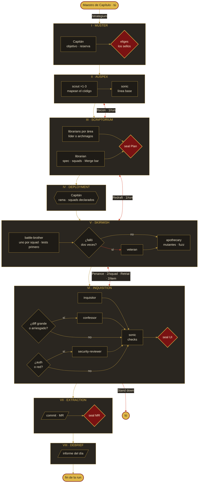

# strategium

> English: [README.md](README.md)

**Strategium** es un workflow orquestador para omp. La sesión principal planifica y delega, los agentes especializados construyen y revisan, y tú conservas los sellos. Trabaja cualquier objetivo: texto libre, un fichero de spec o de plan, o un ticket. **El ticketing es opcional**, y con él viene un temporizador de reserva.

Este es un plugin de **omp**: se instala, se actualiza y se ejecuta con omp, y no apunta a ningún otro agente de programación.

El plugin trae tres cosas:

| Parte | Qué es |
|---|---|
| **Extensión** | el tool `strategium` y el comando `/strategium`: reserva de la run por sesión, bloqueo de edición, temporizador de reserva opcional |
| **Agentes** | `battle-brother`, `veteran`, `librarian`, `apothecary`, `inquisitor`, `confessor`, `archmagos`, más los incluidos `scout` y `sonic` |
| **Skills** | `strategium`, `strategium-alarm`, `strategium-github`, `strategium-release`, `strategium-setup`, `strategium-study`, `strategium-ui` |

## Cómo funciona una run

La sesión principal es el **Capitán**: nunca edita código de producto. Planifica, delega y custodia los sellos. Tú eres el **Maestro de Capítulo**: solo tú concedes un sello (Plan, UI, MR, Commit).

```
Muster → Auspex → Scriptorium → Deployment → Skirmish → Inquisition → Extraction
```

1. **Muster** — el objetivo, los sellos y, con ticketing, la reserva.
2. **Auspex** — los scouts mapean el código que toca el objetivo.
3. **Scriptorium** — un librarian escribe una especificación, de 1 a 5 squads y una Merge bar; cuando el objetivo se divide en áreas, un librarian por área y después un líder une las partes (con el Archmagos Dominus marcado en Muster, un `archmagos` integra las partes en lugar del líder).
4. **Deployment** — una rama para la run, los squads declarados con sus ficheros; cada agente aislado trabaja en su propio checkout de omp.
5. **Skirmish** — un `battle-brother` implementa cada squad con los tests primero; un `apothecary` intenta romper los tests nuevos, solo en squads con lógica nueva y dentro de un presupuesto fijo.
6. **Inquisition** — un `inquisitor` revisa el diff contra la Merge bar, y se une un `confessor` de otra familia de modelos (si está disponible) cuando el plan marca el diff como grande o arriesgado; un `sonic` ejecuta las comprobaciones del repo.
7. **Extraction** — el commit y la merge request, después de tu sello.



Los nombres de estación, los nombres de agente y las alertas tienen su propia voz; el `archmagos` la usa solo en el chat y el todo, nunca en el fichero del plan. Los tickets, los mensajes de commit y las merge requests se quedan planos y profesionales.

### Volver atrás

Una run vuelve atrás en vez de avanzar, y cada vuelta tiene un detonante, un destino y un presupuesto. Cuando el presupuesto se agota, la run se para y te enseña lo que queda abierto. Las flechas rojas del diagrama de arriba muestran las vueltas; la tabla da el detalle.

| Vuelta | Detonante | Destino | Presupuesto |
|---|---|---|---|
| **Recon** | el mapa del código está equivocado | un `scout` más con ese hueco concreto | 1 por run |
| **Redraft** | el plan está equivocado, o el check de un squad no se puede cumplir tal cual está escrito | el mismo `librarian` reescribe el trabajo restante (con áreas, solo el área afectada, y el líder vuelve a unir; en una run marcada para el Archmagos Dominus, un `archmagos` nuevo vuelve a integrar solo esa área) | 1 por run |
| **Penance** | el código está equivocado: check rojo, supervivientes o crashes del fuzz del apothecary, hallazgos BLOCKING | un `battle-brother` de reparación con todos los IDs de hallazgos abiertos en un solo brief, nunca el informe anterior; primero reproduce cada hallazgo, y el que no puede reproducir vuelve como NOT REPRODUCED | 2 rondas por squad, luego un `veteran` |
| **Retrial** | el código reparado necesita otra mirada | el `inquisitor` otra vez (el `confessor` revisa sus propios IDs), solo sobre los IDs de hallazgos abiertos y el rango del arreglo, y luego `sonic` para los checks | 2 rondas por item del Merge bar |
| **Stand down** | se agotó el presupuesto, o el fallo no está en el código | tú, con los puntos abiertos | — |

Si el código puede cumplir el check del squad tal como está escrito, es un penance; si no puede, el squad se cortó mal y es un redraft. Una vuelta que pasa por delante de un sello ya concedido rompe el sello y hay que pedirlo otra vez. Lo que ya pasó, sigue pasado.

### Los agentes

El Capitán planifica y delega; cada uno de los demás papeles es un agente que él lanza. Cada uno tiene un único trabajo y un límite estricto.

| Agente | Estación | Qué hace | Nunca | Modelo / esfuerzo |
|---|---|---|---|---|
|  **Capitán** (sesión principal) | todas | planifica, delega, guarda los sellos, hace los commits | edita código del producto | el modelo de tu sesión |
|  `scout` | Auspex | mapea el código que toca el objetivo; de 1 a 3 a la vez, cada uno con su foco | escribe ficheros o ejecuta bash | `@smol` / medium |
|  `librarian` | Scriptorium | escribe la spec, los squads y el Merge bar; uno por área cuando el objetivo se divide, y luego un líder une las partes | edita ficheros del repositorio | claude-opus-5-5 / high |
|  `archmagos` | Scriptorium | integra los planes de cada área en uno, comprobando cada supuesto contra el código; solo si se marcó en Muster | edita, escribe o lanza agentes | claude-fable-5-2 / max |
|  `battle-brother` | Skirmish | construye un squad con los tests primero y reporta la evidencia rojo/verde | hace commits o toca ficheros fuera de su squad | claude-sonnet-5-5 / medium |
|  `veteran` | Skirmish | rehace un squad que falló dos veces, después de averiguar por qué | hace commits | claude-sonnet-5-5 / high |
|  `apothecary` | Skirmish | muta las líneas cambiadas del squad y hace fuzzing de la entrada no fiable, para enseñar dónde los tests no protegen el código | edita los tests que audita, o deja el árbol cambiado | claude-sonnet-5-5 / medium |
|  `inquisitor` | Inquisition | revisa el diff contra el Merge bar; un PASS necesita evidencia con fichero:línea o un comando | edita, hace commits o push | claude-opus-5-5 / high |
|  `confessor` | Inquisition | una segunda revisión, independiente y de otra familia de modelos, cuando el plan marca el diff como grande o arriesgado | lee el informe del inquisitor | gpt-6-astra / high |
|  `security-reviewer` | Inquisition | entra cuando el diff toca auth, entrada externa, secretos o la red | edita | incluido en omp, `@slow` |
|  `sonic` | Auspex, Inquisition | ejecuta los checks del repo: primero la línea base, al final los checks completos | arregla lo que falla | `@smol` / medium |

## Instalación

Strategium funciona dentro de [omp](https://omp.sh/), nuestro agente de código: instala omp primero.

**Que lo haga un agente:** pega este prompt en cualquier agente de código con acceso a la shell. Instala omp si falta y después el plugin.

```text
Set up omp (https://omp.sh/) with the Strategium plugin on this machine.

1. Run `omp --version`. If omp is not found, install it:
   - macOS / Linux: curl -fsSL https://omp.sh/install | sh
   - Windows (PowerShell): irm https://omp.sh/install.ps1 | iex
   If `omp` is still not on PATH, open a new shell and try again. Stop and report if it still fails.
2. Run `git --version` and `bun --version`. If one is missing, tell me with its official install command; do not install it without asking.
3. Install the plugins (if one is already there, keep it and move on):
   omp plugin marketplace add addyosmani/agent-skills
   omp plugin install agent-skills@addy-agent-skills
   omp plugin marketplace add frandev94/strategium
   omp plugin install strategium@strategium
4. Verify with `omp plugin list` and `omp plugin doctor`.
5. Report a table: step, result, and the error output of any failure. Then tell me to open a fresh omp session and run /skill:strategium-setup.

Change no other omp settings, and do not remove or upgrade anything already installed.
```

**Como plugin de marketplace:**

```
/marketplace add frandev94/strategium
/marketplace install strategium@strategium
```

Desde la shell: `omp plugin marketplace add frandev94/strategium` y `omp plugin install strategium@strategium`.

**Enlazado desde una copia local:**

```
omp plugin link /ruta/al/strategium
```

Luego, en una sesión nueva, ejecuta `/skill:strategium-setup`. Comprueba el plugin, sus dependencias, las herramientas y la configuración, y devuelve una tabla de lo que hizo. Reinicia omp después: recargar un plugin dentro de una sesión ya en marcha no monta el tool `strategium`.

### Requisitos

| Necesita | Para qué |
|---|---|
| `bun` | ejecutar el script de la alarma, las alarmas del temporizador y la suite de tests |
| `git` | worktrees, ramas, commits |
| plugin `agent-skills` | las skills que cargan los agentes (`omp plugin marketplace add addyosmani/agent-skills`, luego `omp plugin install agent-skills@addy-agent-skills`) |
| plugin `ponytail` | recomendado, modo de diff mínimo para todos los agentes |
| plugin `obsidian-second-brain` | opcional, teatros que guardan registros en Obsidian |

## Uso

```
/strategium "texto libre" [theatre]   trabaja un objetivo con tus palabras
/strategium @ruta [theatre]           trabaja un fichero de spec o un plan aprobado
/strategium <clave> [theatre]         trabaja un ticket que conoce el teatro, o un nombre corto
/strategium-pause                     para el reloj
/strategium-resume [booked]           continúa (una run con reserva pasa los minutos de hoy en un día nuevo)
/strategium-add <min>                 corrección manual, en negativo para restar
/strategium-status                    todas las runs y su tiempo
/strategium-config [notify on|off | idle <min> | archmagos on|off]    ajustes; notify on|off, los minutos de inactividad o archmagos on|off para esta sesión
/strategium-cockpit                   abre el cockpit (también Alt+C)
/strategium-end                       cierra la run
```

El texto libre necesita las comillas, para no chocar nunca con un subcomando. Sin ticket, el librarian propone los criterios de aceptación y tú los confirmas en el sello Plan, que no se puede saltar. El comando inicia la run de inmediato, sin temporizador, bajo una KEY tomada del objetivo (una clave tal cual, el nombre base de un fichero, o las primeras palabras del texto libre en kebab-case).

Cada sesión es dueña de una run, con una reserva atómica, así que varias sesiones de omp pueden trabajar en objetivos distintos a la vez. Cerrar una sesión pausa su run y libera la reserva; al reabrir esa sesión la recupera y la reanuda sola, salvo que tú la hubieras pausado (`/strategium-pause`, acción `stop`, el stand down). Una run con temporizador en un día nuevo sigue pausada hasta que se da la reserva de hoy. El Capitán no puede editar el repositorio de la run: mientras la run está abierta `edit` y `ast_edit` se ocultan de la sesión principal, `write` está bloqueado dentro del repo de la run y de su carpeta `<repo>-worktrees`, los ejecutores de tests y builds por bash y las escrituras de ficheros por bash están bloqueados (solo pasan las redirecciones a `$TEMP` y `local://`), se rechazan los agentes fuera del plantel de Strategium y se rechazan los battle-brothers hasta que se declaren los squads del plan (`strategium` `slices`; los squads en paralelo no pueden compartir un fichero). Cuando el plan se aprueba en el modo plan de omp, "Approve and execute" abre una sesión nueva y la run se va con ella; un `/new` normal deja la run en su propia sesión.

Pausa por inactividad: cuando ningún agente trabaja y nada espera para ejecutarse, el reloj de la run se pausa tras `STRATEGIUM_IDLE_MIN` minutos de inactividad (3 por defecto), suena el sonido `idle` (con las notificaciones activas) y el pie la muestra pausada. El siguiente turno la reanuda sola; el Capitán no llama a `start`. Una run que pausaste a mano (`/strategium-pause`, acción `stop`, el stand down) nunca se reanuda sola. Una pregunta o una revisión de plan que te espera cuenta como actividad: el reloj sigue corriendo y la alarma `attention` te avisa (con las notificaciones activas). Una run con temporizador en un día nuevo sigue pausada hasta que se da la reserva de hoy.

Pie: la estación se muestra como `<estación> › <tarea>`, donde `<tarea>` es la tarea activa del todo sin su etiqueta de agente, cortada a 32 caracteres con `…`. Un sello mantiene `⏳ seal <nombre>`; un retorno muestra `↩ <estación> › <tarea>`. El pie aparece en cuanto `/strategium` inicia la run (`strategium: <KEY> · <transcurrido> min`); al iniciar la primera tarea del esqueleto muestra p. ej. `Muster › Objective`, y luego `⏳ seal Seals`. Si el terminal es lo bastante ancho (cabe el texto del pie más dos espacios y la pista) la línea termina, pegada a la derecha, con la pista `ALT + C to enter cockpit`; más estrecho, o con ancho desconocido, no hay pista. El ancho se lee en cada dibujo del pie (cada minuto y en cada cambio de estado), no al redimensionar.

Cockpit: `/strategium-cockpit` (o Alt+C) abre el overlay a pantalla completa (tapa el prompt, la lista de todos y la transcripción hasta que Esc o `q` lo cierra; también se cierra solo cuando el agente te pregunta algo, pide aprobar una herramienta o abre una revisión de plan) mientras esta sesión tiene una run abierta: la clave, el reloj y los sellos arriba, debajo una línea de estado (`▶ AGENT AT WORK` mientras corre un turno, `○ AWAITING YOUR ORDERS` en dorado cuando el agente se ha parado y el prompt te espera; un diálogo de otra extensión no tiene evento, así que no se anuncia), luego solo la estación activa (la primera fase con una tarea del todo en curso; si no, la primera con una tarea en espera) como título (`▶` en curso, `↶` tras un retorno, `○` en espera; un sello en espera añade `· seal <nombre> awaits you`), una caja por tipo de agente presente en ella, y las últimas entradas de la crónica. Las cajas, en este orden, toman las tareas del todo con esa etiqueta y los agentes lanzados en esa estación: CAPTAIN, SCOUTS, LIBRARIANS (también `[archmagos]`), BATTLE-BROTHERS (también `[veteran]`), APOTHECARIES, INQUISITOR, SECURITY-REVIEWER, SONIC, ADEPTS (`[task]`) y SEAL. Una caja solo sale si la estación tiene una tarea o un agente de su tipo. Cada línea lleva su marca de estado: `▶` en curso, `✓` hecha, `○` en espera, `✗` fallida; las líneas de BATTLE-BROTHERS llevan `†` (o `‡` si es veterano) y suman una línea `squad <id> …` por escuadrón declarado. Un sello concedido pasa a ✠ y, con las notificaciones activas, suena el sonido `done`. La crónica y la lista de agentes lanzados viven solo en memoria, así que reiniciar omp las borra; un agente lanzado desde eval sigue en `▶` hasta que vuelve la celda de eval que lo espera, o hasta que omp entrega su resultado, y entonces pasa a `✓` o `✗`. Los colores son truecolor si el terminal lo admite y 256 colores si no. El cockpit no puede mostrar recuentos de tests ni de mutantes: los eventos de los agentes ocurren dentro de subagentes, que el padre no ve. El cockpit dibuja glifos Nerd Font con `STRATEGIUM_GLYPHS=1` y símbolos simples si no, nunca emoji.

Un diálogo de selección o confirmación que otra extensión abra con el cockpit visible no recibe teclas y se queda colgado, incluso tras Esc o `q` (omp devuelve el foco al editor), así que cierra el cockpit antes de lanzar un comando así. Con Bloq Mayús activo, Alt+C llega como Alt+Shift+C (copiar el prompt en omp) y el cockpit no se abre: usa `/strategium-cockpit`.

### Ticketing (opcional)

Una run lleva **temporizador** cuando su objetivo es un ticket de un teatro, o cuando le das una reserva en Muster. La **reserva** es el presupuesto de tiempo de hoy: el temporizador suena al 50 %, 80 % y 100 % — el umbral más alto que cruza, así que una run que empieza pasado el 50 % va directamente al siguiente. Al 100 % el Capitán hace *stand down*: deja de lanzar agentes e informa de lo que está hecho y de lo que queda. Cada día es su propio turno con su propia reserva.

Una run **sin temporizador** sigue contando su tiempo (`status`, `report`), sin avisos, sin *stand down* y sin turnos.

### Configuración

| Variable | Significado |
|---|---|
| `STRATEGIUM_THEATRE` | teatro por defecto para `/strategium`; vacío → el teatro GitHub cuando el repo de la ejecución está en GitHub |
| `STRATEGIUM_ALARM` | comando que se ejecuta cuando suena el temporizador, p. ej. `bun /ruta/al/strategium/alarm/vox.ts`; entrecomilla una ruta con espacios (`bun "C:/mis herramientas/vox.ts"`) |
| `STRATEGIUM_STATE_DIR` | dónde vive el estado de las sesiones (por defecto `~/.omp/agent/state/strategium`) |
| `STRATEGIUM_GLYPHS` | `1` para usar glifos de Nerd Font en lugar de emoji |
| `STRATEGIUM_NOTIFY` | `1` activa los sonidos y las notificaciones de escritorio; apagado por defecto; `/strategium-config notify on` u `off` lo cambia para la sesión |
| `STRATEGIUM_IDLE_MIN` | minutos enteros sin trabajo antes de pausar el reloj de la run; por defecto `3`, `0` lo desactiva; `/strategium-config idle <min>` lo cambia para la sesión |
| `STRATEGIUM_ARCHMAGOS` | `1` deja que una run marque al Archmagos Dominus en Muster; apagado por defecto; `/strategium-config archmagos on` u `off` lo cambia para la sesión |

`/strategium-config` muestra los valores efectivos: el aviso, los minutos de inactividad y el ajuste del archmagos, cada uno con su origen, el teatro, la alarma, los glifos y el directorio de estado.

El estado (un JSONL por día más las reservas de las runs) vive fuera del repositorio, así que nunca se commitean datos de sesión.

### La alarma

`alarm/vox.ts` sintetiza cada sonido desde cero: sin muestras, sin dependencias, todo original y bajo la licencia MIT del proyecto. Comparten un kit grimdark a 100 bpm en do menor (tambores de guerra, bajo distorsionado, coro, metales, campana). Los niveles son `50`, `80`, `100`, `done` (también el sonido de un sello concedido en el cockpit), `attention`, `idle` (un sonido de espera más bajo cuando el reloj se pausa por inactividad) y `theme` (cuatro compases, 9,6 s, que se repiten sin costura; suena cuando termina la run de la sesión, o a mano: `bun alarm/vox.ts theme`); con mensaje, además, levanta una notificación de escritorio (toast de Windows, notificación de macOS, `notify-send` en Linux).

```
bun alarm/vox.ts 100 "la reserva se ha agotado"
```

### Los teatros

Un teatro es una skill `strategium-<nombre>` que ata la run a tu organización: dónde están los tickets, cómo se reserva el tiempo, cómo se escriben las merge requests y qué registros se guardan. Sin teatro no se sube nada: la entrega es la rama con sus commits.

El plugin trae el **teatro de GitHub** (`strategium-github`): la issue es el ticket (se crea en Muster cuando el objetivo es texto libre o un fichero), un Project da el estado y campos opcionales de minutos para la reserva, y la entrega es una pull request en borrador que cierra la issue al fusionarse. Es el teatro por defecto: cuando el repo de la run está en GitHub, la run lo usa salvo que se nombre otro teatro, `STRATEGIUM_THEATRE` nombre uno, o digas `none`.

## Desarrollo

```
bun run check                     # TypeScript estricto sobre la extensión
bun test                          # temporizador, reservas entre procesos, la extensión con un host falso, WAV de la alarma
```

```
extensions/strategium/            la extensión (tool, comando, temporizador, bloqueo de edición)
extensions/strategium/timer.ts    ficheros del día, reservas, tiempo transcurrido
alarm/                            el vox-caster y sus tests
agents/                           definiciones de agente
skills/                           las skills
```

La extensión es TypeScript puro y sin dependencias en tiempo de ejecución; `bun` solo hace falta para ejecutarla y para correr los tests.

## Licencia

MIT
