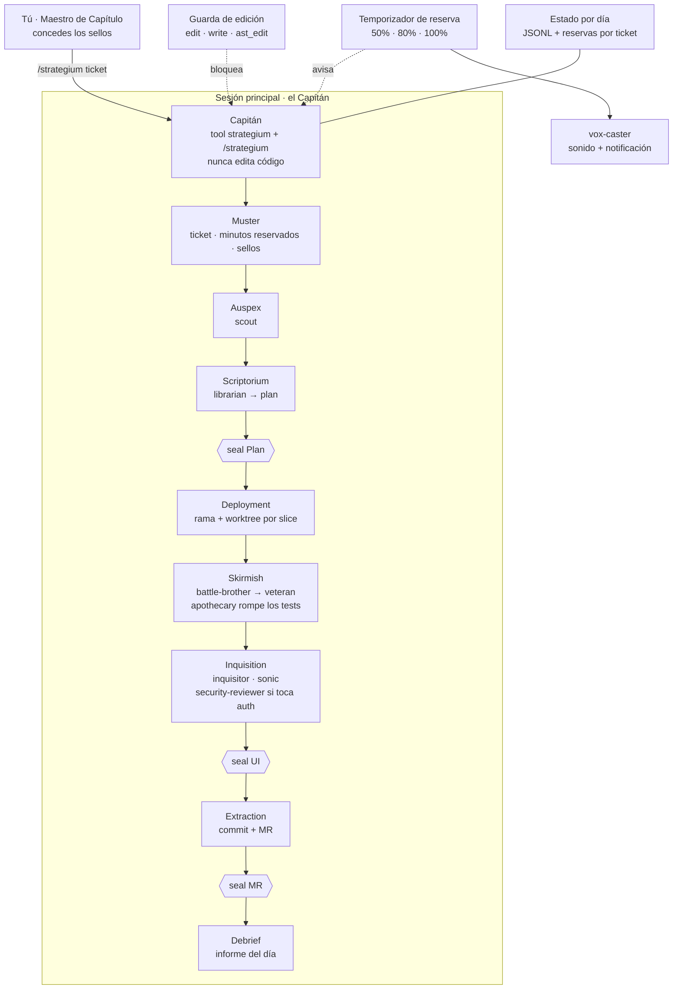

# strategium

> English: [README.md](README.md)

Convierte una sesión de omp en un **Strategium**: la sesión principal planifica y delega, los agentes especializados construyen y revisan, y tú conservas los sellos.

Este es un plugin de **omp**: se instala, se actualiza y se ejecuta con omp, y no apunta a ningún otro agente de programación.

El plugin trae tres cosas:

| Parte | Qué es |
|---|---|
| **Extensión** | el tool `strategium` y el comando `/strategium`: temporizador de reserva, reserva de ticket por sesión, bloqueo de edición |
| **Agentes** | `battle-brother`, `veteran`, `librarian`, `apothecary`, `inquisitor`, más los incluidos `scout` y `sonic` |
| **Skills** | `strategium`, `strategium-alarm`, `strategium-setup`, `strategium-study`, `strategium-ui` |

## Cómo funciona una run

La sesión principal es el **Capitán**: nunca edita código de producto. Planifica, delega, custodia los sellos y lleva el reloj. Tú eres el **Maestro de Capítulo**: solo tú concedes un sello (Plan, UI, MR, Commit).

```
Muster → Auspex → Scriptorium → Deployment → Skirmish → Inquisition → Extraction
```

1. **Muster** — el ticket, los minutos reservados y los sellos.
2. **Auspex** — los scouts mapean el código que toca el ticket.
3. **Scriptorium** — el librarian escribe una especificación, de 1 a 5 slices y una Merge bar.
4. **Deployment** — una rama por slice, un worktree por slice en paralelo.
5. **Skirmish** — un `battle-brother` implementa cada slice con los tests primero; un `apothecary` intenta romper los tests nuevos.
6. **Inquisition** — un `inquisitor` revisa el diff contra la Merge bar; un `sonic` ejecuta las comprobaciones del repo.
7. **Extraction** — el commit y la merge request, después de tu sello.



Los nombres de estación, los nombres de agente y las alertas tienen su propia voz. Los tickets, los mensajes de commit y las merge requests se quedan planos y profesionales.

### Volver atrás

Una run vuelve atrás en vez de avanzar, y cada vuelta tiene un detonante, un destino y un presupuesto. Cuando el presupuesto se agota, la run se para y te enseña lo que queda abierto.

| Vuelta | Detonante | Destino | Presupuesto |
|---|---|---|---|
| **Re-scan** | el mapa del código está equivocado | un `scout` más con ese hueco concreto | 1 por run |
| **Re-plan** | el plan está equivocado, o el check de un slice no se puede cumplir tal cual está escrito | el mismo `librarian` recorta el trabajo restante | 1 por run |
| **Fix** | el código está equivocado: check rojo, supervivientes del apothecary, hallazgos BLOCKING | un `battle-brother` de reparación con el informe del fallo | 2 rondas por slice, luego un `veteran` |
| **Re-review** | el código reparado necesita otra mirada | el `inquisitor` otra vez | 2 rondas por item del Merge bar |
| **Stand down** | se agotó el presupuesto, o el fallo no está en el código | tú, con los puntos abiertos | — |

Si el código puede cumplir el check del slice tal como está escrito, es un fix; si no puede, el slice se cortó mal y es un re-plan. Una vuelta que pasa por delante de un sello ya concedido lo anula y hay que pedirlo otra vez. Lo que ya pasó, sigue pasado.

## Instalación

**Como plugin de marketplace:**

```
/marketplace add frandev94/strategium
/marketplace install strategium@strategium
```

Desde la shell: `omp plugin marketplace add frandev94/strategium` y `omp plugin install strategium@strategium`.

**Enlazado desde una copia local:**

```
omp plugin link /ruta/al/strategium
```

Luego, en una sesión nueva, ejecuta `/skill:strategium-setup`. Comprueba el plugin, sus dependencias, las herramientas y la configuración, y devuelve una tabla de lo que hizo. Reinicia omp después: recargar un plugin dentro de una sesión ya en marcha no monta el tool `strategium`.

### Requisitos

| Necesita | Para qué |
|---|---|
| `bun` | ejecutar el script de la alarma, las alarmas del temporizador y la suite de tests |
| `git` | worktrees, ramas, commits |
| plugin `agent-skills` | las skills que cargan los agentes (`omp plugin marketplace add addyosmani/agent-skills`, luego `omp plugin install agent-skills@addy-agent-skills`) |
| plugin `ponytail` | recomendado, modo de diff mínimo para todos los agentes |
| plugin `obsidian-second-brain` | opcional, teatros que guardan registros en Obsidian |

## Uso

```
/strategium <ticket> [theatre]   arranca una run
/strategium pause                para el reloj
/strategium resume [booked]      continúa (pasa los minutos de hoy en un día nuevo)
/strategium add <min>            corrección manual, en negativo para restar
/strategium status               todas las runs y su temporizador
/strategium end                  cierra la run
```

La **reserva** es el presupuesto de tiempo del ticket. El temporizador suena al 50 %, 80 % y 100 % de la reserva — el umbral más alto que cruza, así que una run que empieza pasado el 50 % va directamente al siguiente. Al 100 % el Capitán deja de lanzar agentes e informa de lo que está hecho y de lo que queda.

Cada sesión es dueña de un ticket, con una reserva atómica, así que varias sesiones de omp pueden trabajar en tickets distintos a la vez. El Capitán no puede editar el repositorio del ticket: `edit` y `write` están bloqueados dentro del repo de la run y de su carpeta `<repo>-worktrees`, y `ast_edit` queda bloqueado en toda la sesión mientras la run está abierta.

### Configuración

| Variable | Significado |
|---|---|
| `STRATEGIUM_THEATRE` | teatro por defecto para `/strategium` |
| `STRATEGIUM_ALARM` | comando que se ejecuta cuando suena el temporizador, p. ej. `bun /ruta/al/strategium/alarm/vox.ts`; entrecomilla una ruta con espacios (`bun "C:/mis herramientas/vox.ts"`) |
| `STRATEGIUM_STATE_DIR` | dónde vive el estado de las sesiones (por defecto `~/.omp/agent/state/strategium`) |
| `STRATEGIUM_GLYPHS` | `1` para usar glifos de Nerd Font en lugar de emoji |

El estado (un JSONL por día más las reservas de tickets) vive fuera del repositorio, así que nunca se commitean datos de sesión.

### La alarma

`alarm/vox.ts` sintetiza cada sonido desde cero: sin muestras y sin dependencias. Los niveles son `50`, `80`, `100`, `done` y `attention`; con mensaje, además, levanta una notificación de escritorio (toast de Windows, notificación de macOS, `notify-send` en Linux).

```
bun alarm/vox.ts 100 "la reserva se ha agotado"
```

### Los teatros

Un teatro es una skill `strategium-<nombre>` que ata la run a tu organización: dónde están los tickets, cómo se reserva el tiempo, cómo se escriben las merge requests y qué registros se guardan. Sin teatro, el Capitán te pide los minutos reservados y los criterios de aceptación, y se detiene tras el sello de UI.

## Desarrollo

```
bun test                          # 28 tests: temporizador, reservas entre procesos, WAV de la alarma
```

```
extensions/strategium/            la extensión (tool, comando, temporizador, bloqueo de edición)
extensions/strategium/timer.ts    ficheros del día, reservas, tiempo transcurrido
alarm/                            el vox-caster y sus tests
agents/                           definiciones de agente
skills/                           las skills
```

La extensión es TypeScript puro y sin dependencias en tiempo de ejecución; `bun` solo hace falta para ejecutarla y para correr los tests.

## Licencia

MIT
