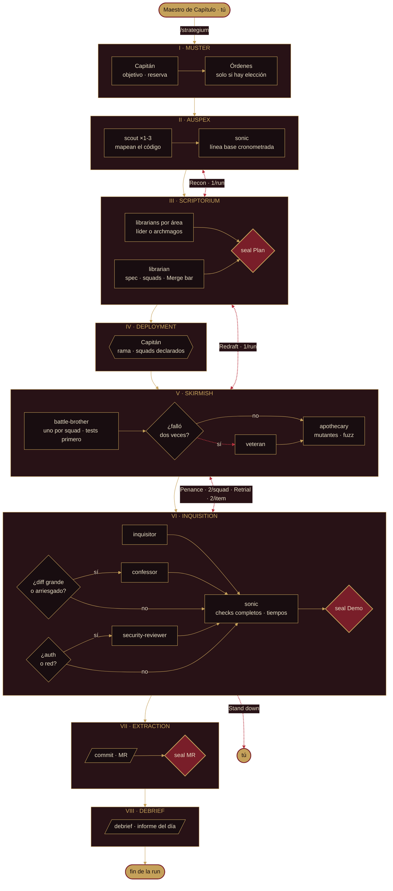

<h1 align="center">
  <picture>
    <source media="(prefers-color-scheme: dark)" srcset="docs/banner-dark.svg">
    
  </picture>
</h1>

<p align="center">
  <a href="https://github.com/frandev94/strategium/releases"></a>
  <a href="https://omp.sh/"></a>
  <a href="LICENSE"></a>
</p>

<p align="center"><em>«Un sello concedido es un sello que se defiende.»</em><br><sub>— pensamiento del día</sub></p>

<p align="center">English: <a href="README.md">README.md</a></p>

**Strategium** es un workflow orquestador para omp. La sesión principal planifica y delega, los agentes especializados construyen y revisan, y tú conservas los sellos. Trabaja cualquier objetivo: texto libre, un fichero de spec o de plan, o un ticket. **El ticketing es opcional**, y con él viene un temporizador de reserva.

Este es un plugin de **omp**: se instala, se actualiza y se ejecuta con omp, y no apunta a ningún otro agente de programación.

El plugin trae tres cosas:

| Parte | Qué es |
|---|---|
| **Extensión** | el tool `strategium` y el comando `/strategium`: reserva de la run por sesión, bloqueo de edición, temporizador de reserva opcional |
| **Agentes** | `battle-brother`, `veteran`, `librarian`, `apothecary`, `inquisitor`, `confessor`, `archmagos`, más los incluidos `scout` y `sonic` |
| **Skills** | `strategium`, `strategium-alarm`, `strategium-github`, `strategium-release`, `strategium-setup`, `strategium-study`, `strategium-ui` |

## Cómo funciona una run

La sesión principal es el **Capitán**: nunca edita código de producto. Planifica, delega y custodia los sellos. Tú eres el **Maestro de Capítulo**: solo tú concedes un sello (Plan, Demo, MR, Commit, Review & merge).

```
Muster → Auspex → Scriptorium → Deployment → Skirmish → Inquisition → Extraction
```

1. **Muster** — el objetivo y las órdenes: Plan por defecto, Demo y MR cuando aplican (Demo cuando el objetivo tiene algo que ver funcionando: una pantalla, una API HTTP, una DLL cargada por un host) y, con ticketing, la reserva. Solo se te pregunta cuando hay elección (una reserva, activar o no Demo o MR, `Review & merge`, un campo del teatro o la casilla del Archmagos); si no, la run toma los valores por defecto y pasa directa a Auspex.
2. **Auspex** — los scouts mapean el código que toca el objetivo y los tiers de checks del repo (fast, squad, full); un `sonic` cronometra los checks completos sobre `main` como línea base y marca como flaky un fallo que pasa al repetirlo una vez.
3. **Scriptorium** — un librarian escribe una especificación, de 1 a 5 squads y una Merge bar; cuando el objetivo se divide en áreas, un librarian por área y después un líder une las partes (con el Archmagos Dominus marcado en Muster, un `archmagos` integra las partes en lugar del líder).
4. **Deployment** — una rama para la run, los squads declarados con sus ficheros; cada agente aislado trabaja en su propio checkout de omp.
5. **Skirmish** — un `battle-brother` implementa cada squad con los tests primero, con los tiers de checks fast y squad (los checks completos quedan para `sonic`); un `apothecary` intenta romper los tests nuevos, solo en squads con lógica nueva y dentro de un presupuesto fijo.
6. **Inquisition** — un `inquisitor` revisa el diff contra la Merge bar y comprueba que cada test borrado o debilitado sigue cubierto por otro, y se une un `confessor` de otra familia de modelos (si está disponible) cuando el plan marca el diff como grande o arriesgado, o en el bucle Review & merge; un `sonic` ejecuta las comprobaciones completas del repo y da sus tiempos junto a los de la línea base.
7. **Extraction** — el commit y la merge request, después de tu sello. Con el sello opcional `Review & merge`, un inquisitor y un confessor nuevos revisan la PR cuando el CI está en verde, como máximo 2 rondas, y una revisión limpia termina en el merge.



Los nombres de estación, los nombres de agente y las alertas tienen su propia voz; el `archmagos` la usa solo en el chat y el todo, nunca en el fichero del plan. Los tickets, los mensajes de commit y las merge requests se quedan planos y profesionales.

### Volver atrás

Una run vuelve atrás en vez de avanzar, y cada vuelta tiene un detonante, un destino y un presupuesto. Cuando el presupuesto se agota, la run se para y te enseña lo que queda abierto. Las flechas rojas del diagrama de arriba muestran las vueltas; la tabla da el detalle.

| Vuelta | Detonante | Destino | Presupuesto |
|---|---|---|---|
| **Recon** | el mapa del código está equivocado | un `scout` más con ese hueco concreto | 1 por run |
| **Redraft** | el plan está equivocado, o el check de un squad no se puede cumplir tal cual está escrito, o rechazas el plan en el sello Plan | primero vuelta a Auspex: uno o dos scouts refrescan el mapa con lo que cambió (una sección `## Redraft`, nunca un barrido completo). Luego el mismo `librarian` reescribe el trabajo restante (con áreas, solo el área afectada, y el líder vuelve a unir; en una run marcada para el Archmagos Dominus, un `archmagos` nuevo vuelve a integrar solo esa área), y el sello Plan se pide otra vez | 1 por run |
| **Penance** | el código está equivocado: check rojo, supervivientes o crashes del fuzz del apothecary, hallazgos BLOCKING | un `battle-brother` de reparación con todos los IDs de hallazgos abiertos en un solo brief, nunca el informe anterior; primero reproduce cada hallazgo, y el que no puede reproducir vuelve como NOT REPRODUCED | 2 rondas por squad, luego un `veteran` |
| **Retrial** | el código reparado necesita otra mirada | el `inquisitor` otra vez (el `confessor` revisa sus propios IDs), solo sobre los IDs de hallazgos abiertos y el rango del arreglo, y luego `sonic` para los checks completos | 2 rondas por item del Merge bar |
| **Stand down** | se agotó el presupuesto, o el fallo no está en el código | tú, con los puntos abiertos | — |

Si el código puede cumplir el check del squad tal como está escrito, es un penance; si no puede, el squad se cortó mal y es un redraft. Una vuelta que pasa por delante de un sello ya concedido rompe el sello (salvo el bucle Review & merge) y hay que pedirlo otra vez. Lo que ya pasó, sigue pasado.

### Los agentes

El Capitán planifica y delega; cada uno de los demás papeles es un agente que él lanza. Cada uno tiene un único trabajo y un límite estricto.

| Agente | Estación | Qué hace | Nunca | Modelo / esfuerzo |
|---|---|---|---|---|
|  **Capitán** (sesión principal) | todas | planifica, delega, guarda los sellos, hace los commits | edita código del producto | el modelo de tu sesión |
|  `scout` | Auspex | mapea el código que toca el objetivo; de 1 a 3 a la vez, cada uno con su foco | escribe ficheros o ejecuta bash | `@smol` / medium |
|  `librarian` | Scriptorium | escribe la spec, los squads y el Merge bar; uno por área cuando el objetivo se divide, y luego un líder une las partes | edita ficheros del repositorio | `@plan` / high |
|  `archmagos` | Scriptorium | integra los planes de cada área en uno, comprobando cada supuesto contra el código; solo si se marcó en Muster | edita, escribe o lanza agentes | `@plan` / xhigh |
|  `battle-brother` | Skirmish | construye un squad con los tests primero, con los tiers de checks fast y squad, y reporta la evidencia rojo/verde | hace commits, toca ficheros fuera de su squad o ejecuta los checks completos | el [tier](#tiers) de su squad |
|  `veteran` | Skirmish | rehace un squad que falló dos veces, después de averiguar por qué | hace commits o ejecuta los checks completos | tier heavy (`@slow:high`); solo para escalar |
|  `apothecary` | Skirmish | muta las líneas cambiadas del squad y hace fuzzing de la entrada no fiable, para enseñar dónde los tests no protegen el código | edita los tests que audita, o deja el árbol cambiado | `@task` / medium |
|  `inquisitor` | Inquisition | revisa el diff contra el Merge bar y cada test borrado o debilitado; un PASS necesita evidencia con fichero:línea o un comando | edita, hace commits o push | `@slow` / high |
|  `confessor` | Inquisition | una segunda revisión, independiente y de otra familia de modelos, cuando el plan marca el diff como grande o arriesgado, o en el bucle Review & merge | lee el informe del inquisitor | gpt-6-astra (si no, `@task`) / high |
|  `security-reviewer` | Inquisition | entra cuando el diff toca auth, entrada externa, secretos o la red | edita | incluido en omp, el modelo de tu sesión |
|  `sonic` | Auspex, Inquisition | ejecuta los checks completos del repo: primero la línea base cronometrada (un fallo que pasa al repetirlo una vez es flaky), al final los checks completos con sus tiempos junto a los de la línea base | arregla lo que falla | `@smol` / medium |

#### El Capítulo

| Quién | Rango | Departamento u organización |
|---|---|---|
| Tú · el Capitán (sesión principal) | Maestro de Capítulo · Capitán | Chapter Command |
| `scout` | Neophyte | 10th Company |
| `librarian` | Librarian (especialista) | Librarius |
| `battle-brother` | Battle-Brother | battle company |
| `veteran` | Battle-Brother (veterano) | 1st Company |
| `apothecary` | Apothecary (especialista) | Apothecarion |
| `task` | ninguno (auxiliar), un Adept | Chapter Serfs (sin relación con el Mechanicus) |
| `sonic` | ninguno (auxiliar), un Servitor | mantenido por la Armoury |
| `archmagos` | Archmagos Dominus | Adeptus Mechanicus (externa) |
| `inquisitor`, `security-reviewer` | Autoridad y auditor inquisitorial | Inquisition (externa) |
| `confessor` | Confessor | Ecclesiarchy (externa) |

Los papeles de librarian, apothecary, inquisitor, confessor, archmagos y security-reviewer, y el Adept de `task`, son adaptaciones temáticas de su lore (las notas de [docs/chapter.md](docs/chapter.md) explican cómo). Los temas del cockpit son esquemas de color y no cambian ningún término de aquí. Rango, departamento y papel van separados; el roster completo está en [docs/chapter.md](docs/chapter.md) (en inglés). Los nombres de rango y departamento se quedan en inglés, como en ese documento; solo se traducen Capitán y Maestro de Capítulo. `task` es el agente de omp para el trabajo delegado general.

#### Modelos

Los agentes eligen modelo con los alias de rol de omp: eliges los modelos una vez en `~/.omp/agent/config.yml` y Strategium los sigue. Configura los tres roles que usa, sin sufijo `:nivel` (un sufijo pisa el effort de todos los agentes de ese rol). Un rol sin configurar cae en lo que trae omp: `plan` y `task` en el modelo de tu sesión, `slow` en tu `default` (si tampoco está, en la lista de omp, que puede acabar en el modelo más caro que conoce):

```yaml
modelRoles:
  plan: anthropic/claude-opus-5-5   # librarian, archmagos
  slow: anthropic/claude-opus-5-5   # inquisitor
  task: anthropic/claude-sonnet-5-5 # apothecary, confessor sin Codex; nivel standard
```

El effort que pide cada agente está en la tabla de arriba. Para llevar un solo agente a otro modelo, usa `task.agentModelOverrides`, p. ej. `inquisitor: anthropic/claude-sonnet-5-5`. Durante una run, `battle-brother` y `veteran` siguen `STRATEGIUM_TIERS`: el modelo del hook sustituye ese override. La config recomendada completa y sus motivos: [docs/models.md](docs/models.md) (en inglés); `/skill:strategium-setup` compara tus roles con ella.

#### Tiers

El plan da a cada squad un tier de coste con un motivo de una línea, y el plugin lanza cada `battle-brother` con el tier de su squad, así que un mismo lote en paralelo puede mezclar tiers. Un tier es un selector de modelo de omp; su sufijo `:nivel` fija el effort y gana al `thinkingLevel` del propio agente.

| Tier | Selector por defecto | Para |
|---|---|---|
| `light` | `@smol:medium` | docs, prompts, renombrados, fixtures, ediciones mecánicas con un check claro |
| `standard` | `@task:medium` | código normal con tests (el valor por defecto de un squad sin tier) |
| `heavy` | `@slow:high` | concurrencia, seguridad, parsers, workflows de CI con tokens de escritura, código sin tests, todo lo irreversible |

El sello Plan muestra el tier de cada squad y una estimación aproximada (coste relativo 1 / 3 / 10, unos 5 / 10 / 20 minutos por squad, de la tabla de la skill), y puedes cambiar un tier ahí (`S2 heavy`) sin redraft. Un squad cuyo builder falló recibe su penance un tier más arriba (heavy sigue en heavy, y después el `veteran`); los revisores conservan sus propios tiers. Con `STRATEGIUM_TIERS` cambias los selectores, y hay que configurar el rol `smol`, que `light` necesita: mira [docs/models.md](docs/models.md) (en inglés).

#### Valoraciones

El Capitán valora a cada agente de la run a partir de los informes de los revisores, con la acción `rate`: `proven`, `proven-regression` o `corrupted`, con su evidencia (de 1 a 8 elementos: IDs de hallazgos, el check que falla o la regla infringida), el modelo y el effort. El modelo y el effort son con los que el Capitán lo lanzó (el selector del tier de un builder partido en los dos puntos: `@task:medium` es `@task` y `medium`); el plugin los guarda y no los observa.

| Valoración | Cuándo |
|---|---|
| `corrupted` | un hallazgo BLOCKING reproducido, un superviviente del apothecary o un crash del fuzz, un check de aceptación en rojo, o una infracción de regla (un commit, `git push`, una escritura con `gh`, una escritura fuera de su worktree o su scratch) |
| `proven-regression` | pasa, pero un hallazgo BLOCKING nuevo cayó en las líneas que tocó una penance |
| `proven` | ninguna de las anteriores |

Un hallazgo NOT REPRODUCED no cuenta. La valoración nunca sale del informe del propio agente. Una penance o un veterano es un agente nuevo y empieza sin valorar; cada agente conserva su propia valoración. `corrupted` es permanente durante el resto de la run: ese agente solo puede volver a valorarse `corrupted`. Las valoraciones viven en el archivo de la run, sobreviven a un reinicio de omp y a un `redraft`, y se ven como una insignia en la fila del agente (y en la de su squad, la del agente más reciente del squad), en las líneas `rating:` y `evidence:` de su detalle, y en el debrief (`## Ratings`, por agente y por modelo + effort). Un constructor lanzado por una task bloqueante no está en el registro del cockpit, así que la fila de su escuadrón no muestra insignia; la valoración se guarda igualmente. Con los nombres activados, una valoración `corrupted` del último builder de un squad cuenta como caída al terminar la run, aunque su job acabara `completed`; un primer builder corrupted seguido de una penance que no lo es sigue siendo una penance, y un builder retirado por un redraft ya no cuenta.

Tras una valoración `corrupted`, `rate` termina con una línea `LESSON` que recuerda al Capitán escribir la lección de ese agente en `local://<KEY>-lessons.md` (el plugin no escribe ningún archivo): una entrada `## <id del agente> · squad <id> · <modelo> <effort>` con `Findings:`, `Reproduction:`, `Tried:`, `Why it failed:` y `Do not:`, sacada de los informes de los revisores y de los checks, nunca del informe del propio agente. La siguiente ronda de ese squad (una penance o el veterano) cita las lecciones del squad tal cual en su brief bajo `Lessons (do not repeat):`, nunca el informe en bruto; `battle-brother` y `veteran` leen ese bloque primero y no repiten lo que lista. El primer elemento de evidencia de una valoración `corrupted` es `cause: <por qué falló, máximo 100 caracteres>`; si el primer elemento no empieza por `cause:`, la línea `LESSON` termina con `; start evidence with cause: <why>`. Una lección solo se promueve a la memoria a largo plazo cuando el mismo fallo (misma causa, regla incumplida o comprobación fallida) aparece en 2 o más runs: antes de `end` el Capitán compara cada lección con los elementos `cause:` de los debriefs guardados y con la memoria del host, y la promueve con la herramienta `learn` del host (la causa, la lista `Do not:` y las claves de las runs), o se la muestra al usuario si no hay tal herramienta; la primera vez no se promueve.

#### Reutilización

Una ronda posterior de un squad (una penance, o el escalado al veterano) puede partir del trabajo de un builder `proven` en vez de empezar de cero. El Capitán pregunta `reuse <squad>`; el plugin no escribe nada y responde con hasta 3 candidatos, cada uno un agente de esta run valorado `proven` que ya terminó (nunca `corrupted`, `proven-regression`, sin valorar ni en marcha; con nombres desactivados solo se ofrece un builder asíncrono, que llega al registro del cockpit: el de una task bloqueante no está en él) cuyo squad comparte archivos con el squad destino o, si no, un directorio: `REUSE squad <target>: <id> (squad <src>, shared files, <n> tokens); <id> (squad <src>, same area, usage unknown)`. Primero los que comparten archivos, luego los de menos tokens usados (un indicador aproximado, porque omp no expone a las extensiones cuánto contexto lleva). Sin candidato responde `REUSE squad <target>: none (no proven builder of this run that has ended shares its files or area); spawn a fresh builder`.

Con un candidato, el nuevo spawn es el agente que pide la escalera, con la línea de brief `Reuse: <id>`: da al builder los commits de ese agente, su informe final (`agent://<id>`) y el final de su historial (`history://<id>:-60`), que lee primero. La reutilización cuenta como esa ronda de penance y el tier sigue saliendo de la escalera (uno más arriba, el veterano heavy), así que una ronda 1 `corrupted` seguida de una reutilización nunca corre más bajo. Una llamada `task` cuyo brief o contexto nombre en `Reuse:` a un agente `corrupted` se bloquea, y también `name` con un `source` corrupted. El escaneo lee un `Reuse:` por línea (vale un prefijo markdown como `- ` o `**`, y `` `código` ``, `<ángulo>` o `agent://` alrededor del id) y solo cubre la llamada a la herramienta `task`, no el brief de un `agent()` de eval: lanza los builders con `task` para que el veto valga. Un squad que no puede pasar tal como está escrito es un redraft, no una corrupción: su builder no se valora `corrupted` por eso, y el squad replanteado empieza en su tier previsto. Con los nombres activados, un hermano reutilizado conserva su apellido (`PenitentLorenzo`) en el squad al que se une; el resultado del squad sigue siendo de su primer hermano.

## Instalación

Strategium funciona dentro de [omp](https://omp.sh/), nuestro agente de código: instala omp primero.

**Que lo haga un agente:** pega este prompt en cualquier agente de código con acceso a la shell. Instala omp si falta y después el plugin.

```text
Set up omp (https://omp.sh/) with the Strategium plugin on this machine.

1. Run `omp --version`. If omp is not found, install it:
   - macOS / Linux: curl -fsSL https://omp.sh/install | sh
   - Windows (PowerShell): irm https://omp.sh/install.ps1 | iex
   If `omp` is still not on PATH, open a new shell and try again. Stop and report if it still fails.
2. Run `git --version` and `bun --version`. If one is missing, tell me with its official install command; do not install it without asking.
3. Install the plugins (if one is already there, keep it and move on):
   omp plugin marketplace add addyosmani/agent-skills
   omp plugin install agent-skills@addy-agent-skills
   omp plugin marketplace add frandev94/strategium
   omp plugin install strategium@strategium
4. Verify with `omp plugin list` and `omp plugin doctor`.
5. Report a table: step, result, and the error output of any failure. Then tell me to open a fresh omp session and run /skill:strategium-setup.

Change no other omp settings, and do not remove or upgrade anything already installed.
```

**Como plugin de marketplace:**

```
/marketplace add frandev94/strategium
/marketplace install strategium@strategium
```

Desde la shell: `omp plugin marketplace add frandev94/strategium` y `omp plugin install strategium@strategium`.

**Enlazado desde una copia local:**

```
omp plugin link /ruta/al/strategium
```

Luego, en una sesión nueva, ejecuta `/skill:strategium-setup`. Comprueba el plugin, sus dependencias, las herramientas y la configuración, y devuelve una tabla de lo que hizo. omp 19 no carga las `rules/` de un plugin enlazado en las sesiones, así que la skill las lee ella misma desde `rules/`.

> [!IMPORTANT]
> Reinicia omp después: recargar un plugin dentro de una sesión ya en marcha no monta el tool `strategium`.

### Requisitos

| Necesita | Para qué |
|---|---|
| `bun` | ejecutar el script de la alarma, las alarmas del temporizador y la suite de tests |
| `git` | worktrees, ramas, commits |
| plugin `agent-skills` | las skills que cargan los agentes (`omp plugin marketplace add addyosmani/agent-skills`, luego `omp plugin install agent-skills@addy-agent-skills`) |
| plugin `ponytail` | recomendado, modo de diff mínimo para todos los agentes |
| plugin `obsidian-second-brain` | opcional, teatros que guardan registros en Obsidian |

## Uso

```
/strategium "texto libre" [theatre]   trabaja un objetivo con tus palabras
/strategium @ruta [theatre]           trabaja un fichero de spec o un plan aprobado
/strategium <clave> [theatre]         trabaja un ticket que conoce el teatro, o un nombre corto
/strategium-pause                     para el reloj
/strategium-resume [booked]           continúa (una run con reserva pasa los minutos de hoy en un día nuevo)
/strategium-add <min>                 corrección manual, en negativo para restar
/strategium-status                    todas las runs y su tiempo
/strategium-config [notify on|off | sound on|off | toast on|off | volume <0-100> [preview] | idle <min> | archmagos on|off | commit on|off | cockpit-key <key> | cockpit-theme <name>|default | relic on|off|default | caster on|off|default | names on|off|default]    ajustes; notify, sound o toast on|off, el volumen de la alarma (preview la reproduce a ese volumen), los minutos de inactividad, archmagos o commit on|off para esta sesión; cockpit-key <key> fija la tecla del cockpit desde el próximo arranque de omp; cockpit-theme <name> fija el tema del cockpit y lo aplica al instante; relic on|off|default guarda el acabado de reliquia desgastada del cockpit y lo aplica al instante; caster on|off|default guarda el interruptor del locutor del cockpit y lo aplica al instante; names on|off|default guarda el interruptor de los nombres de agentes
/strategium-cockpit                   abre el cockpit (también Alt+C, o la tecla fijada con cockpit-key)
/strategium-end                       cierra la run y escribe su debrief
```

El texto libre necesita las comillas, para no chocar nunca con un subcomando. Sin ticket, el librarian propone los criterios de aceptación y tú los confirmas en el sello Plan, que no se puede saltar. El comando inicia la run de inmediato, sin temporizador, bajo una KEY tomada del objetivo (una clave tal cual, el nombre base de un fichero, o las primeras palabras del texto libre en kebab-case).

Cada sesión es dueña de una run, con una reserva atómica, así que varias sesiones de omp pueden trabajar en objetivos distintos a la vez. Cerrar una sesión pausa su run y libera la reserva; al reabrir esa sesión la recupera y la reanuda sola, salvo que tú la hubieras pausado (`/strategium-pause`, acción `stop`, el stand down). Una run con temporizador en un día nuevo sigue pausada hasta que se da la reserva de hoy. Una run que sigue contando a medianoche no se para: su bloque termina a las 00:00 en el fichero del día anterior y empieza otro a las 00:00 de hoy, así que `status`, `report` y el pie siguen contando; una run con temporizador cuenta ahí sin reserva y sin las alertas de 50/80/100 (pie `<elapsed> min · new day: /strategium-resume <min>`) hasta que `/strategium-resume <min>` da la de hoy. El Capitán no puede editar el repositorio de la run: desde `begin`, `edit` y `ast_edit` se ocultan de la sesión principal y se rechazan los agentes fuera del plantel de Strategium; cuando `strategium repo` arma la guardia, `ast_edit` y `write` quedan bloqueados dentro del repo de la run y de su carpeta `<repo>-worktrees`, los ejecutores de tests y builds por bash y las escrituras de ficheros por bash están bloqueados (solo pasan las redirecciones a `$TEMP`, `$TMP`, `$TMPDIR`, `%TEMP%`, `/tmp/`, `local://`, `out://`, `/dev/null` y descriptores de fichero) y se rechazan los battle-brothers hasta que se declaren los squads del plan (`strategium` `slices`; los squads en paralelo no pueden compartir un fichero). En el modo plan de omp la run recorre las mismas estaciones, pero su todo solo contiene las que pueden correr ahí: Muster (Orders sin la casilla Plan), Auspex y Scriptorium, con los squads declarados antes de `xd://propose`. El plan propuesto abre con las estaciones ya hechas y lista solo lo que arranca la aprobación. "Approve and execute" abre una sesión nueva y la run se va con ella (reserva, marca de Archmagos y squads incluidos); su todo contiene de Deployment en adelante y empieza en la primera tarea de Deployment. Un `/new` normal deja la run en su propia sesión. Para mover una sesión a otro objetivo (una subtarea, o el padre para el tiempo de coordinación) la herramienta tiene `switch <key>`: termina la run actual como un `end` normal (con su debrief) y inicia `<key>` en una sola llamada, conservando el theatre y el repo. La nueva run va sin temporizador salvo que se dé `booked` (la reserva anterior nunca se arrastra; `booked` y `via` salen solo de la consulta de la clave nueva), y una clave que tiene otra sesión se rechaza salvo que `takeover` nombre a su dueña. Volver a una clave ya iniciada hoy conserva la reserva de ese día (pasa `booked` solo para una reserva nueva). El switch se rechaza mientras haya builders (battle-brothers, veterans) en marcha y empieza los presupuestos de la run de cero (redraft, marca de Archmagos, slices por declarar otra vez), así que no lo uses para saltártelos. Las dos mitades no son atómicas: un fallo entre ellas deja la reclamación de la clave nueva; recupérala con `begin` sobre la clave nueva: la misma sesión no necesita `takeover`; una sesión nueva pasa `takeover` con el id que nombra el rechazo. Suma los minutos de la clave terminada a su Spent, como hace Records.

El debrief: `end` (y `/strategium-end`) escribe el informe de la run en `<state dir>/debriefs/<key, saneada>-<8-hex>-<YYYY-MM-DDTHH-MM-SS>.md`, que se queda tras terminar la run, y devuelve su ruta más un resumen corto en el chat (tiempo, sellos, spawns, coste). Sus secciones son el tiempo por estación (minutos activos y en pausa, que suman el total de la run), los sellos (pedido, concedido, espera), los squads (ejecuciones del builder, penances, ejecuciones del veteran, último resultado, estado) y los agentes lanzados por rol y el modelo pedido (el selector que Strategium pidió al host; el host puede ejecutar otro, así que esa columna no es exacta); el resto de números fuera de la sección Cost son exactos, salen de los registros propios del plugin y sobreviven a un reinicio de omp. La sección Cost lista, por agente, sus tokens de entrada, de salida, la caché y el coste; por rol, los agentes, el coste y una barra que compara los roles; y el total de la run. En una run con temporizador añade el coste por hora reservada (el total entre los minutos reservados), y el resumen del chat trae una línea `COST`. Las cifras son estimaciones a precio de lista de omp: lo que gasta cada agente tal como lo valora omp, sin sus subagentes anidados, calculado como lo calcula la vista de agentes de omp (los tokens incluyen los subagentes anidados; el coste no). Solo agentes: la sesión del Captain no cuenta, así que la fila de totales dice `Total (agents)` y la línea del chat `COST (agents, list price)`; una run que usó el caster del cockpit añade una fila `caster` (su celda de squad dice `N calls` y el modelo al que resolvió el alias, p. ej. `3 calls · <id del modelo>`; tokens como los cuenta un agente, solo entrada y la caché aparte; y su coste), la fila de totales pasa a `Total (agents and caster)` con `N + caster` en la columna Agents, y la nota dice "Agents and the cockpit caster only". Un plan de suscripción paga distinto. `?` significa desconocido (no se registró uso, o un modelo sin precio en omp), nunca 0, y un total con agentes desconocidos se lee `$x + ?`. El Capitán pasa los números que informaron los agentes en el parámetro opcional `reported` de `end` (`apothecary`: `killed`, `survived`, `crashes`; `review`: `pass`, `fail`, `opened`, `fixed`, `not_reproduced`); solo aparecen en las secciones `Apothecary (reported)` y `Review (reported)`, o como `Not reported.`. Después copia el fichero junto a los demás de la run con `cat "<path>" > local://<KEY>-debrief.md`.

<details>
<summary><strong>Pausa por inactividad, pie y cockpit</strong></summary>

Pausa por inactividad: cuando ningún agente trabaja y nada espera para ejecutarse, el reloj de la run se pausa tras `STRATEGIUM_IDLE_MIN` minutos de inactividad (3 por defecto), suena el sonido `idle` (con las notificaciones activas) y el pie la muestra pausada. El siguiente turno la reanuda sola; el Capitán no llama a `start`. Una run que pausaste a mano (`/strategium-pause`, acción `stop`, el stand down) nunca se reanuda sola. Una pregunta o una revisión de plan que te espera cuenta como actividad: el reloj sigue corriendo y la alarma `attention` te avisa (con las notificaciones activas). Una run con temporizador en un día nuevo sigue pausada hasta que se da la reserva de hoy.

Pie: la estación se muestra como `<estación> › <tarea>`, donde `<tarea>` es la tarea activa del todo sin su etiqueta de agente, cortada a 32 caracteres con `…`. Un sello mantiene `⏳ seal <nombre>` con el nombre entero (`Demo (2)`); un retorno muestra `↩ <estación> › <tarea>`. El pie aparece en cuanto `/strategium` inicia la run (`strategium: <KEY> · <transcurrido> min`); al iniciar la primera tarea del esqueleto muestra p. ej. `Muster › Objective`, y luego `Muster › Orders`. Un `todo init` que reconstruye el todo de una run no mueve el pie (omp inicia su primera tarea por sí mismo); el siguiente `start` o `done` sí. La excepción es el relevo tras aprobar un plan, cuyo todo (de Deployment en adelante) sustituye a las estaciones del modo plan: el pie pasa a su primera tarea al instante. Si el terminal es lo bastante ancho (cabe el texto del pie más dos espacios y la pista) la línea termina, pegada a la derecha, con la pista que nombra la tecla del cockpit (`ALT + C to enter cockpit` por defecto); más estrecho, o con ancho desconocido, no hay pista. El ancho se lee en cada dibujo del pie (cada minuto y en cada cambio de estado), no al redimensionar.

Cockpit: `/strategium-cockpit` (o Alt+C, o tu tecla del cockpit) abre el overlay a pantalla completa (tapa el prompt, la lista de todos y la transcripción hasta que Esc o `q` lo cierra; también se cierra solo cuando el agente te pregunta algo, pide aprobar una herramienta o abre una revisión de plan) mientras esta sesión tiene una run abierta: la clave, el reloj y los sellos arriba como una cadena (`✠ Plan → ○ Demo`, sin fila cuando la run no tiene sellos), debajo una línea de estado (`▶ AGENT AT WORK` mientras corre un turno o un trabajo en segundo plano, como un subagente asíncrono, un job de bash o uno de eval, sigue en marcha, `○ VOX OPEN · esc to give orders` en dorado cuando el agente se ha parado, no corre ningún trabajo y el prompt está libre para tus órdenes; un diálogo de otra extensión no tiene evento, así que no se anuncia), luego una estación como título (por defecto la activa: la primera fase con una tarea del todo en curso, si no la primera con una tarea en espera; ←/→ recorren las demás, ver las teclas más abajo) (`▶` en curso, `↶` tras un retorno, `○` en espera; un sello en espera añade `· seal <nombre> awaits you`), una caja por tipo de agente presente en ella, y las últimas entradas de la crónica. Las cajas, en este orden, toman las tareas del todo con esa etiqueta y los agentes lanzados en esa estación: CAPTAIN, SCOUTS, LIBRARIANS (también `[archmagos]`), BATTLE-BROTHERS (también `[veteran]`), APOTHECARIES, INQUISITOR, SECURITY-REVIEWER, SONIC y ADEPTS (`[task]`). Una caja solo sale si la estación tiene una tarea o un agente de su tipo. Cada línea lleva su marca de estado: `▶` en curso, `✓` hecha, `○` en espera, `✗` fallida; las líneas de BATTLE-BROTHERS llevan `†` (o `‡` si es veterano) y suman una línea `squad <id> …` por escuadrón declarado. Las líneas van `▶`, `✗`, `○` y luego `✓`; una caja muestra como mucho 8 líneas (menos en una ventana baja, para que la crónica conserve 5 filas) y su última línea cuenta el resto, p. ej. `+5 more (3 done, 2 idle)`. Teclas: ↑/↓ mueven un cursor dorado `▸` por las líneas de las cajas y las entradas de la crónica (al abrir el cockpit no hay nada seleccionado; la primera ↑, ↓ o Tab selecciona una línea, y el cursor sigue a su línea cuando la run cambia); una línea seleccionada que una caja ocultaría se sigue dibujando, y la fila `+k more` cuenta el resto; Tab salta a la primera línea de la caja siguiente; ←/→ muestran la estación anterior o la siguiente, y el título pasa a `<marca> <estación> · viewing · active: <estación activa>`; Home vuelve a la estación activa, a la que el cockpit también vuelve solo cuando la run pasa a otra estación. Enter abre el detalle de la línea seleccionada en lugar de las cajas y la crónica: un escuadrón muestra sus archivos, `parallel`, nivel (tier) y los agentes que lo ejecutaron (battle-brother, penitencias y el veterano) con sus resultados; un agente, su rol, id, estación, tiempo transcurrido, estado, estado en vivo (progreso, ETA, intención, línea señalada), coste y tokens; un sello, el panel entero; una entrada de la crónica, su texto completo, sin cortar; una tarea, su texto; ↑/↓ desplazan un detalle largo. Enter en el detalle de un agente, o en el de un escuadrón con al menos un agente (abre el agente más reciente del escuadrón, el último lanzado), abre `TRANSCRIPT <id>` en lugar del detalle: la conversación del propio agente, de solo lectura, desde la fila más reciente hacia arriba (↑/↓ desplazan, y sigue las entradas nuevas mientras el archivo crece, releído como mucho una vez por segundo y solo si cambió). Las filas son `user: <encargo>` (el encargo del Capitán, no tú), el texto del asistente, `→ <herramienta> <intención>` para una llamada a herramienta y `← <herramienta> ok: <primera línea>` o `← <herramienta> error: <primera línea>` para su resultado; los bloques de razonamiento (thinking) nunca se muestran. Un agente terminado o fallido añade `final answer:` y su archivo de respuesta, o `no final answer file`. Cuando no hay nada que mostrar, una línea dice por qué: `no session file: this session is not saved, so its agents' transcripts are not either`, `<id>: a nested agent; its transcript is not read`, `<id>: not a transcript id`, `no transcript yet: omp writes it after the agent's first reply`, `transcript unreadable: <code>` o `no messages yet`. El título es `TRANSCRIPT <id>` (más ` · a–b/n` cuando hay filas ocultas) y el pie `esc/bksp back · q close · ↑↓ scroll`; el detalle de agente y el de escuadrón muestran `enter transcript` en el suyo. Solo se leen los últimos 512 KiB de la transcripción (más hasta los primeros 512 KiB de su cabeza, para el encargo) y los primeros 64 KiB de la respuesta (cuando se saltaron bytes, `… earlier entries not shown` encabeza las filas, bajo el encargo del agente, el primer mensaje `user` del registro, buscado en los primeros 512 KiB, de 64 KiB en 64 KiB), se conservan como mucho las 1000 filas más recientes, cada fila se corta a 400 caracteres y cada bloque de texto a 40 líneas, los caracteres de control y bidi pasan a espacios, y los enlaces simbólicos y demás archivos no regulares se rechazan. El Enter que abre una transcripción es la única pulsación que lee un archivo (la transcripción y la respuesta de ese agente); ninguna otra tecla lee nada, una transcripción abierta se mira de nuevo como mucho una vez por segundo y se vuelve a leer solo si un archivo cambió, y cerrar la transcripción descarta lo leído. Backspace o Esc vuelven un nivel (de una transcripción al detalle de donde venía, con su desplazamiento), con el cursor en la misma línea de antes. `q` cierra el cockpit de una sola pulsación desde cualquier nivel, y Esc lo cierra desde el nivel superior (o sea, dos veces desde un detalle, tres desde una transcripción), sea cual sea el cursor o la estación. En terminales anchos el pie lista las teclas (`esc/q close · ↑↓ line · ←→ station · tab box · home active · enter open`; en un detalle, `esc/bksp back · q close · ↑↓ scroll`). El cursor no se guarda: un cockpit reabierto empieza sin selección en la estación activa. Un sello concedido pasa a ✠ y, con las notificaciones activas, suena el sonido `done`. Mientras un sello espera, un panel a todo el ancho bajo el título de la estación muestra lo que el Capitán preparó para él (el Capitán lo rellena con la acción `seal`; sin ella el panel muestra `the details are in the Captain's message`); sin panel cuando nada espera. La crónica (las 200 entradas más recientes), la lista de agentes lanzados, las marcas de los escuadrones y las líneas del panel del sello se guardan con la run, así que sobreviven a un reinicio de omp; terminar la run las borra; un agente lanzado desde eval sigue en `▶` hasta que vuelve la celda de eval que lo espera, o hasta que omp entrega su resultado, y entonces pasa a `✓` o `✗`. Los colores son truecolor si el terminal lo admite y 256 colores si no. Bajo cada agente o escuadra en marcha, el cockpit dibuja una fila con el tiempo transcurrido, su coste (`10m · $0.42 · …`, o `$?` mientras no se conoce el uso) y, de la propia lista de tareas del agente, `done/total · ~ETA · tarea actual`, o si no su última intención (el nombre de la herramienta si el trazado de intención está apagado); la fila sigue el archivo del propio agente, así que se actualiza mientras el turno del padre espera. Un agente que ya ha hecho su primera llamada a una herramienta y lleva 5 min sin ninguna en curso y sin que haya terminado ninguna se pone en dorado con `stalled Nm` y deja una sola entrada en la crónica (un `bun test` largo no cuenta como parado; una llamada posterior acaba el estancamiento). Un subagente también puede llamar a `strategium` `signal` (`pct`, `eta_min`, `line`, `blocked`) para escribir su propia fila: `line` sustituye la tarea actual o la intención, `eta_min` el ETA calculado y `pct` el `done/total`; `blocked: true` pone la fila en dorado, deja una entrada en la crónica y suena la alarma `attention` una sola vez por bloqueo (cada paso a bloqueado suena una vez); una fila bloqueada sin nada en vuelo durante 5 min también se marca como parada. El Capitán se entera del bloqueo por el usuario o por la entrada de la crónica `blocked: <línea>` y puede leer el progreso del agente en `agent://<id>`. La sesión principal no puede llamar a `signal`, y nunca nombra a otro agente. Un agente de eval sin id de host, o un subagente en otro proceso del SO, muestra solo el tiempo transcurrido. El cockpit sigue sin poder mostrar recuentos de tests ni de mutantes. El cockpit dibuja glifos Nerd Font con `STRATEGIUM_GLYPHS=1` y símbolos simples si no, nunca emoji. Los colores salen de un tema: `blood-angels` por defecto (un fondo oscuro Night que llena el overlay a todo el ancho), `ultramarines`, `dark-angels` o `cogitator`, la paleta anterior sobre el fondo propio del terminal. `/strategium-config cockpit-theme <name>` guarda la elección y la aplica al instante, sin reiniciar (`cockpit-theme default` borra la elección guardada, así que el tema vuelve a `STRATEGIUM_COCKPIT_THEME` si está definida, y si no a `blood-angels`). Cuando la run termina con el cockpit abierto (`end`, `/strategium-end`), el overlay se queda como pantalla final: la línea del fichero `DEBRIEF`, tiempo por estación, sellos, spawns y coste, `PR merged` si el Captain fusionó, y `esc/q close` (cualquier otra tecla no hace nada); con el cockpit cerrado no se abre nada. Un `switch` o un `begin` nuevo sustituye la pantalla final por el cockpit en vivo de la nueva run, y `/strategium-cockpit` sin run solo avisa.

Aspecto reliquia (apagado por defecto): `/strategium-config relic on` da al cockpit un acabado de reliquia tecnológica desgastada: los tramos de borde y de reglas se rompen por trechos y llevan remaches, los terminales truecolor añaden un deslustre dorado con líneas de barrido tenues, y el espacio en blanco recibe algunos arañazos. Solo rige en el diseño ancho (72 columnas o más), no dibuja nada sobre el texto y se siembra con la clave de la run, así que un redibujado nunca lo cambia. `relic off` lo detiene, `relic default` quita la elección guardada y `STRATEGIUM_RELIC` lo fija cuando no hay nada guardado. Apagado, el cockpit se ve exactamente como antes.

Nombres de agentes (apagado por defecto): `/strategium-config names on` hace que el plugin dé un nombre de la tradición a cada agente de la run mediante la acción `name` de la herramienta `strategium`: `BrotherLorenzo` para el primer constructor de un escuadrón, `PenitentLorenzo` para su penitencia, `VeteranLorenzo` para el veterano, y un título propio para cada otro rol (véase `docs/chapter.md`). Un nombre es único dentro de la run, no lleva dígitos salvo la designación de un servidor `sonic`, tiene como máximo 28 caracteres y sobrevive a un reinicio de omp. Con los nombres activados, un spawn con un nombre que el plugin no dio se rechaza con un motivo que nombra la acción; con los nombres desactivados no se rechaza nada. `names off` los detiene, `names default` quita la elección guardada y `STRATEGIUM_NAMES` lo fija cuando no hay nada guardado. Tras un spawn rechazado, omp puede mostrar el id reintentado como `Name-2` (el sufijo de omp); el plugin lo vuelve a asociar con el nombre. Con los nombres activados, un registro guarda el historial de servicio de cada hermano (escuadrones aprobados a la primera, penitencias, salvados por el veterano, caídas, y las condecoraciones Purity Seal, Iron Halo, Laurel Imperialis y Crux Terminatus; véase `docs/chapter.md`) en `roster.json` del directorio de estado, compartido por todas las sesiones de omp. El apellido de un escuadrón nuevo va al mejor hermano disponible, saltando a los corrompidos (3 caídas, o más penitencias que aprobados tras 5 escuadrones: se mantienen en reserva, con sus condecoraciones) y a cualquiera en campaña en la run abierta de otra sesión; solo se recluta un nombre del conjunto cuando no queda ninguno. Dos sesiones nunca reciben el mismo hermano: la asignación y el registro se escriben bajo un bloqueo (`roster.lock`), y el registro se escribe al terminar la run. Un registro que el plugin no puede leer (JSON inválido, versión distinta, un nombre o contador no válido, más de 256 KiB) no se sobrescribe nunca: una línea `WARN` lo avisa, los nombres salen del conjunto y tú arreglas o borras el archivo. El plugin ve el estado del trabajo del agente, no el veredicto de los revisores, así que un constructor que devuelve `completed` cuenta como aprobado, y el Laurel Imperialis exige que la fusión se haga con `gh pr merge` o `glab mr merge` desde el shell del propio Capitán (una fusión en otro sitio no lo da). Con los nombres desactivados no se lee ni se escribe ningún registro.

Con los nombres activados, el cockpit muestra el constructor de cada escuadrón por su nombre con las insignias de su registro (`PenitentLorenzo ✠4 ☉1 ❦1 · squad alpha forging`), el detalle del escuadrón muestra el registro, la crónica escribe a los agentes por su nombre, y el debrief y el resultado de `end` listan los honores y las caídas de la run (véase `docs/chapter.md`).

Detalles del registro: un hermano cuyo escuadrón está en la run de otra sesión queda retenido hasta que esa run termina, se rehace (redraft), pierde su reclamo o pasa 24 horas en silencio (una run en pausa puede no latir). Un constructor que termina `aborted` o `cancelled` deja su escuadrón sin resultado; una caída es `failed` o una valoración `corrupted` del último constructor del escuadrón (véase Valoraciones). El Laurel solo cuenta un `gh pr merge` o `glab mr merge` que abre el comando (tras algún `cd … &&`), sin `--auto`, `--help`, `-h`, tubería ni `;`, que se ejecuta en primer plano y termina bien. Un bloqueo del registro ocupado al repartir nombres da nombres del conjunto con un `WARN`; en `end` se espera 12 s, y un registro aún ocupado entonces pierde el registro de esa run (`WARN ROSTER not written`). Un bloqueo cuyo proceso ya no existe se toma de inmediato. Un `begin` con takeover descarta la run anterior, así que su registro se pierde: termínala antes con `end` más takeover si debe contar. Un merge que solo programa (auto-merge de glab, una merge queue) cuenta igualmente, y un `&` que manda el comando al fondo no es un merge en primer plano.

Cuenta: en `end`, cada constructor valorado con escuadra conocida suma uno en `<state dir>/tally.json` bajo (modelo, esfuerzo, tipo de escuadra), como `proven`, `proven-regression` o `corrupted`; el tipo sale de los archivos de la escuadra (`workflow`, `docs`, `ui` o `code`). El archivo se escribe bajo el mismo bloqueo que el registro, de forma atómica, y funciona con names apagado; uno ilegible da `WARN TALLY not written` y nunca detiene el cierre. `strategium` `report` (sin fecha) lista `TALLY <modelo> <esfuerzo> <tipo>: proven <p>, proven-regression <r>, corrupted <c>` por fila y, cuando un nivel de ese tipo falló en la mayoría de al menos 3 valoraciones, `PROPOSE <tipo> squads: default tier <siguiente> (now <t>: …)`. Muster ofrece cada propuesta como campo sin marcar del ask de Orders; una aceptada va al brief del librarian. Borrar `tally.json` la reinicia. La cuenta no tiene dimensión de run, así que las valoraciones de una sola run ya pueden disparar una propuesta; el usuario decide si la acepta. Una propuesta se omite mientras un nivel más pesado de ese tipo ya tenga al menos 3 resultados (adoptado): una fila suelta, como una sola penance, no la silencia, y solo un fallo allí (3 o más resultados, corrupted la mayoría) propone el siguiente paso. Un constructor valorado cuya escuadra no se puede resolver no se cuenta: `TALLY recorded <n> rating(s) (<k> skipped)`. Calcular la cuenta nunca detiene `end`: cualquier fallo da `WARN TALLY not written`. Con el bloqueo ocupado, el peor caso es 12 s para el registro (names encendido) más 2 s para la cuenta, o 12 s solo para la cuenta con names apagado.

Locutor (apagado por defecto): `/strategium-config caster on` hace que un modelo rápido escriba una o dos frases, en tono de comentarista, sobre cómo va la estación actual, dibujadas en una caja `CASTER` entre las cajas y la crónica (CHRONICLE) (por debajo de 72 columnas, una línea `caster: …` bajo la cabecera; las vistas de detalle y de transcripción la ocultan). Solo funciona con el cockpit abierto y hace como mucho una llamada por intervalo (`STRATEGIUM_CASTER_EVERY_MIN`, 1 minuto por defecto), y solo si el estado de la estación cambió desde el último intento; al cerrar el cockpit se aborta la llamada en curso. El modelo es un alias de rol de omp (`STRATEGIUM_CASTER_MODEL`, por defecto `@smol`, debe empezar por `@`), así que Strategium no nombra ningún id de modelo. Lee solo lo que el cockpit ya tiene en memoria, las líneas de estado de los agentes y la crónica, limpias de caracteres de control y recortadas; nunca lee transcripciones, nunca escribe a los agentes ni les pregunta, y no conserva ningún resumen tras reiniciar omp. Su gasto (coste a precio de lista de omp, tokens, llamadas) se suma por run y aparece como una fila `caster` en el informe de la run; no cuenta para `Spent (min)`. Cuando no tiene nada que mostrar, la caja lleva una fila tenue: `listening…`, `nothing new`, `no model for <alias>`, `no auth`, `call failed: <reason>` (o `call failed` a secas si no hay motivo) o `not a role alias: <value>`. `caster off` lo detiene, `caster default` quita la elección guardada y `STRATEGIUM_CASTER` lo fija cuando no hay nada guardado. Apagado, el cockpit se ve exactamente como antes y no se hace ninguna llamada a un modelo.

Registro en el vault (apagado por defecto): `/strategium-config vault <carpeta absoluta>` hace que el plugin añada una línea por cada evento de la run a la nota diaria de tu vault de notas, así la run aparece en tu registro sin que la escribas. `vault off` lo detiene, `vault default` quita la elección guardada (un `off` guardado gana a la variable) y `STRATEGIUM_VAULT` fija la carpeta cuando no hay nada guardado. Una ruta relativa se rechaza; una carpeta que aún no existe se acepta y se avisa en el primer evento. Las comillas dobles alrededor se quitan. Apagado, no se escribe nada, no sale ningún aviso y la salida y el fichero de la run no cambian. Se registran cuatro eventos, cada uno con la hora local real: `run begun`, `seal <id> granted` (uno por sello), `PR opened <url>` (el primer `gh pr create` o `glab mr create` que el Capitán ejecuta con éxito, solo `PR opened` cuando su salida no trae URL) y `run ended[, PR merged] (<a> min active, <p> min paused)`. Una run que cruza la medianoche escribe cada línea en la nota de su propio día. La línea del PR se registra cuando el comando de creación empieza su propia línea (una asignación previa `title=$(cat <<'X' … X)` vale, y también un prefijo `cd … &&`); `git push && gh pr create` en una sola línea no se registra, ni tampoco un create con `-w`, `--web` o `--dry-run`, ni uno seguido de otros comandos. Los subagentes nunca escriben.

El vault dice dónde y cómo escribir en un fichero de contrato, `<vault>/.strategium.json` (un fichero normal de 16 KiB como máximo; las claves que no conoce se ignoran; se lee en cada evento, así que una corrección rige desde el siguiente):

```json
{"daily":"Daily/{date}.md","heading":"## 📝 Log","line":"- {time} - Strategium {key}: {text}","createDaily":true,"notes":["Projects/*.md","Hosts/**/*.md"],"noteHeading":"## Work log"}
```

- `daily`: una ruta relativa con `/` o `\`, que acaba en `.md` y contiene `{date}` (la fecha local `YYYY-MM-DD`). Ningún segmento puede estar vacío, ser `.` o `..`, empezar por punto (así `.obsidian` y `.git` quedan fuera) ni llevar `:` `<` `>` `"` `|` `?` `*`. El fichero debe resolverse dentro del vault: un enlace simbólico o una unión que salga de él se rechaza, y una diaria existente que no sea un fichero normal (o pase de 4 MiB o no sea UTF-8) se deja intacta. Una diaria que falta no se crea salvo que el contrato lleve `"createDaily": true` (la plantilla o la revisión diaria de tu app de notas suele crearla): sin él, el evento se omite con el aviso `daily missing`; con él se crean la diaria y sus carpetas. Un segmento no puede acabar en espacio ni en punto.
- `heading`: una línea de encabezado markdown, de `#` a `######`, p. ej. `## 📝 Log`.
- `notes` (opcional): una lista de 1 a 32 globs `.md` relativos que nombran las notas a las que `record` puede añadir líneas (ver abajo). Mismas reglas de segmento que `daily` (`/` o `\`, 200 caracteres como máximo, ningún segmento vacío, que empiece por punto o acabe en espacio o punto, ni con `:` `<` `>` `"` `|` `?` `\0`); `*` vale por cualquier carácter dentro de un segmento, `**` solo se admite como segmento entero (cero o más carpetas); `?`, `[]` y `{}` no son comodines y se rechazan. Un glob malo invalida todo el contrato (`contract invalid: notes must be a list of 1 to 32 relative .md globs (* within a segment, ** as a whole segment)`). Sin `notes`, `record` solo escribe en la diaria.
- `noteHeading` (opcional): una línea de encabezado markdown, misma regla que `heading`. Una línea de nota va bajo ese encabezado igual que en la diaria (el encabezado se añade al final de la nota si falta); sin `noteHeading` la línea se añade tras la última línea de la nota, con sus finales de línea y su BOM y sin encabezado.
- `line`: una línea que contiene `{text}` y ningún `{palabra}` aparte de `{time}` (`HH:MM` local), `{key}` (la clave de la run) y `{text}` (el evento), y no empieza por `#`. Con el ejemplo, el primer evento queda `- 05:12 - Strategium 151: run begun`.

La línea va bajo la primera línea igual al encabezado, tras la última línea no vacía de esa sección (antes del siguiente encabezado del mismo nivel o superior); si falta el encabezado, el encabezado y la línea se añaden al final; los bloques de código vallados (``` o ~~~) nunca se leen como encabezados. Una inserción a mitad de fichero vuelve a comprobar el tamaño y la fecha de modificación justo antes de escribir, rehace la inserción una vez si cambiaron y sustituye el fichero mediante un temporal en la carpeta de estado, restaurando los bytes antiguos si la escritura falla. Las líneas que ya están en la diaria nunca se cambian, y el fichero conserva sus finales de línea y su BOM. Una línea se escribe como mucho una vez: los ids de evento (`begin`, `seal:<id>`, `pr`) se guardan en el fichero de la run, así que un reinicio de omp, un `begin` con la misma clave, un relevo, un traspaso del plan o un resultado repetido no añaden duplicados. Cuando la carpeta no es accesible, el contrato falta o es inválido, la diaria no se puede escribir o otra run tiene el bloqueo de escritura, la run sigue como siempre y recibes un aviso por run (`Strategium cannot write to the vault <dir>: <reason>. The run goes on, but this event is not in the vault; fix the folder or run /strategium-config vault off.` (en inglés, tal como se muestra: no se puede escribir en el vault, la run sigue, el evento no queda en el vault; arregla la carpeta o ejecuta `/strategium-config vault off`)); la línea de ese evento se pierde, no se reintenta. El plugin solo escribe la nota diaria y, mediante `record`, las notas que el contrato lista, y las líneas que escribe por sí mismo llevan únicamente la clave de la run, el id del sello, la URL del PR y el resumen de tiempo: nunca un valor de entorno ni un secreto.

Entradas del Capitán (`record`): el Capitán añade líneas de criterio con la acción `record` de `strategium` (`text`, y `note` opcional), así el contrato del vault, el filtro de secretos y las comprobaciones de ruta están en un solo sitio y escribe el plugin. Necesita una run activa de la sesión (su clave rellena `{key}`) y un vault configurado; es solo del Capitán (un subagente recibe `ERROR strategium tool is for the main session only`). Cada llamada escribe una línea con el formato del contrato y la hora local real en la diaria y, si se da `note`, también en esa nota; las entradas no se deduplican (dos llamadas iguales añaden dos líneas) y no muestran aviso. `note` es una ruta relativa al vault que debe coincidir con uno de los globs de `notes` del contrato (se compara por segmentos, sin expresiones regulares; en Windows y macOS no se distingue mayúsculas), debe resolverse dentro del vault (un enlace simbólico o una unión que salga se rechaza), debe ser un fichero normal que ya exista (una nota nunca se crea) y no puede ser la diaria de hoy. No se escribe nada hasta que pasan todas las comprobaciones, en este orden: run, texto, filtro de secretos, vault, contrato, nota. La primera línea de la salida decide: `RECORDED daily` (más `RECORDED note <note>` con nota); `ERROR record needs text`; `ERROR no active run in this session`; `ERROR no vault set (/strategium-config vault <carpeta absoluta>)`; `ERROR vault <dir>: <motivo>`; `ERROR record refused: note <note>: <motivo>; nothing was written`; `ERROR the text looks like a secret (<kind>); nothing was written; rephrase without the value`. El único resultado parcial es una nota que falla al escribir (más de 4 MiB, no UTF-8, ocupada, cambiada mientras se escribía): la salida es `RECORDED daily` y luego `ERROR note <note>: <motivo>; the daily line stays`.

`record` rechaza un texto de más de 200 caracteres (tras recortarlo) con `ERROR record needs text of at most 200 characters` y no escribe nada; una `note` que es una carpeta u otro fichero no regular se rechaza como `not a regular file`, también antes de escribir nada; una ruta con un carácter de control (`\x00` a `\x1f`) no es una ruta válida de nota ni de diaria.

Filtro de secretos: `record` rechaza el texto que parece un secreto y nunca repite el texto detectado. `<kind>` es `token` (tokens de GitHub, GitLab, estilo `sk-` (solo al inicio de palabra, así que `task-…` pasa), Slack, AWS, Google, npm, JWT y `Bearer`), `private key` (una cabecera PEM), `NAME=value` (un nombre en mayúsculas de 3 o más caracteres pegado a `=` y un valor), `credential` (una palabra como password, secret o api key seguida de `=`, o de `:` y un valor largo) o `key-like string` (una racha de 32 o más letras, dígitos, `+` o `=` que mezcla mayúsculas, minúsculas y dígitos; `/`, `\`, `.`, `-` y `_` cortan la racha, así que rutas, URL y slugs pasan, y también los hashes hexadecimales y los UUID). Es un filtro, no una garantía. Falsos positivos conocidos, rechazados aunque sean inocuos: prosa `NAME=value` como `NODE_ENV=production` (escribe `NODE_ENV set to production`), `token: <16 o más caracteres sin espacio>` (pon un espacio o una palabra tras `token:`) `Bearer <16 o más caracteres>` (reformula, p. ej. `esquema bearer`) y un identificador camelCase largo con un dígito como `recordLineWithBeforeWriteCopyPass2` (pártelo o acórtalo). Una clave con `/`, `-` o `_` dentro no se detecta si no viene con un nombre (`NAME=…`, `token: …`), así que nunca pegues una. El análisis es lineal en la longitud del texto.

Guardia: `record` escribe desde el proceso del plugin, no mediante una llamada de herramienta del Capitán, así que la guardia de edición no necesita excepción y no cambia. Durante una run rechaza los comandos bash que escriben ficheros (`rm`, `mv`, `cp`, `touch`, `tee`, `sed -i`, comandos `git` que escriben, redirecciones) y solo deja pasar las redirecciones a sitios temporales (`$TEMP`, `/tmp`, `local://`, `out://`); los destinos de write/edit dentro del repo y sus worktrees se rechazan. Las herramientas write y edit y el MCP de obsidian siguen llegando al vault, así que `record` es la vía recomendada, no una frontera de seguridad: solo llega a la diaria y a las `notes` del contrato.

</details>

> [!WARNING]
> Un diálogo de selección o confirmación que otra extensión abra con el cockpit visible no recibe teclas y se queda colgado, incluso tras Esc o `q` (omp devuelve el foco al editor), así que cierra el cockpit antes de lanzar un comando así.

> [!TIP]
> Con Bloq Mayús activo, Alt+C llega como Alt+Shift+C (copiar el prompt en omp) y el cockpit no se abre: usa `/strategium-cockpit`, o fija otra tecla con `/strategium-config cockpit-key <key>` (o `STRATEGIUM_COCKPIT_KEY`), p. ej. `f8`, que Caps Lock no cambia; una tecla que omp u otra extensión ya usa se avisa al arrancar.

### Ticketing (opcional)

Una run lleva **temporizador** cuando su objetivo es un ticket de un teatro, o cuando le das una reserva (en Muster, o más tarde). La **reserva** es el presupuesto de tiempo de hoy: el temporizador suena al 50 %, 80 % y 100 % — el umbral más alto que cruza, así que una run que empieza pasado el 50 % va directamente al siguiente. Al 100 % el Capitán hace *stand down*: deja de lanzar agentes e informa de lo que está hecho y de lo que queda. Cada día es su propio turno con su propia reserva.

Una run **sin temporizador** sigue contando su tiempo (`status`, `report`), sin avisos, sin *stand down* y sin turnos.

Una subtarea no tiene reserva propia, así que el theatre resuelve una y pasa `booked` más `via {key, reason}` a `begin` o `switch`. `reason` es `parent booking` (una subtarea real toma la reserva de su padre, `via.key` = el padre; una historia nunca toma la de su épica) o `estimate` (la estimación restante del ticket: Original Estimate − tiempo registrado − minutos de hoy, `via.key` = ese ticket). Sin ninguna de las dos, la run sigue sin temporizador (dicho en voz alta, nunca con todo el presupuesto del padre); un padre que no se puede leer vuelve a la pregunta "no reservado hoy", nunca a un padre adivinado. El tiempo de coordinación o de un MR compartido es un `switch` a la clave del padre con su propia reserva. `via` solo funciona con `booked`: un `via` solo o mal formado responde una línea `ERROR` y no cambia nada; un `begin`, `start` o `switch` con `booked` y sin `via` es una reserva propia y lo borra. Las claves reservadas a través del mismo padre comparten las alertas de esa reserva: 50/80/100 % saltan una vez para el grupo sobre la suma de sus minutos de hoy (el tiempo propio del padre incluido), la primera sesión que haga tic; un `estimate` nunca se agrupa. `status` muestra ` via <P> (<reason>)` en la línea de la clave (y ` · shared <P> <el>/<booked> min (<pct>%)` cuando está agrupada), `report` añade una línea `VIA <KEY> <P> (<reason>)` antes de `TOTAL`, y `TIMER` añade ` via <P> (shared <k>+<k>)`. Un día nuevo borra `via`: vuelve a consultar la reserva y llama a `begin` sobre la misma clave con `booked` y `via`. Los minutos del grupo son tiempo de reloj: la unión de los tramos de las claves del grupo (las claves que corren a la vez cuentan una vez) más el prior y los ajustes de cada clave. Solo la sesión cuyo tick llega primero envía el mensaje TIMER del grupo; las demás lo ven en el pie. Los minutos que una clave registró con su propia reserva antes de unirse a un grupo cuentan para el grupo una vez que se une. El coste reservado por clave del debrief usa la reserva completa del padre para cada subtarea (límite conocido).

Cuando dos o más tickets corren a la vez, `report` añade, tras su línea `OVERLAP <n> min`, una línea `OVERLAP <clave>+<clave> HH:MM-HH:MM (<n> min, <n> each)` por cada intervalo en el que corrieron juntas las mismas claves (un intervalo aún abierto termina en `now`, o a las 23:59 en un día pasado) y una línea `SPLIT <clave> <n> min` por clave: sus minutos medidos con cada solape repartido a partes iguales entre las claves que lo componen, de modo que los totales suman el tiempo real de la unión de los bloques. Los minutos se redondean hacia abajo, así que la suma puede quedar hasta un minuto por clave por debajo. Lo previo y los ajustes quedan fuera del reparto. Sin solape, el informe no cambia.

### Configuración

| Variable | Significado |
|---|---|
| `STRATEGIUM_THEATRE` | teatro por defecto para `/strategium`; vacío → el teatro GitHub cuando el repo de la ejecución está en GitHub |
| `STRATEGIUM_STATE_DIR` | dónde vive el estado de las sesiones (por defecto `~/.omp/agent/state/strategium`) |
| `STRATEGIUM_GLYPHS` | `1` para usar glifos de Nerd Font en lugar de emoji |
| `STRATEGIUM_NOTIFY` | `1` activa la alarma (su sonido y sus notificaciones de escritorio, cada uno con su interruptor); apagado por defecto, y apagado significa ninguno; `/strategium-config notify on` u `off` lo cambia para la sesión |
| `STRATEGIUM_SOUND` | el sonido de la alarma; activo por defecto, `0` lo apaga (un aviso solo con notificación no necesita reproductor de audio); `/strategium-config sound on` u `off` lo cambia para la sesión |
| `STRATEGIUM_VOLUME` | el volumen de la alarma, de `0` a `100`; por defecto `20`; `/strategium-config volume <n>` lo cambia para la sesión, `volume <n> preview` (o `volume preview`) además lo reproduce |
| `STRATEGIUM_TOAST` | la notificación de escritorio (toast de Windows, notificación de macOS, `notify-send`); activa por defecto, `0` la apaga; `/strategium-config toast on` u `off` la cambia para la sesión |
| `STRATEGIUM_IDLE_MIN` | minutos enteros sin trabajo antes de pausar el reloj de la run; por defecto `3`, `0` lo desactiva; `/strategium-config idle <min>` lo cambia para la sesión |
| `STRATEGIUM_ARCHMAGOS` | `1` deja que una run marque al Archmagos Dominus en Muster; apagado por defecto; `/strategium-config archmagos on` u `off` lo cambia para la sesión |
| `STRATEGIUM_COMMIT` | `1` da a cada run el sello Commit (el Capitán pregunta antes de cada commit); apagado por defecto; `/strategium-config commit on` u `off` lo cambia para la sesión |
| `STRATEGIUM_COCKPIT_KEY` | la tecla que abre el cockpit, p. ej. `ctrl+shift+k` o `f8`; necesita `ctrl`, `alt` o `super`, o ser `f1`-`f12`, así que una letra suelta nunca se come lo que escribes; por defecto `alt+c`; `/strategium-config cockpit-key <key>` guarda otra para el próximo arranque de omp y gana a esta, `cockpit-key default` la quita |
| `STRATEGIUM_COCKPIT_THEME` | el tema del cockpit: `blood-angels` (por defecto), `ultramarines`, `dark-angels` o `cogitator`; solo rige si no hay un tema guardado: `/strategium-config cockpit-theme <name>` guarda uno, lo aplica al instante y gana a esta, `cockpit-theme default` lo quita; un valor desconocido se avisa al iniciar la sesión y se ignora |
| `STRATEGIUM_RELIC` | `1` activa el aspecto de reliquia desgastada del cockpit, `0` lo desactiva; apagado por defecto; solo rige si no hay una elección guardada: `/strategium-config relic on` u `off` guarda una, la aplica al instante y gana a esta, `relic default` la quita; cualquier otro valor se ignora |
| `STRATEGIUM_CASTER` | `1` activa el locutor del cockpit (un resumen de la estación actual escrito por un modelo), `0` lo desactiva; apagado por defecto; solo rige si no hay una elección guardada: `/strategium-config caster on` u `off` guarda una, la aplica al instante y gana a esta, `caster default` la quita; cualquier otro valor se ignora |
| `STRATEGIUM_CASTER_EVERY_MIN` | minutos entre llamadas del locutor, un número entero de 1 o más; por defecto `1`; cualquier otro valor vuelve a `1` y `/strategium-config` lo lista como ignorado |
| `STRATEGIUM_CASTER_MODEL` | el alias de rol de omp que usa el locutor, por defecto `@smol`; debe empezar por `@` (un id de modelo se rechaza con `not a role alias: <value>`) y el rol debe estar configurado en omp, ver `docs/models.md`; el coste del locutor va a la fila `caster` del informe de la run |
| `STRATEGIUM_TIERS` | el selector de cada tier de coste, entradas `tier=selector` separadas por `;`, p. ej. `light=anthropic/claude-haiku-5-5:low;heavy=@task:high`; un tier que omitas conserva su valor por defecto (`light=@smol:medium`, `standard=@task:medium`, `heavy=@slow:high`); un tier desconocido o un selector vacío se ignora y lo muestra `strategium status` |
| `STRATEGIUM_NAMES` | `1` activa los nombres de agentes (la acción `strategium name` y el guard que rechaza un spawn con un nombre que el plugin no dio), `0` los desactiva; apagado por defecto; solo rige si no hay una elección guardada: `/strategium-config names on` u `off` guarda una y gana a esta, `names default` la quita; cualquier otro valor se ignora |
| `STRATEGIUM_VAULT` | la ruta absoluta de una carpeta de vault donde registrar las runs, ver Registro en el vault; apagado por defecto; solo rige si no hay una elección guardada: `/strategium-config vault <ruta absoluta>` u `off` guarda una y gana a esta, `vault default` la quita; una ruta relativa o un valor vacío se ignora |

`/strategium-config` muestra los valores efectivos: los ajustes notify, sound, volume y toast, los minutos de inactividad, el ajuste del archmagos, el ajuste de commit, la tecla del cockpit, el tema del cockpit (`cockpit-theme: <name> (<origen>)`), el aspecto reliquia (`relic: on|off (<origen>)`), los nombres de agentes (`names: on|off (<origen>)`), el vault (`vault: off (<origen>)`, o `vault: <dir> (<origen>) · contract ok`, o `vault: <dir> (<origen>) · <motivo>`) y el locutor (`caster: on|off (<origen>) · model <alias> [→ <id del modelo> una vez resuelto] · every <n> min`, más cualquier valor `STRATEGIUM_CASTER*` ignorado), cada uno con su origen, el teatro, los glifos y el directorio de estado.

El estado (un JSONL por día más las reservas de las runs) vive fuera del repositorio, así que nunca se commitean datos de sesión.

### La alarma

`alarm/vox.ts` sintetiza cada sonido desde cero: sin muestras, sin dependencias, todo original y bajo la licencia MIT del proyecto. Comparten un kit grimdark a 100 bpm en do menor (tambores de guerra con doble bombo, guitarra y bajo en drop C, coro, metales, campana). Los niveles son `50`, `80`, `100` (los golpes de guitarra se aprietan de uno a otro), `done` (también el sonido de un sello concedido en el cockpit), `attention`, `idle` (un sonido de espera más bajo cuando el reloj se pausa por inactividad) y `theme` (cuatro compases, 9,6 s, que se repiten sin costura: un riff de guitarra con el bajo y el doble bombo pegados a él, bajo el coro; suena cuando termina la run de la sesión, o a mano: `bun alarm/vox.ts theme`); con mensaje, además, levanta una notificación de escritorio (toast de Windows, notificación de macOS, `notify-send` en Linux); `STRATEGIUM_SOUND=0` omite el sonido y `STRATEGIUM_VOLUME` (de `0` a `100`, por defecto `20`) fija su volumen. Con las notificaciones activas, el plugin reproduce su propio `alarm/vox.ts` incluido, al 50/80/100 % de una reserva, con `attention` (un `ask`, una revisión de plan en espera, la llamada `attention` del Capitán, una pausa tras un hueco de silencio), con la pausa `idle`, con `done` cuando se concede un sello y con `theme` cuando termina la run. Nada elige el comando: solo existen los interruptores notify, sound, toast (y el volumen). Una ejecución de vox que sale con código distinto de cero se avisa una vez por sesión.

```
bun alarm/vox.ts 100 "la reserva se ha agotado"
```

### Los teatros

Un teatro es una skill `strategium-<nombre>` que ata la run a tu organización: dónde están los tickets, cómo se reserva el tiempo, cómo se escriben las merge requests y qué registros se guardan. Sin teatro no se sube nada: la entrega es la rama con sus commits.

El plugin trae el **teatro de GitHub** (`strategium-github`): la issue es el ticket (se crea en Muster cuando el objetivo es texto libre o un fichero), un Project da el estado, y los campos de issue `Booked (min)` y `Spent (min)` (o los campos del Project con el mismo nombre cuando los campos de issue no existen) dan la reserva. La issue recibe un único comentario de la run, un resumen de la pull request. La entrega es una pull request en borrador que cierra la issue al fusionarse (con `Review & merge`, el teatro la fusiona tras una revisión limpia); no se añade al Project, porque aparece en la tarjeta de la issue. Pasar la tarjeta a Done al fusionar necesita el workflow "Item closed" del Project, y Muster avisa cuando está desactivado (al final, Records revisa el tablero y pasa la tarjeta a Done si se quedó atrás). Es el teatro por defecto: cuando el repo de la run está en GitHub, la run lo usa salvo que se nombre otro teatro, `STRATEGIUM_THEATRE` nombre uno, o digas `none`.

## Desarrollo

```
bun run check                     # TypeScript estricto sobre la extensión
bun test                          # temporizador, reservas entre procesos, la extensión con un host falso, WAV de la alarma
```

En las pull requests que tocan `extensions/`, `tools/tui-shot/`, `skills/strategium/todo.ts` y `alarm/` (ambos importados por el cockpit), `package.json`/`bun.lock` (el pin de omp) o el propio workflow, `.github/workflows/tui-shot.yml` ejecuta además en Windows los replays de tui-shot con el omp real (`bun tools/tui-shot/shot.ts --all --no-png`), con omp del devDependency fijado.

```
extensions/strategium/            la extensión (tool, comando, temporizador, bloqueo de edición)
extensions/strategium/timer.ts    ficheros del día, reservas, tiempo transcurrido
alarm/                            el vox-caster y sus tests
agents/                           definiciones de agente
skills/                           las skills
rules/                            las reglas de la run, que el Capitán lee al empezar una run
```

La extensión es TypeScript puro y sin dependencias en tiempo de ejecución; `bun` solo hace falta para ejecutarla y para correr los tests. El banner, los badges, el diagrama y los iconos del README siguen una paleta Blood Angels: [docs/style.md](docs/style.md).

Las versiones son automáticas: un merge a `main` que cambie `extensions/`, `skills/`, `agents/`, `alarm/`, `rules/` o `.omp-plugin/` (sin contar los ficheros de test) ejecuta `.github/workflows/release.yml`. Los commits convencionales fijan la versión (mientras sea 0.x, un cambio incompatible, marcado con `!` o con un pie `BREAKING CHANGE:`, sube la minor y cualquier otro commit convencional la patch; los commits no convencionales no suben nada y no entran en el changelog). Los merges que solo tocan docs, tests o herramientas de desarrollo no publican nada; sus commits entran en el changelog de la siguiente versión. Para publicar a mano, usa la skill `strategium-release`.

## Licencia

MIT

Strategium es una obra de fans no oficial inspirada en Warhammer 40,000. Warhammer 40,000, Blood Angels y los nombres relacionados son marcas de Games Workshop Limited; este proyecto no está afiliado a Games Workshop ni cuenta con su respaldo.
