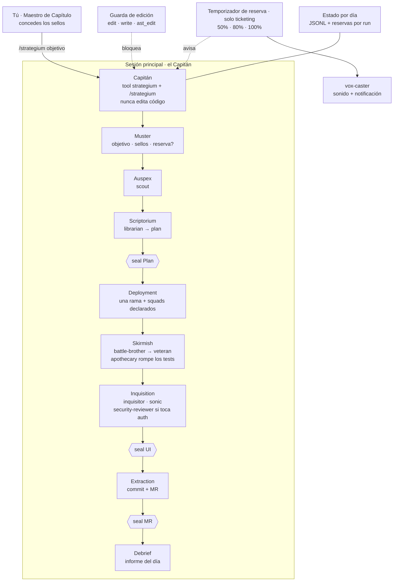

# strategium

> English: [README.md](README.md)

**Strategium** es un workflow orquestador para omp. La sesión principal planifica y delega, los agentes especializados construyen y revisan, y tú conservas los sellos. Trabaja cualquier objetivo: texto libre, un fichero de spec o de plan, o un ticket. **El ticketing es opcional**, y con él viene un temporizador de reserva.

Este es un plugin de **omp**: se instala, se actualiza y se ejecuta con omp, y no apunta a ningún otro agente de programación.

El plugin trae tres cosas:

| Parte | Qué es |
|---|---|
| **Extensión** | el tool `strategium` y el comando `/strategium`: reserva de la run por sesión, bloqueo de edición, temporizador de reserva opcional |
| **Agentes** | `battle-brother`, `veteran`, `librarian`, `apothecary`, `inquisitor`, `archmagos`, más los incluidos `scout` y `sonic` |
| **Skills** | `strategium`, `strategium-alarm`, `strategium-setup`, `strategium-study`, `strategium-ui` |

## Cómo funciona una run

La sesión principal es el **Capitán**: nunca edita código de producto. Planifica, delega y custodia los sellos. Tú eres el **Maestro de Capítulo**: solo tú concedes un sello (Plan, UI, MR, Commit).

```
Muster → Auspex → Scriptorium → Deployment → Skirmish → Inquisition → Extraction
```

1. **Muster** — el objetivo, los sellos y, con ticketing, la reserva.
2. **Auspex** — los scouts mapean el código que toca el objetivo.
3. **Scriptorium** — un librarian escribe una especificación, de 1 a 5 squads y una Merge bar; cuando el objetivo se divide en áreas, un librarian por área y después un líder une las partes (con el Archmagos Dominus marcado en Muster, un `archmagos` integra las partes en lugar del líder).
4. **Deployment** — una rama para la run, los squads declarados con sus ficheros; cada agente aislado trabaja en su propio checkout de omp.
5. **Skirmish** — un `battle-brother` implementa cada squad con los tests primero; un `apothecary` intenta romper los tests nuevos, solo en squads con lógica nueva y dentro de un presupuesto fijo.
6. **Inquisition** — un `inquisitor` revisa el diff contra la Merge bar; un `sonic` ejecuta las comprobaciones del repo.
7. **Extraction** — el commit y la merge request, después de tu sello.



Los nombres de estación, los nombres de agente y las alertas tienen su propia voz; el `archmagos` la usa solo en el chat y el todo, nunca en el fichero del plan. Los tickets, los mensajes de commit y las merge requests se quedan planos y profesionales.

### Volver atrás

Una run vuelve atrás en vez de avanzar, y cada vuelta tiene un detonante, un destino y un presupuesto. Cuando el presupuesto se agota, la run se para y te enseña lo que queda abierto.

| Vuelta | Detonante | Destino | Presupuesto |
|---|---|---|---|
| **Recon** | el mapa del código está equivocado | un `scout` más con ese hueco concreto | 1 por run |
| **Redraft** | el plan está equivocado, o el check de un squad no se puede cumplir tal cual está escrito | el mismo `librarian` reescribe el trabajo restante (con áreas, solo el área afectada, y el líder vuelve a unir; en una run marcada para el Archmagos Dominus, un `archmagos` nuevo vuelve a integrar solo esa área) | 1 por run |
| **Rally** | el código está equivocado: check rojo, supervivientes del apothecary, hallazgos BLOCKING | un `battle-brother` de reparación con todos los IDs de hallazgos abiertos en un solo brief, nunca el informe anterior | 2 rondas por squad, luego un `veteran` |
| **Retrial** | el código reparado necesita otra mirada | el `inquisitor` otra vez, solo sobre los IDs de hallazgos abiertos y el rango del arreglo, y luego `sonic` para los checks | 2 rondas por item del Merge bar |
| **Stand down** | se agotó el presupuesto, o el fallo no está en el código | tú, con los puntos abiertos | — |

Si el código puede cumplir el check del squad tal como está escrito, es un rally; si no puede, el squad se cortó mal y es un redraft. Una vuelta que pasa por delante de un sello ya concedido rompe el sello y hay que pedirlo otra vez. Lo que ya pasó, sigue pasado.

## Instalación

**Como plugin de marketplace:**

```
/marketplace add frandev94/strategium
/marketplace install strategium@strategium
```

Desde la shell: `omp plugin marketplace add frandev94/strategium` y `omp plugin install strategium@strategium`.

**Enlazado desde una copia local:**

```
omp plugin link /ruta/al/strategium
```

Luego, en una sesión nueva, ejecuta `/skill:strategium-setup`. Comprueba el plugin, sus dependencias, las herramientas y la configuración, y devuelve una tabla de lo que hizo. Reinicia omp después: recargar un plugin dentro de una sesión ya en marcha no monta el tool `strategium`.

### Requisitos

| Necesita | Para qué |
|---|---|
| `bun` | ejecutar el script de la alarma, las alarmas del temporizador y la suite de tests |
| `git` | worktrees, ramas, commits |
| plugin `agent-skills` | las skills que cargan los agentes (`omp plugin marketplace add addyosmani/agent-skills`, luego `omp plugin install agent-skills@addy-agent-skills`) |
| plugin `ponytail` | recomendado, modo de diff mínimo para todos los agentes |
| plugin `obsidian-second-brain` | opcional, teatros que guardan registros en Obsidian |

## Uso

```
/strategium "texto libre" [theatre]   trabaja un objetivo con tus palabras
/strategium @ruta [theatre]           trabaja un fichero de spec o un plan aprobado
/strategium <clave> [theatre]         trabaja un ticket que conoce el teatro, o un nombre corto
/strategium-pause                     para el reloj
/strategium-resume [booked]           continúa (una run con reserva pasa los minutos de hoy en un día nuevo)
/strategium-add <min>                 corrección manual, en negativo para restar
/strategium-status                    todas las runs y su tiempo
/strategium-config [notify on|off | idle <min> | archmagos on|off | cockpit on|off]    ajustes; notify on|off, los minutos de inactividad, archmagos on|off o cockpit on|off para esta sesión
/strategium-cockpit                   abre el cockpit (también Alt+C)
/strategium-end                       cierra la run
```

El texto libre necesita las comillas, para no chocar nunca con un subcomando. Sin ticket, el librarian propone los criterios de aceptación y tú los confirmas en el sello Plan, que no se puede saltar.

Cada sesión es dueña de una run, con una reserva atómica, así que varias sesiones de omp pueden trabajar en objetivos distintos a la vez. Cerrar una sesión pausa su run y libera la reserva; al reabrir esa sesión la recupera y la reanuda sola, salvo que tú la hubieras pausado (`/strategium-pause`, acción `stop`, el stand down). Una run con temporizador en un día nuevo sigue pausada hasta que se da la reserva de hoy. El Capitán no puede editar el repositorio de la run: mientras la run está abierta `edit` y `ast_edit` se ocultan de la sesión principal, `write` está bloqueado dentro del repo de la run y de su carpeta `<repo>-worktrees`, los ejecutores de tests y builds por bash y las escrituras de ficheros por bash están bloqueados (solo pasan las redirecciones a `$TEMP` y `local://`), se rechazan los agentes fuera del plantel de Strategium y se rechazan los battle-brothers hasta que se declaren los squads del plan (`strategium` `slices`; los squads en paralelo no pueden compartir un fichero). Cuando el plan se aprueba en el modo plan de omp, "Approve and execute" abre una sesión nueva y la run se va con ella; un `/new` normal deja la run en su propia sesión.

Pausa por inactividad: cuando ningún agente trabaja y nada espera para ejecutarse, el reloj de la run se pausa tras `STRATEGIUM_IDLE_MIN` minutos de inactividad (3 por defecto), suena el sonido `idle` (con las notificaciones activas) y el pie la muestra pausada. El siguiente turno la reanuda sola; el Capitán no llama a `start`. Una run que pausaste a mano (`/strategium-pause`, acción `stop`, el stand down) nunca se reanuda sola. Una pregunta o una revisión de plan que te espera cuenta como actividad: el reloj sigue corriendo y la alarma `attention` te avisa (con las notificaciones activas). Una run con temporizador en un día nuevo sigue pausada hasta que se da la reserva de hoy.

Pie: la estación se muestra como `<estación> › <tarea>`, donde `<tarea>` es la tarea activa del todo sin su etiqueta de agente, cortada a 32 caracteres con `…`. Un sello mantiene `⏳ seal <nombre>`; un retorno muestra `↩ <estación> › <tarea>`. Durante los pasos 0-2 de Muster aún no existe una run, así que no hay pie; desde `begin` muestra p. ej. `Muster › Begin run and theatre status`.

Cockpit: el widget viene apagado; `/strategium-config cockpit on` (o `STRATEGIUM_COCKPIT=1`) lo enciende para la sesión y `cockpit off` lo quita. Mientras esta sesión tiene una run abierta y el widget está encendido, un widget compacto (hasta 6 líneas) queda sobre el editor con la clave, el reloj, los sellos y las últimas entradas de la crónica. `/strategium-cockpit` (o Alt+C) abre el overlay completo; Esc o `q` lo cierra. Cada caja y su origen: STRATEGOS es la estación y la tarea del todo; LIBRARIAN, APOTHECARY e INQUISITOR son las tareas del todo con esa etiqueta de rol (activa, última completada o en reposo), y la caja LIBRARIAN muestra también las tareas del planificador Archmagos (etiqueta `[archmagos]`); cada caja SQUAD sale de los escuadrones declarados y de los agentes lanzados y devueltos (battle-brother, o ‡ VETERAN tras una escalada). Un sello concedido pasa a ✠ y, con las notificaciones activas, suena el sonido `done`. La crónica vive solo en memoria, así que reiniciar omp la borra. Los colores son truecolor si el terminal lo admite y 256 colores si no. El cockpit no puede mostrar recuentos de tests ni de mutantes: los eventos de los agentes ocurren dentro de subagentes, que el padre no ve. El cockpit dibuja glifos Nerd Font con `STRATEGIUM_GLYPHS=1` y símbolos simples si no, nunca emoji.

### Ticketing (opcional)

Una run lleva **temporizador** cuando su objetivo es un ticket de un teatro, o cuando le das una reserva en Muster. La **reserva** es el presupuesto de tiempo de hoy: el temporizador suena al 50 %, 80 % y 100 % — el umbral más alto que cruza, así que una run que empieza pasado el 50 % va directamente al siguiente. Al 100 % el Capitán hace *stand down*: deja de lanzar agentes e informa de lo que está hecho y de lo que queda. Cada día es su propio turno con su propia reserva.

Una run **sin temporizador** sigue contando su tiempo (`status`, `report`), sin avisos, sin *stand down* y sin turnos.

### Configuración

| Variable | Significado |
|---|---|
| `STRATEGIUM_THEATRE` | teatro por defecto para `/strategium` |
| `STRATEGIUM_ALARM` | comando que se ejecuta cuando suena el temporizador, p. ej. `bun /ruta/al/strategium/alarm/vox.ts`; entrecomilla una ruta con espacios (`bun "C:/mis herramientas/vox.ts"`) |
| `STRATEGIUM_STATE_DIR` | dónde vive el estado de las sesiones (por defecto `~/.omp/agent/state/strategium`) |
| `STRATEGIUM_GLYPHS` | `1` para usar glifos de Nerd Font en lugar de emoji |
| `STRATEGIUM_NOTIFY` | `1` activa los sonidos y las notificaciones de escritorio; apagado por defecto; `/strategium-config notify on` u `off` lo cambia para la sesión |
| `STRATEGIUM_IDLE_MIN` | minutos enteros sin trabajo antes de pausar el reloj de la run; por defecto `3`, `0` lo desactiva; `/strategium-config idle <min>` lo cambia para la sesión |
| `STRATEGIUM_COCKPIT` | `1` muestra el widget sobre el editor mientras hay una run abierta; apagado por defecto; `/strategium-config cockpit on` u `off` lo cambia para la sesión; Alt+C abre el overlay en ambos casos |
| `STRATEGIUM_ARCHMAGOS` | `1` deja que una run marque al Archmagos Dominus en Muster; apagado por defecto; `/strategium-config archmagos on` u `off` lo cambia para la sesión |

`/strategium-config` muestra los valores efectivos: el aviso, los minutos de inactividad, el ajuste del archmagos y el del cockpit, cada uno con su origen, el teatro, la alarma, los glifos y el directorio de estado.

El estado (un JSONL por día más las reservas de las runs) vive fuera del repositorio, así que nunca se commitean datos de sesión.

### La alarma

`alarm/vox.ts` sintetiza cada sonido desde cero: sin muestras y sin dependencias. Los niveles son `50`, `80`, `100`, `done` (también el sonido de un sello concedido en el cockpit), `attention`, `idle` (un sonido corto de espera cuando el reloj se pausa por inactividad) y `theme` (15 s, suena cuando termina la run de la sesión, o a mano: `bun alarm/vox.ts theme`); con mensaje, además, levanta una notificación de escritorio (toast de Windows, notificación de macOS, `notify-send` en Linux).

```
bun alarm/vox.ts 100 "la reserva se ha agotado"
```

### Los teatros

Un teatro es una skill `strategium-<nombre>` que ata la run a tu organización: dónde están los tickets, cómo se reserva el tiempo, cómo se escriben las merge requests y qué registros se guardan. Sin teatro no se sube nada: la entrega es la rama con sus commits.

## Desarrollo

```
bun run check                     # TypeScript estricto sobre la extensión
bun test                          # temporizador, reservas entre procesos, la extensión con un host falso, WAV de la alarma
```

```
extensions/strategium/            la extensión (tool, comando, temporizador, bloqueo de edición)
extensions/strategium/timer.ts    ficheros del día, reservas, tiempo transcurrido
alarm/                            el vox-caster y sus tests
agents/                           definiciones de agente
skills/                           las skills
```

La extensión es TypeScript puro y sin dependencias en tiempo de ejecución; `bun` solo hace falta para ejecutarla y para correr los tests.

## Licencia

MIT
