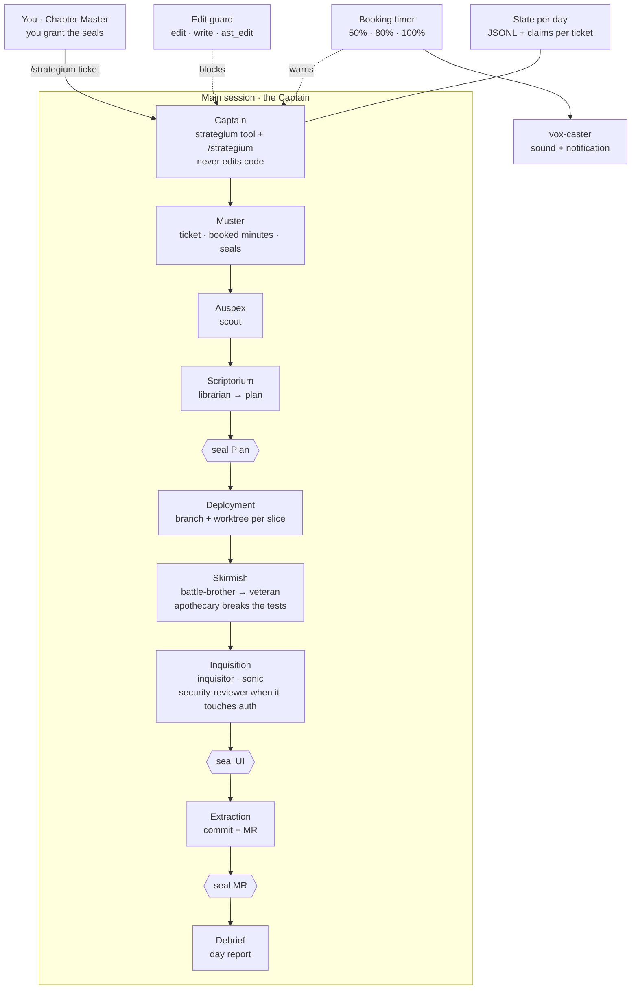

# strategium

> Español: [README.es.md](README.es.md)

Turn an omp session into a **Strategium**: the main session plans and delegates, specialised agents build and review, and you keep the seals.

This is an **omp** plugin: it is installed, updated and run with omp, and it targets no other coding agent.

The plugin ships three things:

| Part | What it is |
|---|---|
| **Extension** | the `strategium` tool and the `/strategium` command: booking timer, per-session ticket claims, edit guard |
| **Agents** | `battle-brother`, `veteran`, `librarian`, `apothecary`, `inquisitor`, plus the bundled `scout` and `sonic` |
| **Skills** | `strategium`, `strategium-alarm`, `strategium-setup`, `strategium-study`, `strategium-ui` |

## How a run works

The main session is the **Captain**: it never edits product code. It plans, delegates, guards the seals and keeps the clock. You are the **Chapter Master**: only you grant a seal (Plan, UI, MR, Commit).

```
Muster → Auspex → Scriptorium → Deployment → Skirmish → Inquisition → Extraction
```

1. **Muster** — the ticket, the booked minutes and the seals.
2. **Auspex** — scouts map the code the ticket touches.
3. **Scriptorium** — the librarian writes a spec, 1–5 slices and a Merge bar.
4. **Deployment** — one branch per slice, one worktree per parallel slice.
5. **Skirmish** — a `battle-brother` implements each slice test-first; an `apothecary` tries to break the new tests.
6. **Inquisition** — an `inquisitor` reviews the diff against the Merge bar; a `sonic` runs the repo's checks.
7. **Extraction** — the commit and the merge request, after your seal.



Station names, agent names and alerts have their own voice. Tickets, commit messages and merge requests stay plain and professional.

### Going back

A run goes back instead of forward, and every return has a trigger, a target and a budget. When the budget is spent, the run stops and shows you what is open.

| Return | Trigger | Target | Budget |
|---|---|---|---|
| **Recon** | the map of the code is wrong | one more `scout` with that exact gap | 1 per run |
| **Redraft** | the plan is wrong, or a slice's acceptance check cannot be satisfied as written | the same `librarian` redrafts the remaining work | 1 per run |
| **Rally** | the code is wrong: check red, apothecary survivors, BLOCKING findings | a `battle-brother` fix run with the failure report | 2 rounds per slice, then one `veteran` run |
| **Retrial** | the fixed code needs a new look | the `inquisitor` again | 2 rounds per Merge bar item |
| **Stand down** | the budget is spent, or the failure is not in the code | you, with the open items | — |

If the code can satisfy the slice's check as written, it is a rally; if it cannot, the slice was cut wrong and it is a redraft. A return past a granted seal breaks the seal, and it is asked for again. What already passed stays passed.

## Install

**As a marketplace plugin:**

```
/marketplace add frandev94/strategium
/marketplace install strategium@strategium
```

From the shell: `omp plugin marketplace add frandev94/strategium` and `omp plugin install strategium@strategium`.

**Linked from a local checkout:**

```
omp plugin link /path/to/strategium
```

Then, in a fresh session, run `/skill:strategium-setup`. It checks the plugin, its dependencies, the tools and the configuration, and prints a table of what it did. Restart omp afterwards: a plugin reload inside a running session does not mount the `strategium` tool.

### Requirements

| Needs | Why |
|---|---|
| `bun` | runs the alarm script, the timer alarms and the test suite |
| `git` | worktrees, branches, commits |
| `agent-skills` plugin | the skills the agents autoload (`omp plugin marketplace add addyosmani/agent-skills`, then `omp plugin install agent-skills@addy-agent-skills`) |
| `ponytail` plugin | recommended, smallest-diff mode for every agent |
| `obsidian-second-brain` plugin | optional, theatres that keep records in Obsidian |

## Usage

```
/strategium <ticket> [theatre]   start a run
/strategium pause                stop the clock
/strategium resume [booked]      continue (pass today's booked minutes on a new day)
/strategium add <min>            manual correction, negative to subtract
/strategium status               every run and its timer
/strategium end                  close the run
```

The **booking** is the time budget of the ticket. The timer fires at 50 %, 80 % and 100 % of it — the highest threshold it crosses, so a run that starts past 50 % goes straight to the next one. At 100 % the Captain stops starting agents and reports what is done and what is left.

Every session owns one ticket, claimed atomically, so several omp sessions can work on different tickets at the same time. The Captain cannot edit the ticket's repository: `edit` and `write` are blocked inside the run's repo and its `<repo>-worktrees` folder, and `ast_edit` is blocked for the whole session while the run is open.

### Configuration

| Variable | Meaning |
|---|---|
| `STRATEGIUM_THEATRE` | default theatre for `/strategium` |
| `STRATEGIUM_ALARM` | command run when the timer fires, e.g. `bun /path/to/strategium/alarm/vox.ts`; quote a path with spaces (`bun "C:/my tools/vox.ts"`) |
| `STRATEGIUM_STATE_DIR` | where the session state lives (default `~/.omp/agent/state/strategium`) |
| `STRATEGIUM_GLYPHS` | `1` to use Nerd Font glyphs instead of emoji |

The state (one JSONL per day plus the ticket claims) stays outside the repository, so no session data is ever committed.

### The alarm

`alarm/vox.ts` synthesises every sound from scratch: no samples, no dependencies. Levels are `50`, `80`, `100`, `done` and `attention`; with a message it also raises a desktop notification (Windows toast, macOS notification, Linux `notify-send`).

```
bun alarm/vox.ts 100 "the booking is over"
```

### Theatres

A theatre is a `strategium-<name>` skill that binds the run to your organisation: where the tickets live, how the time is booked, how the merge requests are written, which records are kept. Without a theatre the Captain asks you for the booked minutes and the acceptance criteria and stops after the UI seal.

## Development

```
bun test                          # 28 tests: timer, claims across processes, alarm WAVs
```

```
extensions/strategium/            the extension (tool, command, timer, edit guard)
extensions/strategium/timer.ts    day files, claims, elapsed time
alarm/                            the vox-caster and its tests
agents/                           agent definitions
skills/                           the skills
```

The extension is plain TypeScript with no runtime dependencies; `bun` is only needed to run it and to run the tests.

## License

MIT
