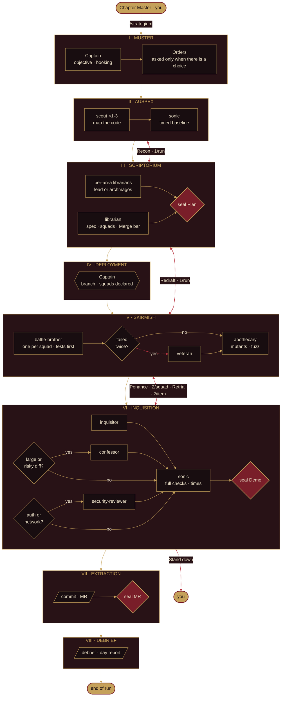

<h1 align="center">
  <picture>
    <source media="(prefers-color-scheme: dark)" srcset="docs/banner-dark.svg">
    
  </picture>
</h1>

<p align="center">
  <a href="https://github.com/frandev94/strategium/releases"></a>
  <a href="https://omp.sh/"></a>
  <a href="LICENSE"></a>
</p>

<p align="center"><em>“A seal granted is a seal defended.”</em><br><sub>— thought for the day</sub></p>

<p align="center">Español: <a href="README.es.md">README.es.md</a></p>

**Strategium** is an orchestrator workflow for omp. The main session plans and delegates, specialised agents build and review, and you keep the seals. It works any objective: free text, a spec or plan file, or a ticket. **Ticketing is optional**, and with it comes a booking timer.

This is an **omp** plugin: it is installed, updated and run with omp, and it targets no other coding agent.

The plugin ships three things:

| Part | What it is |
|---|---|
| **Extension** | the `strategium` tool and the `/strategium` command: per-session claims, edit guard, optional booking timer |
| **Agents** | `battle-brother`, `veteran`, `librarian`, `apothecary`, `inquisitor`, `confessor`, `archmagos`, plus the bundled `scout` and `sonic` |
| **Skills** | `strategium`, `strategium-alarm`, `strategium-github`, `strategium-release`, `strategium-setup`, `strategium-study`, `strategium-ui` |

## How a run works

The main session is the **Captain**: it never edits product code. It plans, delegates and guards the seals. You are the **Chapter Master**: only you grant a seal (Plan, Demo, MR, Commit, Review & merge).

```
Muster → Auspex → Scriptorium → Deployment → Skirmish → Inquisition → Extraction
```

1. **Muster** — the objective and the orders: Plan by default, Demo and MR when they apply (Demo when the objective has something to see running: a screen, an HTTP API, a DLL loaded by a host), and with ticketing the booking. You are asked only when there is a choice (a booking, a Demo or MR toggle, `Review & merge`, a theatre field or the Archmagos box); otherwise the run takes the defaults and goes straight to Auspex.
2. **Auspex** — scouts map the code the objective touches and the repo's check tiers (fast, squad, full); a `sonic` times the full checks on `main` as the baseline and marks a failure that passes on one rerun as flaky.
3. **Scriptorium** — one librarian writes a spec, 1–5 squads and a Merge bar; when the objective splits into areas, one librarian per area, then a lead merges the parts (with the Archmagos Dominus marked in Muster, an `archmagos` integrates the parts instead of the lead).
4. **Deployment** — one branch for the run, the squads declared with their files; each isolated agent works in its own omp checkout.
5. **Skirmish** — a `battle-brother` implements each squad test-first with the fast and squad check tiers (the full checks stay with `sonic`); an `apothecary` tries to break the new tests, only on squads with new logic and within a fixed budget.
6. **Inquisition** — an `inquisitor` reviews the diff against the Merge bar and checks that every deleted or weakened test is still covered by another, and a `confessor` of another model family (when available) joins when the plan flags the diff as large or risky, or in the Review & merge loop; a `sonic` runs the repo's full checks and reports their times next to the baseline's.
7. **Extraction** — the commit and the merge request, after your seal. With the optional `Review & merge` seal, a fresh inquisitor and confessor review the PR once CI is green, for at most 2 rounds, and a clean review ends in the merge.



Station names, agent names and alerts have their own voice; the `archmagos` speaks in that voice only in chat and todo, never in the plan file. Tickets, commit messages and merge requests stay plain and professional.

### Going back

A run goes back instead of forward, and every return has a trigger, a target and a budget. When the budget is spent, the run stops and shows you what is open. The red arrows in the diagram above show the returns; the table gives the detail.

| Return | Trigger | Target | Budget |
|---|---|---|---|
| **Recon** | the map of the code is wrong | one more `scout` with that exact gap | 1 per run |
| **Redraft** | the plan is wrong, or a squad's acceptance check cannot be satisfied as written, or you reject the plan at seal Plan | back to Auspex first: one or two scouts refresh the map with what changed (a `## Redraft` section, never a full sweep). Then the same `librarian` re-plans the remaining work (with areas, only the affected area, then the lead merges again; on a run marked for the Archmagos Dominus, one new `archmagos` re-integrates only that area), and seal Plan is asked again | 1 per run |
| **Penance** | the code is wrong: check red, apothecary survivors or fuzz crashes, BLOCKING findings | a `battle-brother` fix run with every open finding ID in one brief, never the previous report; it first reproduces each finding, and one it cannot reproduce comes back NOT REPRODUCED | 2 rounds per squad, then one `veteran` run |
| **Retrial** | the fixed code needs a new look | the `inquisitor` again (the `confessor` re-checks its own IDs) on the open finding IDs and the fix range only, then `sonic` for the full checks | 2 rounds per Merge bar item |
| **Stand down** | the budget is spent, or the failure is not in the code | you, with the open items | — |

If the code can satisfy the squad's check as written, it is a penance; if it cannot, the squad was cut wrong and it is a redraft. A return past a granted seal breaks the seal (except the Review & merge loop), and it is asked for again. What already passed stays passed.

### The agents

The Captain plans and delegates; every other role is an agent it starts. Each one has a single job and a hard limit.

| Agent | Station | What it does | Never | Model / effort |
|---|---|---|---|---|
|  **Captain** (main session) | all | plans, delegates, guards the seals, commits | edits product code | your session's model |
|  `scout` | Auspex | maps the code the objective touches; 1–3 at once, each with its own focus | writes files or runs bash | `@smol` / medium |
|  `librarian` | Scriptorium | writes the spec, the squads and the Merge bar; one per area when the objective splits, then a lead merges | edits repository files | `@plan` / high |
|  `archmagos` | Scriptorium | integrates the area plans into one, checking every assumption against the source; only when marked in Muster | edits, writes or starts agents | `@plan` / xhigh |
|  `battle-brother` | Skirmish | builds one squad test-first with the fast and squad check tiers and reports red/green evidence | commits, touches files outside its squad or runs the full checks | its squad's [tier](#tiers) |
|  `veteran` | Skirmish | rebuilds a squad that failed twice, after finding why | commits or runs the full checks | heavy tier (`@slow:high`); escalation only |
|  `apothecary` | Skirmish | mutates the squad's changed lines and fuzzes untrusted input, to show where the tests do not protect the code | edits the tests under audit, or leaves the tree changed | `@task` / medium |
|  `inquisitor` | Inquisition | reviews the diff against the Merge bar and every deleted or weakened test; a PASS needs file:line or command evidence | edits, commits or pushes | `@slow` / high |
|  `confessor` | Inquisition | a second, independent review by another model family, when the plan flags the diff as large or risky, or in the Review & merge loop | reads the inquisitor's report | gpt-6-astra (else `@task`) / high |
|  `security-reviewer` | Inquisition | joins when the diff touches auth, external input, secrets or the network | edits | bundled, your session's model |
|  `sonic` | Auspex, Inquisition | runs the repo's full checks: the timed baseline first (a failure that passes on one rerun is flaky), the full checks at the end with their times next to the baseline's | fixes what fails | `@smol` / medium |

#### The Chapter

| Who | Rank | Department or organisation |
|---|---|---|
| You · the Captain (main session) | Chapter Master · Captain | Chapter Command |
| `scout` | Neophyte | 10th Company |
| `librarian` | Librarian (specialist) | Librarius |
| `battle-brother` | Battle-Brother | battle company |
| `veteran` | Battle-Brother (veteran) | 1st Company |
| `apothecary` | Apothecary (specialist) | Apothecarion |
| `task` | none (auxiliary), an Adept | Chapter Serfs (unrelated to the Mechanicus) |
| `sonic` | none (auxiliary), a Servitor | maintained by the Armoury |
| `archmagos` | Archmagos Dominus | Adeptus Mechanicus (external) |
| `inquisitor`, `security-reviewer` | Inquisitorial authority and auditor | Inquisition (external) |
| `confessor` | Confessor | Ecclesiarchy (external) |

The librarian, apothecary, inquisitor, confessor, archmagos and security-reviewer roles, and the `task` Adept, are thematic adaptations of their lore (the notes in [docs/chapter.md](docs/chapter.md) say how). The cockpit themes are colour schemes and change no term here. Rank, department and role are kept apart; the full roster is in [docs/chapter.md](docs/chapter.md). `task` is the omp agent for general delegated work.

#### Models

Agents pick their model through omp's role aliases, so you choose the models once in `~/.omp/agent/config.yml` and Strategium follows. Set the three roles it uses, without a `:level` suffix (a suffix overrides the effort of every agent on that role). A role you leave unset falls back to omp's built-ins: `plan` and `task` to your session's model, `slow` to your `default` (with neither set, to omp's slow list, which can mean the costliest model omp knows):

```yaml
modelRoles:
  plan: anthropic/claude-opus-5-5   # librarian, archmagos
  slow: anthropic/claude-opus-5-5   # inquisitor
  task: anthropic/claude-sonnet-5-5 # apothecary, confessor without Codex; standard tier
```

The effort each agent asks for is in the table above. To move a single agent to another model, use `task.agentModelOverrides`, e.g. `inquisitor: anthropic/claude-sonnet-5-5`. During a run, `battle-brother` and `veteran` follow `STRATEGIUM_TIERS` instead: the hook's model replaces that override. The full recommended config and its reasons: [docs/models.md](docs/models.md); `/skill:strategium-setup` checks your roles against it.

#### Tiers

The plan gives every squad a cost tier with a one-line reason, and the plugin runs each `battle-brother` on its squad's tier, so one parallel batch can mix tiers. A tier is an omp model selector; its `:level` suffix sets the effort and beats the agent's own `thinkingLevel`.

| Tier | Default selector | For |
|---|---|---|
| `light` | `@smol:medium` | docs, prompts, renames, fixtures, mechanical edits with a clear check |
| `standard` | `@task:medium` | ordinary code with tests (the default for a squad with no tier) |
| `heavy` | `@slow:high` | concurrency, security, parsers, CI workflows holding write tokens, code without tests, anything irreversible |

Seal Plan shows each squad's tier and a rough estimate (relative cost 1 / 3 / 10, about 5 / 10 / 20 minutes per squad, from the table in the skill), and you can change a tier there (`S2 heavy`) without a redraft. A squad whose builder failed gets its penance one tier up (heavy stays heavy, then the `veteran`); the reviewers keep their own tiers. Set `STRATEGIUM_TIERS` to change the selectors, and set the `smol` role, which `light` needs: see [docs/models.md](docs/models.md).

## Install

Strategium runs inside [omp](https://omp.sh/), our coding agent: install omp first.

**Let an agent do it:** paste this prompt into any coding agent with shell access. It installs omp when it is missing, then the plugin.

```text
Set up omp (https://omp.sh/) with the Strategium plugin on this machine.

1. Run `omp --version`. If omp is not found, install it:
   - macOS / Linux: curl -fsSL https://omp.sh/install | sh
   - Windows (PowerShell): irm https://omp.sh/install.ps1 | iex
   If `omp` is still not on PATH, open a new shell and try again. Stop and report if it still fails.
2. Run `git --version` and `bun --version`. If one is missing, tell me with its official install command; do not install it without asking.
3. Install the plugins (if one is already there, keep it and move on):
   omp plugin marketplace add addyosmani/agent-skills
   omp plugin install agent-skills@addy-agent-skills
   omp plugin marketplace add frandev94/strategium
   omp plugin install strategium@strategium
4. Verify with `omp plugin list` and `omp plugin doctor`.
5. Report a table: step, result, and the error output of any failure. Then tell me to open a fresh omp session and run /skill:strategium-setup.

Change no other omp settings, and do not remove or upgrade anything already installed.
```

**As a marketplace plugin:**

```
/marketplace add frandev94/strategium
/marketplace install strategium@strategium
```

From the shell: `omp plugin marketplace add frandev94/strategium` and `omp plugin install strategium@strategium`.

**Linked from a local checkout:**

```
omp plugin link /path/to/strategium
```

Then, in a fresh session, run `/skill:strategium-setup`. It checks the plugin, its dependencies, the tools and the configuration, and prints a table of what it did. omp 19 does not load a linked plugin's `rules/` into sessions, so the skill reads them from `rules/` itself.

> [!IMPORTANT]
> Restart omp afterwards: a plugin reload inside a running session does not mount the `strategium` tool.

### Requirements

| Needs | Why |
|---|---|
| `bun` | runs the alarm script, the timer alarms and the test suite |
| `git` | worktrees, branches, commits |
| `agent-skills` plugin | the skills the agents autoload (`omp plugin marketplace add addyosmani/agent-skills`, then `omp plugin install agent-skills@addy-agent-skills`) |
| `ponytail` plugin | recommended, smallest-diff mode for every agent |
| `obsidian-second-brain` plugin | optional, theatres that keep records in Obsidian |

## Usage

```
/strategium "free text" [theatre]   work an objective in your words
/strategium @path [theatre]         work a spec or an approved plan file
/strategium <key> [theatre]         work a ticket the theatre knows, or a short name
/strategium-pause                   stop the clock
/strategium-resume [booked]         continue (a timed run passes today's booked minutes on a new day)
/strategium-add <min>               manual correction, negative to subtract
/strategium-status                  every run and its time
/strategium-config [notify on|off | sound on|off | toast on|off | volume <0-100> [preview] | idle <min> | archmagos on|off | commit on|off | cockpit-key <key> | cockpit-theme <name>|default | relic on|off|default | caster on|off|default | names on|off|default]  show the effective settings; notify, sound or toast on|off, the alarm's volume (preview plays it at that volume), the idle minutes, archmagos or commit on|off for this session; cockpit-key <key> sets the cockpit key from the next omp start; cockpit-theme <name> sets the cockpit theme and applies it at once; relic on|off|default saves the worn relic look of the cockpit and applies it at once; caster on|off|default saves the cockpit caster switch and applies it at once; names on|off|default saves the agent names switch
/strategium-cockpit                 open the cockpit (also Alt+C, or the key set with cockpit-key)
/strategium-end                     close the run and write its debrief
```

Free text needs the quotes, so it never clashes with a subcommand. Without a ticket, the librarian proposes the acceptance criteria and you confirm them at seal Plan, which cannot be skipped. The command begins the run at once, untimed, under a KEY taken from the objective (a key as given, a file's base name, or the free text's first words in kebab-case).

Every session owns one run, claimed atomically, so several omp sessions can work on different objectives at the same time. Closing a session pauses its run and releases the claim; reopening that session takes it back and resumes it on its own, unless you had paused it (`/strategium-pause`, action `stop`, the stand down). A timed run on a new day stays paused until today's booking is given. A run still counting at midnight goes on: its block ends at 00:00 in yesterday's day file and a new one starts at 00:00 today, so `status`, `report` and the footer keep counting; a timed run counts there without a booking and without the 50/80/100 alerts (footer `<elapsed> min · new day: /strategium-resume <min>`) until `/strategium-resume <min>` gives today's. The Captain cannot edit the run's repository: from `begin`, `edit` and `ast_edit` are hidden from the main session and agents outside the Strategium roster are refused; once `strategium repo` arms the guard, `ast_edit` and `write` are blocked inside the run's repo and its `<repo>-worktrees` folder, bash test and build runners and bash file writes are blocked (only redirects into `$TEMP`, `$TMP`, `$TMPDIR`, `%TEMP%`, `/tmp/`, `local://`, `out://`, `/dev/null` and file descriptors pass), and battle-brothers are refused until the plan's squads are declared (`strategium` `slices`; parallel squads must not share a file). In omp's plan mode the run walks the same stations, but its todo holds only the ones that can run there: Muster (Orders without the Plan box), Auspex and Scriptorium, with the squads declared before `xd://propose`. The proposed plan opens with the stations already done and lists only what the approval starts. "Approve and execute" opens a fresh session and the run moves with it (booking, Archmagos mark and squads included); its todo holds Deployment onwards and starts at Deployment's first task. A plain `/new` leaves the run with its own session.

The debrief: `end` (and `/strategium-end`) writes the run's report to `<state dir>/debriefs/<key, sanitised>-<8-hex>-<YYYY-MM-DDTHH-MM-SS>.md`, which stays after the run ends, and returns its path plus a short summary in chat (time, seals, spawns, cost). Its sections are time per station (active and paused minutes, adding up to the run's total), seals (asked, granted, wait), squads (builder runs, penances, veteran runs, last result, state) and agents spawned per role and the model requested (the selector Strategium asked of the host; the host may run another, so that column is not exact); every other number outside the Cost section is exact, read from the plugin's own records, and survive an omp restart. The Cost section lists, per agent, its tokens in, tokens out, cache and cost; per role, the agents, the cost and a bar comparing roles; and the run total. On a timed run it adds the cost per booked hour (the total over the minutes booked), and the chat summary gets a `COST` line. The figures are omp's list-price estimates: each agent's own spend as omp prices it, without its nested subagents', computed as omp's agent view computes it (tokens include nested subagents; cost does not). Agents only: the Captain's own session is not included, so the totals row reads `Total (agents)` and the chat line `COST (agents, list price)`; a run that used the cockpit caster adds a `caster` row (its squad cell reads `N calls` and the model the alias resolved to, e.g. `3 calls · <model id>`; tokens as an agent counts them, input only with cache apart; and its cost), the totals row then reads `Total (agents and caster)` with `N + caster` in the Agents column, and the note reads "Agents and the cockpit caster only". A subscription plan pays differently. `?` means unknown (no usage recorded, or a model with no price in omp), never 0, and a total with unknown agents reads `$x + ?`. The Captain passes the numbers the agents reported in the optional `reported` parameter of `end` (`apothecary`: `killed`, `survived`, `crashes`; `review`: `pass`, `fail`, `opened`, `fixed`, `not_reproduced`); they show only in the `Apothecary (reported)` and `Review (reported)` sections, or as `Not reported.`. It then copies the file next to the run's other files with `cat "<path>" > local://<KEY>-debrief.md`.

<details>
<summary><strong>Idle pause, footer and cockpit</strong></summary>

Idle pause: when no agent works and nothing waits to run, the run's clock pauses after `STRATEGIUM_IDLE_MIN` idle minutes (default 3), the `idle` sound plays (with notifications on) and the footer shows it paused. The next turn resumes it on its own; the Captain does not call `start`. A run you paused by hand (`/strategium-pause`, action `stop`, the stand down) never resumes by itself. A question or a plan review waiting for you counts as busy: the clock keeps running and the `attention` alarm calls you (with notifications on). A timed run on a new day stays paused until today's booking is given.

Footer: the station shows as `<station> › <task>`, where `<task>` is the active todo task without its agent tag, cut to 32 characters with `…`. A seal keeps `⏳ seal <name>` with the whole name (`Demo (2)`); a return shows `↩ <station> › <task>`. The footer appears as soon as `/strategium` begins the run (`strategium: <KEY> · <elapsed> min`); once the skeleton's first task is started it shows e.g. `Muster › Objective`, then `Muster › Orders`. A `todo init` that rebuilds a run's todo does not move the footer (omp starts its first task by itself); the next `start` or `done` does. The exception is the hand-off after a plan approval, whose todo (Deployment onwards) replaces the plan-mode stations: the footer moves to its first task at once. When the terminal is wide enough (the footer text plus two spaces and the hint fit the width) the line ends, flush right, with the hint that names the cockpit key (`ALT + C to enter cockpit` by default); narrower, or with an unknown width, there is no hint. The width is read on each footer draw (every minute and on each status change), not on resize.

Cockpit: `/strategium-cockpit` (or Alt+C, or your cockpit key) opens the full-screen overlay (it covers the prompt, the todo list and the transcript until Esc or `q` closes it; it also closes by itself when the agent asks you something, asks to approve a tool or opens a plan review) while this session has a run open: the key, the clock and the seals on top as a chain (`✠ Plan → ○ Demo`, no row when the run has no seals), under them a status line (`▶ AGENT AT WORK` while a turn runs or a background job such as an async subagent, a bash job or an eval job is still running, `○ VOX OPEN · esc to give orders` in gold when the agent has stopped, no job is running and the prompt is free for your orders; a dialog from another extension has no event, so it is not announced), then one station as a title (by default the active one: the first phase with a running todo task, else the first with a waiting one; ←/→ browse the others, see the keys below) (`▶` running, `↶` after a return, `○` waiting; a waiting seal adds `· seal <name> awaits you`), one box per agent type present in it, and the latest chronicle entries. The boxes, in this order, take the todo tasks with that tag and the agents deployed in that station: CAPTAIN, SCOUTS, LIBRARIANS (also `[archmagos]`), BATTLE-BROTHERS (also `[veteran]`), APOTHECARIES, INQUISITOR, SECURITY-REVIEWER, SONIC and ADEPTS (`[task]`). A box shows only when the station has a task or an agent of its type. Each line has its state mark: `▶` running, `✓` done, `○` waiting, `✗` failed; BATTLE-BROTHERS lines carry `†` (or `‡` for a veteran), and add one `squad <id> …` line per declared squad. Lines run `▶`, `✗`, `○`, then `✓`; a box shows at most 8 lines (fewer in a short window, so the chronicle keeps 5 rows) and its last line counts the rest, e.g. `+5 more (3 done, 2 idle)`. Keys: ↑/↓ move a gold `▸` cursor over the box lines and the chronicle entries (nothing is selected when the cockpit opens; the first ↑, ↓ or Tab selects a line, and the cursor follows its line when the run changes); a selected line that a box would hide stays drawn, and the `+k more` row counts the rest; Tab jumps to the first line of the next box; ←/→ show the previous or next station, and the title then reads `<mark> <station> · viewing · active: <active station>`; Home returns to the active station, which the cockpit also does by itself when the run moves to another station. Enter opens the detail of the selected line in place of the boxes and the chronicle: a squad shows its files, `parallel`, tier and the agents that ran it (battle-brother, penances and the veteran) with their results; an agent its role, id, station, elapsed time, state, live status (progress, ETA, intent, signalled line), cost and tokens; a seal the whole panel; a chronicle entry its full text, uncut; a task its text; ↑/↓ scroll a long detail. Enter in an agent detail, or in a squad detail with at least one agent (it opens the squad's newest agent, the last one deployed), opens `TRANSCRIPT <id>` in place of the detail: the agent's own conversation, read-only, from the newest row up (↑/↓ scroll, it follows new entries while the file grows, re-read at most once a second and only when it changed). The rows are `user: <brief>` (the Captain's brief, not you), the assistant's text, `→ <tool> <intent>` for a tool call and `← <tool> ok: <first line>` or `← <tool> error: <first line>` for its result; thinking blocks are never shown. A done or failed agent adds `final answer:` and its answer file, or `no final answer file`. When there is nothing to show, one line says why: `no session file: this session is not saved, so its agents' transcripts are not either`, `<id>: a nested agent; its transcript is not read`, `<id>: not a transcript id`, `no transcript yet: omp writes it after the agent's first reply`, `transcript unreadable: <code>` or `no messages yet`. The title is `TRANSCRIPT <id>` (plus ` · a–b/n` when rows are hidden) and the footer `esc/bksp back · q close · ↑↓ scroll`; the agent and squad details show `enter transcript` in theirs. Only the last 512 KiB of the transcript (plus up to the first 512 KiB of its head, for the brief) and the first 64 KiB of the answer are read (when bytes were skipped, `… earlier entries not shown` leads the rows, under the agent's brief, the first `user` message of the log, looked for in the first 512 KiB, 64 KiB at a time), at most the newest 1000 rows are kept, each row is cut at 400 characters and each text block at 40 lines, control and bidi characters become spaces, and symlinks and other non-regular files are refused. The Enter that opens a transcript is the one keypress that reads a file (that agent's transcript and answer); every other key reads none, an open transcript is looked at again at most once per second and read again only when a file changed, and closing the transcript drops what it read. Backspace or Esc go back one level (from a transcript to the detail it came from, with its scroll), with the cursor on the same line as before. `q` closes the cockpit in one press from any level, and Esc closes it from the top level (so twice from a detail, three times from a transcript), whatever the cursor or the station. On wide terminals the footer lists the keys (`esc/q close · ↑↓ line · ←→ station · tab box · home active · enter open`; in a detail, `esc/bksp back · q close · ↑↓ scroll`). The cursor is not saved: a reopened cockpit starts with no selection on the active station. A granted seal turns ✠ and, with notifications on, plays the `done` sound. While a seal waits, a full-width panel under the station title shows what the Captain prepared for it (the Captain fills it with the `seal` action; without it the panel shows `the details are in the Captain's message`); no panel when nothing waits. The chronicle (newest 200 entries), the list of deployed agents, the squad marks and the seal panel lines are saved with the run, so they survive an omp restart; ending the run clears them; an agent launched from eval stays `▶` until the eval cell that waits for it returns, or until omp delivers its result, then turns `✓` or `✗`. Colours are truecolor when the terminal supports it and 256-colour otherwise. Under each running agent or squad the cockpit draws a row with its elapsed time, its cost (`10m · $0.42 · …`, or `$?` while no usage is known) and, from the agent's own todo list, `done/total · ~ETA · current task`, or else its last intent (the tool name when intent tracing is off); the row follows the agent's own file, so it updates while the parent's turn waits. An agent that has made its first tool call and then has none in flight and none ended for 5 min turns gold with `stalled Nm` and logs one chronicle entry (a long `bun test` is not stalled; a later tool call ends the stall). A subagent can also call `strategium` `signal` (`pct`, `eta_min`, `line`, `blocked`) to write its own row: `line` replaces the current task or intent, `eta_min` the computed ETA and `pct` the `done/total`; `blocked: true` turns the row gold, logs one chronicle entry and rings the `attention` alarm once per block (every transition into blocked rings once); a blocked row with nothing in flight for 5 min is also marked stalled. The Captain learns of a block from the user or from the chronicle entry `blocked: <line>` and can read the agent's progress at `agent://<id>`. The main session cannot call `signal`, and it never names another agent. An eval agent that has no host id, or a subagent in another OS process, shows its elapsed time only. The cockpit still cannot show test or mutant counts. The cockpit draws Nerd Font glyphs with `STRATEGIUM_GLYPHS=1` and plain symbols otherwise, never emoji. The colours come from a theme: `blood-angels` by default (a dark Night background that fills the overlay to its full width), `ultramarines`, `dark-angels`, or `cogitator`, the previous palette on the terminal's own background. `/strategium-config cockpit-theme <name>` saves the choice and applies it at once, with no restart (`cockpit-theme default` deletes the saved choice, so the theme falls back to `STRATEGIUM_COCKPIT_THEME` if set, else `blood-angels`).

Relic look (off by default): `/strategium-config relic on` gives the cockpit a worn techno-relic finish: the border and rule runs get broken stretches and rivets, truecolor terminals add a gold tarnish with faint scanlines, and blank space gets a few scratches. It applies only to the wide layout (72 columns or more), draws nothing over text, and is seeded by the run key, so a redraw never changes it. `relic off` stops it, `relic default` drops the saved choice, and `STRATEGIUM_RELIC` sets it when nothing is saved. With it off the cockpit looks exactly as before.

Agent names (off by default): `/strategium-config names on` makes the plugin hand out a lore name to every agent of the run through the `strategium` tool's `name` action: `BrotherLorenzo` for a squad's first builder, `PenitentLorenzo` for its penance, `VeteranLorenzo` for the veteran, and a title of its own for each other role (see `docs/chapter.md`). A name is unique inside the run, has no digits except a `sonic` servitor's designation, is at most 28 characters and survives an omp restart. With names on, a spawn whose name the plugin did not hand out is refused with the reason naming the action; with names off nothing is refused. `names off` stops it, `names default` drops the saved choice, and `STRATEGIUM_NAMES` sets it when nothing is saved. After a refused spawn omp may show the retried id as `Name-2` (omp's suffix); the plugin maps it back to the name.

Caster (off by default): `/strategium-config caster on` makes a fast model write one or two spoken-style sentences about how the current station is going, drawn in a `CASTER` box between the boxes and the CHRONICLE (below 72 columns, one `caster: …` line under the header; the detail and transcript views hide it). It runs only while the cockpit is open and makes at most one call per interval (`STRATEGIUM_CASTER_EVERY_MIN`, default 1 minute), and only when the station state changed since the last attempt; closing the cockpit aborts the call in flight. The model is an omp role alias (`STRATEGIUM_CASTER_MODEL`, default `@smol`, must start with `@`), so Strategium names no model id. It reads only what the cockpit already holds in memory, the agents' status lines and the chronicle, cleaned of control characters and cut to size; it never reads transcripts, never writes to or asks the agents, and keeps no summary across an omp restart. Its spend (cost at omp's list price, tokens, calls) is summed per run and shows as a `caster` row in the run report; it does not count towards `Spent (min)`. When it has nothing to show, the box holds one dim row: `listening…`, `nothing new`, `no model for <alias>`, `no auth`, `call failed: <reason>` (or plain `call failed` when there is none) or `not a role alias: <value>`. `caster off` stops it, `caster default` drops the saved choice, and `STRATEGIUM_CASTER` sets it when nothing is saved. With it off the cockpit looks exactly as before and no model call is made.

</details>

> [!WARNING]
> A select or confirm dialog that another extension opens while the cockpit is up gets no keys and stays stuck, even after Esc or `q` (omp gives the focus back to the editor), so close the cockpit before running such a command.

> [!TIP]
> With Caps Lock on, Alt+C arrives as Alt+Shift+C (omp's copy prompt) and the cockpit does not open: use `/strategium-cockpit`, or set another key with `/strategium-config cockpit-key <key>` (or `STRATEGIUM_COCKPIT_KEY`), e.g. `f8`, which Caps Lock does not change; a key omp or another extension already holds is reported at start.

### Ticketing (optional)

A run is **timed** when its objective is a ticket of a theatre, or when you give it a booking (in Muster, or later). The **booking** is the time budget for today: the timer fires at 50 %, 80 % and 100 % of it — the highest threshold it crosses, so a run that starts past 50 % goes straight to the next one. At 100 % the Captain stands down: it stops starting agents and reports what is done and what is left. Each day is its own shift with its own booking.

An **untimed** run still counts its time (`status`, `report`), with no alerts, no stand down and no shifts.

### Configuration

| Variable | Meaning |
|---|---|
| `STRATEGIUM_THEATRE` | default theatre for `/strategium`; empty → the GitHub theatre when the run's repo is on GitHub |
| `STRATEGIUM_STATE_DIR` | where the session state lives (default `~/.omp/agent/state/strategium`) |
| `STRATEGIUM_GLYPHS` | `1` to use Nerd Font glyphs instead of emoji |
| `STRATEGIUM_NOTIFY` | `1` turns on the alarm (its sound and desktop notifications, each with its own switch); off by default, and off means neither; `/strategium-config notify on` or `off` overrides it for the session |
| `STRATEGIUM_SOUND` | the alarm's sound; on by default, `0` turns it off (a toast-only alert needs no audio player); `/strategium-config sound on` or `off` overrides it for the session |
| `STRATEGIUM_VOLUME` | the alarm's volume, `0` to `100`; default `20`; `/strategium-config volume <n>` overrides it for the session, `volume <n> preview` (or `volume preview`) also plays it |
| `STRATEGIUM_TOAST` | the desktop notification (Windows toast, macOS notification, `notify-send`); on by default, `0` turns it off; `/strategium-config toast on` or `off` overrides it for the session |
| `STRATEGIUM_IDLE_MIN` | whole minutes without work before the run's clock pauses; default `3`, `0` turns it off; `/strategium-config idle <min>` overrides it for the session |
| `STRATEGIUM_ARCHMAGOS` | `1` lets a run mark the Archmagos Dominus in Muster; off by default; `/strategium-config archmagos on` or `off` overrides it for the session |
| `STRATEGIUM_COMMIT` | `1` gives every run the Commit seal (the Captain asks before each commit); off by default; `/strategium-config commit on` or `off` overrides it for the session |
| `STRATEGIUM_COCKPIT_KEY` | the key that opens the cockpit, e.g. `ctrl+shift+k` or `f8`; it needs `ctrl`, `alt` or `super`, or is `f1`-`f12`, so a bare letter never takes your typing; default `alt+c`; `/strategium-config cockpit-key <key>` saves another for the next omp start and wins over it, `cockpit-key default` drops it |
| `STRATEGIUM_COCKPIT_THEME` | the cockpit theme: `blood-angels` (default), `ultramarines`, `dark-angels` or `cogitator`; it applies only when no theme is saved: `/strategium-config cockpit-theme <name>` saves one, applies it at once and wins over this, `cockpit-theme default` drops it; an unknown value is warned at session start and ignored |
| `STRATEGIUM_RELIC` | `1` turns on the cockpit's worn relic look, `0` turns it off; off by default; it applies only when no choice is saved: `/strategium-config relic on` or `off` saves one and applies it at once and wins over this, `relic default` drops it; any other value is ignored |
| `STRATEGIUM_CASTER` | `1` turns on the cockpit caster (a model summary of the current station), `0` turns it off; off by default; it applies only when no choice is saved: `/strategium-config caster on` or `off` saves one and applies it at once and wins over this, `caster default` drops it; any other value is ignored |
| `STRATEGIUM_CASTER_EVERY_MIN` | minutes between caster calls, a whole number of 1 or more; default `1`; anything else falls back to `1` and `/strategium-config` lists it as ignored |
| `STRATEGIUM_CASTER_MODEL` | the omp role alias the caster uses, default `@smol`; it must start with `@` (a model id is refused with `not a role alias: <value>`) and the role must be set in omp, see `docs/models.md`; the caster's cost goes to the `caster` row of the run report |
| `STRATEGIUM_TIERS` | the selector of each cost tier, `;`-separated `tier=selector` entries, e.g. `light=anthropic/claude-haiku-5-5:low;heavy=@task:high`; a tier you leave out keeps its default (`light=@smol:medium`, `standard=@task:medium`, `heavy=@slow:high`); an unknown tier or an empty selector is ignored and shown by `strategium status` |
| `STRATEGIUM_NAMES` | `1` turns on the agent names (the `strategium name` action and the spawn guard that refuses a name the plugin did not hand out), `0` turns them off; off by default; it applies only when no choice is saved: `/strategium-config names on` or `off` saves one and wins over this, `names default` drops it; any other value is ignored |

`/strategium-config` shows the effective values: the notify, sound, volume and toast settings, the idle minutes, the archmagos setting, the commit setting, the cockpit key, the cockpit theme (`cockpit-theme: <name> (<source>)`), the relic look (`relic: on|off (<source>)`), the agent names (`names: on|off (<source>)`) and the caster (`caster: on|off (<source>) · model <alias> [→ <model id> once resolved] · every <n> min`, plus any ignored `STRATEGIUM_CASTER*` value), each with its source, the theatre, the glyphs and the state directory.

The state (one JSONL per day plus the run claims) stays outside the repository, so no session data is ever committed.

### The alarm

`alarm/vox.ts` synthesises every sound from scratch: no samples, no dependencies, all original and under the project's MIT licence. They share one grimdark kit at 100 bpm in C minor (war drums with a double kick, drop-C guitar and bass, choir, brass, bell). Levels are `50`, `80`, `100` (the guitar chugs tighten from one to the next), `done` (also the sound of a seal granted in the cockpit), `attention`, `idle` (a quieter stand-by sound when the clock pauses after idle) and `theme` (four bars, 9.6 s, that loop without a seam: a guitar riff with the bass and the double kick locked to it, under the choir; plays when the session's run ends, or by hand: `bun alarm/vox.ts theme`); with a message it also raises a desktop notification (Windows toast, macOS notification, Linux `notify-send`); `STRATEGIUM_SOUND=0` skips the sound and `STRATEGIUM_VOLUME` (`0` to `100`, default `20`) sets its volume. With notifications on, the plugin plays its own bundled `alarm/vox.ts` at 50/80/100 % of a booking, on `attention` (an `ask`, a waiting plan review, the Captain's `attention` call, a pause after a silent gap), on the `idle` pause, `done` when a seal is granted and `theme` when the run ends. Nothing chooses the command: only the toggles notify, sound, toast (and volume) exist. A vox run that exits non-zero is reported once per session.

```
bun alarm/vox.ts 100 "the booking is over"
```

### Theatres

A theatre is a `strategium-<name>` skill that binds the run to your organisation: where the tickets live, how the time is booked, how the merge requests are written, which records are kept. Without a theatre nothing is pushed: the delivery is the branch with its commits.

The plugin ships the **GitHub theatre** (`strategium-github`): the issue is the ticket (created in Muster when the objective is free text or a file), a Project gives the status, and the issue fields `Booked (min)` and `Spent (min)` (or Project fields of the same name when the issue fields do not exist) give the booking. The issue gets one comment from the run, a summary of the pull request. The delivery is a draft pull request that closes the issue on merge (with `Review & merge`, the theatre merges it after a clean review); it is not added to the Project, because it shows on the issue's card. Moving the card to Done on merge needs the Project's "Item closed" workflow, and Muster warns when it is off. It is the default: when the run's repo is on GitHub, the run uses it unless another theatre is named, `STRATEGIUM_THEATRE` names one, or you say `none`.

## Development

```
bun run check                     # strict TypeScript over the extension
bun test                          # timer, claims across processes, the extension through a fake host, alarm WAVs
```

On pull requests that touch `extensions/`, `tools/tui-shot/`, `skills/strategium/todo.ts` and `alarm/` (both imported by the cockpit), `package.json`/`bun.lock` (the omp pin) or the workflow itself, `.github/workflows/tui-shot.yml` also runs the real-omp tui-shot replays on Windows (`bun tools/tui-shot/shot.ts --all --no-png`), with omp from the pinned devDependency.

```
extensions/strategium/            the extension (tool, command, timer, edit guard)
extensions/strategium/timer.ts    day files, claims, elapsed time
alarm/                            the vox-caster and its tests
agents/                           agent definitions
skills/                           the skills
rules/                            the run's rules, which the Captain reads at the start of a run
```

The extension is plain TypeScript with no runtime dependencies; `bun` is only needed to run it and to run the tests. The README's banner, badges, diagram and icons follow a Blood Angels palette: [docs/style.md](docs/style.md).

Releases are automatic: a merge to `main` that changes `extensions/`, `skills/`, `agents/`, `alarm/`, `rules/` or `.omp-plugin/` (test files excluded) runs `.github/workflows/release.yml`. Conventional commits set the version (while 0.x, a breaking change, marked with `!` or a `BREAKING CHANGE:` footer, bumps the minor and any other conventional commit the patch; non-conventional commits bump nothing and stay out of the changelog). Merges that only touch docs, tests or dev tooling release nothing; their commits ride along in the next release's changelog. To release by hand, use the `strategium-release` skill.

## License

MIT

Strategium is an unofficial fan work inspired by Warhammer 40,000. Warhammer 40,000, Blood Angels and related names are trademarks of Games Workshop Limited; this project is not affiliated with or endorsed by Games Workshop.
