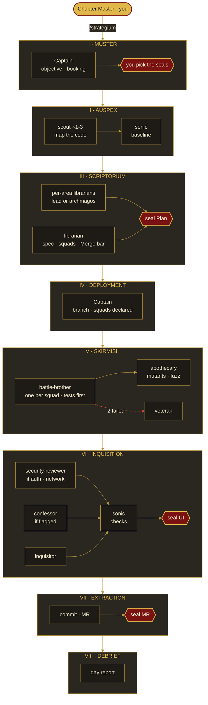
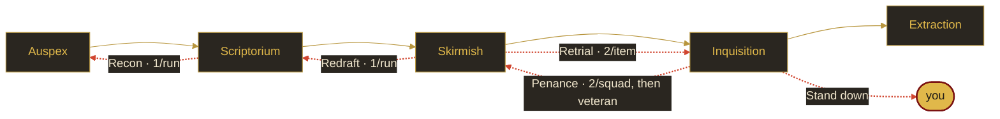

# strategium

> Español: [README.es.md](README.es.md)

**Strategium** is an orchestrator workflow for omp. The main session plans and delegates, specialised agents build and review, and you keep the seals. It works any objective: free text, a spec or plan file, or a ticket. **Ticketing is optional**, and with it comes a booking timer.

This is an **omp** plugin: it is installed, updated and run with omp, and it targets no other coding agent.

The plugin ships three things:

| Part | What it is |
|---|---|
| **Extension** | the `strategium` tool and the `/strategium` command: per-session claims, edit guard, optional booking timer |
| **Agents** | `battle-brother`, `veteran`, `librarian`, `apothecary`, `inquisitor`, `confessor`, `archmagos`, plus the bundled `scout` and `sonic` |
| **Skills** | `strategium`, `strategium-alarm`, `strategium-release`, `strategium-setup`, `strategium-study`, `strategium-ui` |

## How a run works

The main session is the **Captain**: it never edits product code. It plans, delegates and guards the seals. You are the **Chapter Master**: only you grant a seal (Plan, UI, MR, Commit).

```
Muster → Auspex → Scriptorium → Deployment → Skirmish → Inquisition → Extraction
```

1. **Muster** — the objective, the seals and, with ticketing, the booking.
2. **Auspex** — scouts map the code the objective touches.
3. **Scriptorium** — one librarian writes a spec, 1–5 squads and a Merge bar; when the objective splits into areas, one librarian per area, then a lead merges the parts (with the Archmagos Dominus marked in Muster, an `archmagos` integrates the parts instead of the lead).
4. **Deployment** — one branch for the run, the squads declared with their files; each isolated agent works in its own omp checkout.
5. **Skirmish** — a `battle-brother` implements each squad test-first; an `apothecary` tries to break the new tests, only on squads with new logic and within a fixed budget.
6. **Inquisition** — an `inquisitor` reviews the diff against the Merge bar, and a `confessor` of another model family (when available) joins when the plan flags the diff as large or risky; a `sonic` runs the repo's checks.
7. **Extraction** — the commit and the merge request, after your seal.



Station names, agent names and alerts have their own voice; the `archmagos` speaks in that voice only in chat and todo, never in the plan file. Tickets, commit messages and merge requests stay plain and professional.

### Going back

A run goes back instead of forward, and every return has a trigger, a target and a budget. When the budget is spent, the run stops and shows you what is open.



| Return | Trigger | Target | Budget |
|---|---|---|---|
| **Recon** | the map of the code is wrong | one more `scout` with that exact gap | 1 per run |
| **Redraft** | the plan is wrong, or a squad's acceptance check cannot be satisfied as written | the same `librarian` redrafts the remaining work (with areas, only the affected area, then the lead merges again; on a run marked for the Archmagos Dominus, one new `archmagos` re-integrates only that area) | 1 per run |
| **Penance** | the code is wrong: check red, apothecary survivors or fuzz crashes, BLOCKING findings | a `battle-brother` fix run with every open finding ID in one brief, never the previous report; it first reproduces each finding, and one it cannot reproduce comes back NOT REPRODUCED | 2 rounds per squad, then one `veteran` run |
| **Retrial** | the fixed code needs a new look | the `inquisitor` again (the `confessor` re-checks its own IDs) on the open finding IDs and the fix range only, then `sonic` for the checks | 2 rounds per Merge bar item |
| **Stand down** | the budget is spent, or the failure is not in the code | you, with the open items | — |

If the code can satisfy the squad's check as written, it is a penance; if it cannot, the squad was cut wrong and it is a redraft. A return past a granted seal breaks the seal, and it is asked for again. What already passed stays passed.

## Install

Strategium runs inside [omp](https://omp.sh/), our coding agent: install omp first.

**Let an agent do it:** paste this prompt into any coding agent with shell access. It installs omp when it is missing, then the plugin.

```text
Set up omp (https://omp.sh/) with the Strategium plugin on this machine.

1. Run `omp --version`. If omp is not found, install it:
   - macOS / Linux: curl -fsSL https://omp.sh/install | sh
   - Windows (PowerShell): irm https://omp.sh/install.ps1 | iex
   If `omp` is still not on PATH, open a new shell and try again. Stop and report if it still fails.
2. Run `git --version` and `bun --version`. If one is missing, tell me with its official install command; do not install it without asking.
3. Install the plugins (if one is already there, keep it and move on):
   omp plugin marketplace add addyosmani/agent-skills
   omp plugin install agent-skills@addy-agent-skills
   omp plugin marketplace add frandev94/strategium
   omp plugin install strategium@strategium
4. Verify with `omp plugin list` and `omp plugin doctor`.
5. Report a table: step, result, and the error output of any failure. Then tell me to open a fresh omp session and run /skill:strategium-setup.

Change no other omp settings, and do not remove or upgrade anything already installed.
```

**As a marketplace plugin:**

```
/marketplace add frandev94/strategium
/marketplace install strategium@strategium
```

From the shell: `omp plugin marketplace add frandev94/strategium` and `omp plugin install strategium@strategium`.

**Linked from a local checkout:**

```
omp plugin link /path/to/strategium
```

Then, in a fresh session, run `/skill:strategium-setup`. It checks the plugin, its dependencies, the tools and the configuration, and prints a table of what it did. Restart omp afterwards: a plugin reload inside a running session does not mount the `strategium` tool.

### Requirements

| Needs | Why |
|---|---|
| `bun` | runs the alarm script, the timer alarms and the test suite |
| `git` | worktrees, branches, commits |
| `agent-skills` plugin | the skills the agents autoload (`omp plugin marketplace add addyosmani/agent-skills`, then `omp plugin install agent-skills@addy-agent-skills`) |
| `ponytail` plugin | recommended, smallest-diff mode for every agent |
| `obsidian-second-brain` plugin | optional, theatres that keep records in Obsidian |

## Usage

```
/strategium "free text" [theatre]   work an objective in your words
/strategium @path [theatre]         work a spec or an approved plan file
/strategium <key> [theatre]         work a ticket the theatre knows, or a short name
/strategium-pause                   stop the clock
/strategium-resume [booked]         continue (a timed run passes today's booked minutes on a new day)
/strategium-add <min>               manual correction, negative to subtract
/strategium-status                  every run and its time
/strategium-config [notify on|off | idle <min> | archmagos on|off]  show the effective settings; notify on|off, the idle minutes or archmagos on|off for this session
/strategium-end                     close the run
```

Free text needs the quotes, so it never clashes with a subcommand. Without a ticket, the librarian proposes the acceptance criteria and you confirm them at seal Plan, which cannot be skipped.

Every session owns one run, claimed atomically, so several omp sessions can work on different objectives at the same time. Closing a session pauses its run and releases the claim; reopening that session takes it back and resumes it on its own, unless you had paused it (`/strategium-pause`, action `stop`, the stand down). A timed run on a new day stays paused until today's booking is given. The Captain cannot edit the run's repository: while the run is open `edit` and `ast_edit` are hidden from the main session, `write` is blocked inside the run's repo and its `<repo>-worktrees` folder, bash test and build runners and bash file writes are blocked (only redirects into `$TEMP` and `local://` pass), agents outside the Strategium roster are refused, and battle-brothers are refused until the plan's squads are declared (`strategium` `slices`; parallel squads must not share a file). When the plan is approved in omp's plan mode, "Approve and execute" opens a fresh session and the run moves with it; a plain `/new` leaves the run with its own session.

Idle pause: when no agent works and nothing waits to run, the run's clock pauses after `STRATEGIUM_IDLE_MIN` idle minutes (default 3), the `idle` sound plays (with notifications on) and the footer shows it paused. The next turn resumes it on its own; the Captain does not call `start`. A run you paused by hand (`/strategium-pause`, action `stop`, the stand down) never resumes by itself. A question or a plan review waiting for you counts as busy: the clock keeps running and the `attention` alarm calls you (with notifications on). A timed run on a new day stays paused until today's booking is given.

Footer: the station shows as `<station> › <task>`, where `<task>` is the active todo task without its agent tag, cut to 32 characters with `…`. A seal keeps `⏳ seal <name>`; a return shows `↩ <station> › <task>`. During Muster steps 0-2 no run exists yet, so there is no footer; from `begin` on it shows e.g. `Muster › Begin run and theatre status`.

### Ticketing (optional)

A run is **timed** when its objective is a ticket of a theatre, or when you give it a booking in Muster. The **booking** is the time budget for today: the timer fires at 50 %, 80 % and 100 % of it — the highest threshold it crosses, so a run that starts past 50 % goes straight to the next one. At 100 % the Captain stands down: it stops starting agents and reports what is done and what is left. Each day is its own shift with its own booking.

An **untimed** run still counts its time (`status`, `report`), with no alerts, no stand down and no shifts.

### Configuration

| Variable | Meaning |
|---|---|
| `STRATEGIUM_THEATRE` | default theatre for `/strategium` |
| `STRATEGIUM_ALARM` | command run when the timer fires, e.g. `bun /path/to/strategium/alarm/vox.ts`; quote a path with spaces (`bun "C:/my tools/vox.ts"`) |
| `STRATEGIUM_STATE_DIR` | where the session state lives (default `~/.omp/agent/state/strategium`) |
| `STRATEGIUM_GLYPHS` | `1` to use Nerd Font glyphs instead of emoji |
| `STRATEGIUM_NOTIFY` | `1` turns on sounds and desktop notifications; off by default; `/strategium-config notify on` or `off` overrides it for the session |
| `STRATEGIUM_IDLE_MIN` | whole minutes without work before the run's clock pauses; default `3`, `0` turns it off; `/strategium-config idle <min>` overrides it for the session |
| `STRATEGIUM_ARCHMAGOS` | `1` lets a run mark the Archmagos Dominus in Muster; off by default; `/strategium-config archmagos on` or `off` overrides it for the session |

`/strategium-config` shows the effective values: the notify setting, the idle minutes and the archmagos setting, each with its source, the theatre, the alarm, the glyphs and the state directory.

The state (one JSONL per day plus the run claims) stays outside the repository, so no session data is ever committed.

### The alarm

`alarm/vox.ts` synthesises every sound from scratch: no samples, no dependencies. Levels are `50`, `80`, `100`, `done`, `attention`, `idle` (a short stand-by sound when the clock pauses after idle) and `theme` (15 s, plays when the session's run ends, or by hand: `bun alarm/vox.ts theme`); with a message it also raises a desktop notification (Windows toast, macOS notification, Linux `notify-send`).

```
bun alarm/vox.ts 100 "the booking is over"
```

### Theatres

A theatre is a `strategium-<name>` skill that binds the run to your organisation: where the tickets live, how the time is booked, how the merge requests are written, which records are kept. Without a theatre nothing is pushed: the delivery is the branch with its commits.

## Development

```
bun run check                     # strict TypeScript over the extension
bun test                          # timer, claims across processes, the extension through a fake host, alarm WAVs
```

```
extensions/strategium/            the extension (tool, command, timer, edit guard)
extensions/strategium/timer.ts    day files, claims, elapsed time
alarm/                            the vox-caster and its tests
agents/                           agent definitions
skills/                           the skills
```

The extension is plain TypeScript with no runtime dependencies; `bun` is only needed to run it and to run the tests.

## License

MIT
